# Ajouter le connecteur « Radar immobilier » sur claude.ai

Guide utilisateur — environ 5 minutes. Mis à jour le 31 octobre 2026 pour la
nouvelle version du serveur MCP (préprod, publication d'artefacts).

## 1. Ce que fait le connecteur

Ce connecteur permet à Claude d'interroger directement les données du **Radar
immobilier** (lots cadastraux, zonage, signaux réglementaires, procès-verbaux)
pendant une conversation, en langage naturel.

**Nouveau :** en préprod, Claude peut aussi **publier une petite page web**
(un « artefact » : HTML, CSS, JavaScript) sur un hôte dédié
`*.preprod.immo-pages.sent-tech.ca`. La page s'ouvre ensuite dans le
navigateur, après connexion à l'application Radar (voir la
[section 10.2](#102-générer-un-artefact-pas-à-pas)).

Le connecteur est un **serveur MCP distant** (Model Context Protocol) hébergé par
l'équipe. La connexion est sécurisée par **OAuth** (client public + PKCE, sans secret
à saisir) : à la première connexion, Claude vous redirige vers `auth.sent-tech.ca`
(préprod : `preprod.auth.sent-tech.ca`) pour vous authentifier et accorder les
autorisations. Chaque appel s'exécute avec **votre** identité.

## 2. Prérequis

- Un compte **claude.ai** payant : **Pro, Max, Team ou Enterprise**.
  (Les connecteurs personnalisés ne sont pas disponibles sur le plan gratuit.)
- Sur **Team / Enterprise**, l'ajout d'un connecteur personnalisé peut être
  réservé à un **administrateur** de l'organisation.
- Un compte **sentropic** valide sur `auth.sent-tech.ca` (fourni par l'équipe),
  utilisé pour la connexion OAuth.
- Pour la préprod : un compte **approuvé** dans l'application
  `https://preprod.immo.sent-tech.ca`, et **un seul espace de travail actif**
  pour la recherche de signaux. La publication d'artefacts ne demande pas
  d'espace de travail.

## 3. Paramètres à préparer

| Champ | Production | Préprod |
|---|---|---|
| **Nom** | `Radar immobilier` | `Radar immobilier (préprod)` |
| **URL du serveur MCP distant** | `https://immo.sent-tech.ca/mcp` | `https://preprod.immo.sent-tech.ca/mcp` |
| **ID client OAuth** (Paramètres avancés) | `immo-mcp` | `immo-mcp-preprod` |
| **Secret client OAuth** | *(laisser **vide** — client public + PKCE)* | *(laisser **vide** — client public + PKCE)* |
| Fournisseur d'identité (OAuth) | `https://auth.sent-tech.ca` | `https://preprod.auth.sent-tech.ca` |
| Scopes accordés à la connexion | `immo:read`, `immo:search`, `immo:documents:read` | identiques |

> Le **secret client doit rester vide** : le serveur est un client OAuth **public**
> qui utilise PKCE. Renseigner un secret ferait échouer la connexion.

Pour la **préprod**, suivre les mêmes étapes avec les valeurs de la colonne
**Préprod**.

> **Connecteur préprod déjà en place ?** Rien ne change avec la nouvelle version du
> MCP : le connecteur existant continue de fonctionner tel quel. Il faut seulement
> le recréer si l'on change de compte Claude.

---

## 4. Ouvrir la page des connecteurs

Dans claude.ai, ouvrir **Personnaliser → Connecteurs**
(URL directe : `https://claude.ai/customize/connectors`).

La colonne de gauche liste vos connecteurs, regroupés en **Web / connectés** et
**Non connecté**. Les connecteurs personnalisés portent l'étiquette **PERSONNALISÉ**.

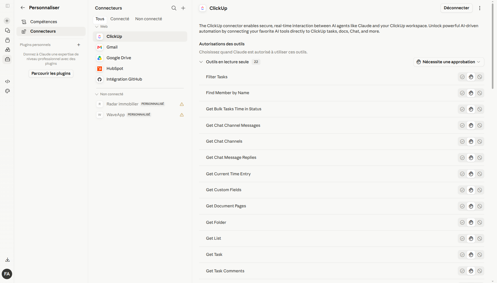

> Si un connecteur « Radar immobilier » **défaillant ou expiré** figure déjà dans
> la liste, supprimez-le d'abord : voir la procédure en
> [section 11 (Dépannage)](#11-dépannage).

## 5. Ajouter le connecteur personnalisé

1. En haut de la colonne **Connecteurs**, cliquer sur **＋ (Ajouter un connecteur)**,
   puis choisir **« Ajouter un connecteur personnalisé »**.
2. Dans la boîte de dialogue **« Ajouter un connecteur personnalisé »** :
   - **Nom** : `Radar immobilier` (préprod : `Radar immobilier (préprod)`)
   - **URL du serveur MCP distant** : `https://immo.sent-tech.ca/mcp`
     (préprod : `https://preprod.immo.sent-tech.ca/mcp`)
3. Déplier **Paramètres avancés** et renseigner :
   - **ID client OAuth** : `immo-mcp` (préprod : `immo-mcp-preprod`)
   - **Secret client OAuth** : **laisser vide**
4. Cliquer sur **Ajouter**.

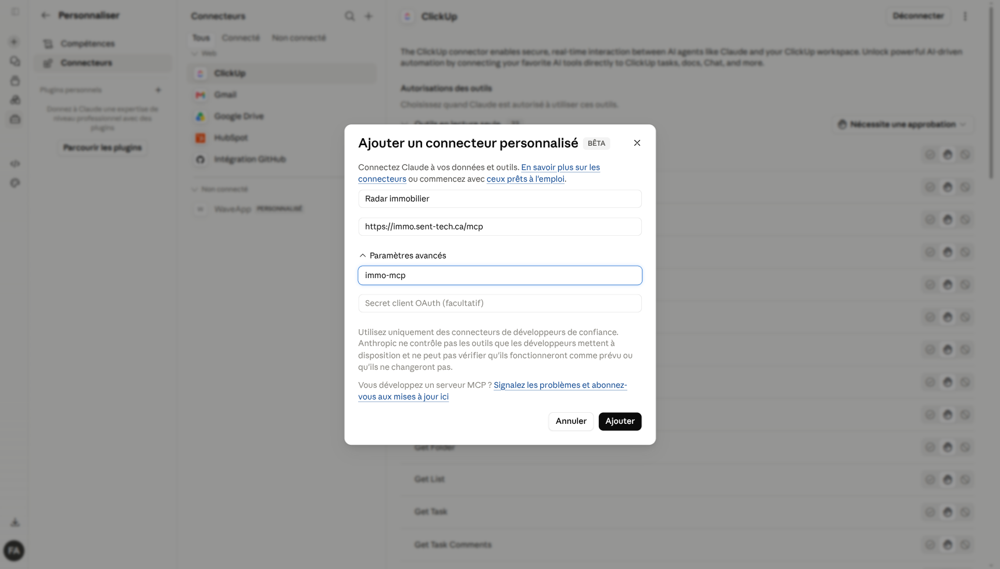

> **[Capture à venir — C1]** La même modale remplie avec les valeurs **préprod**
> (`Radar immobilier (préprod)`, `https://preprod.immo.sent-tech.ca/mcp`,
> `immo-mcp-preprod`).

Le connecteur est créé et apparaît dans la liste, d'abord en **« Vérification de la
connexion… »**.

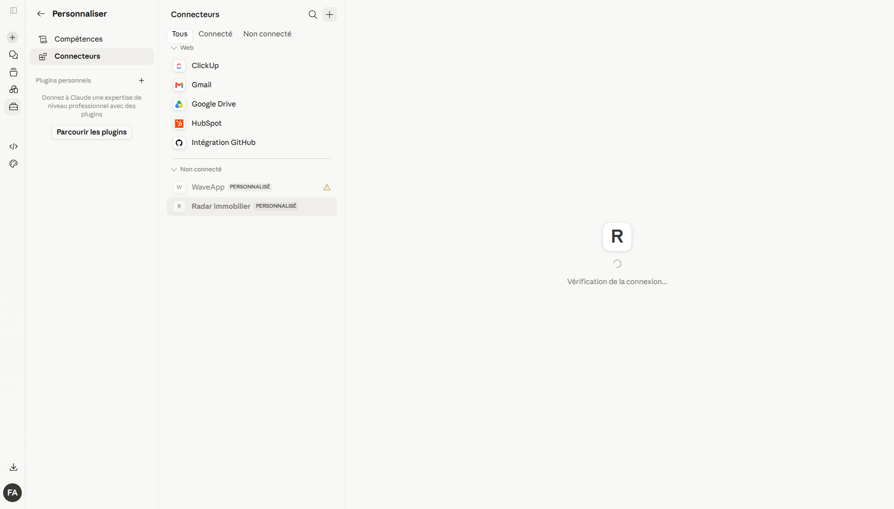

## 6. Autoriser l'accès (OAuth)

Ouvrir le connecteur et cliquer sur **Connecter**. Claude ouvre le flux
d'autorisation OAuth sur **`auth.sent-tech.ca`** (préprod :
**`preprod.auth.sent-tech.ca`**) :

- si vous êtes **déjà connecté** au fournisseur d'identité, l'autorisation est
  accordée automatiquement (SSO) et la fenêtre se referme ;
- sinon, connectez-vous avec votre compte sentropic (**passkey** ou **Google**),
  puis **acceptez** les autorisations demandées (scopes `immo:read`,
  `immo:search`, `immo:documents:read`).


À la fin, claude.ai revient sur la page des connecteurs avec l'état **succès**.
Le déroulé technique complet est schématisé en [annexe A.1](#a1-flux-de-connexion-oauth).

## 7. Vérifier que le connecteur est connecté

Le connecteur passe dans le groupe **connecté** (le bouton en haut à droite devient
**Déconnecter**). Son panneau de détail affiche l'URL et la liste des **outils**
disponibles, sous **« Autorisations des outils »**.

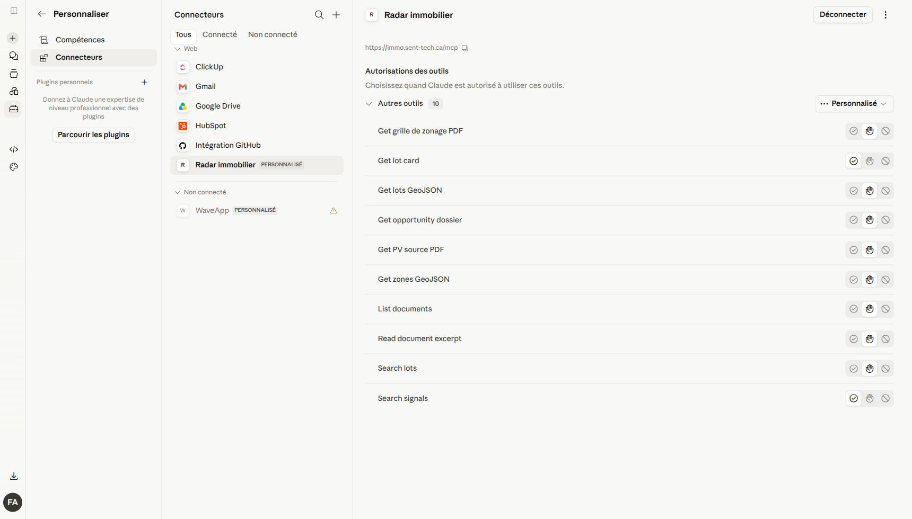

La capture ci-dessus date de juillet 2026 (**10 outils**). La nouvelle version du
serveur expose **12 outils Radar** (deux outils de zonage s'ajoutent :
`Get règlement de zonage provenance` et `Query zoning lifecycle events`) et, là où
les artefacts sont activés (c'est le cas en **préprod**), **4 outils
d'artefacts** : **16 outils** au total.

> **[Capture à venir — C2]** Le connecteur **préprod** connecté, avec la liste de
> ses 16 outils.

Ils sont détaillés à la [section 9](#9-méthodes-disponibles).

## 8. Activer le connecteur dans une conversation

Un connecteur est **désactivé par défaut dans chaque nouvelle conversation**. Pour
l'utiliser :

1. Ouvrir (ou démarrer) une conversation.
2. Sous la zone de saisie, cliquer sur **＋ (Rechercher et outils / « Ajouter des
   fichiers, des connecteurs et plus »)** → **Connecteurs**.
3. Activer l'interrupteur **Radar immobilier** (ou **Radar immobilier (préprod)**).

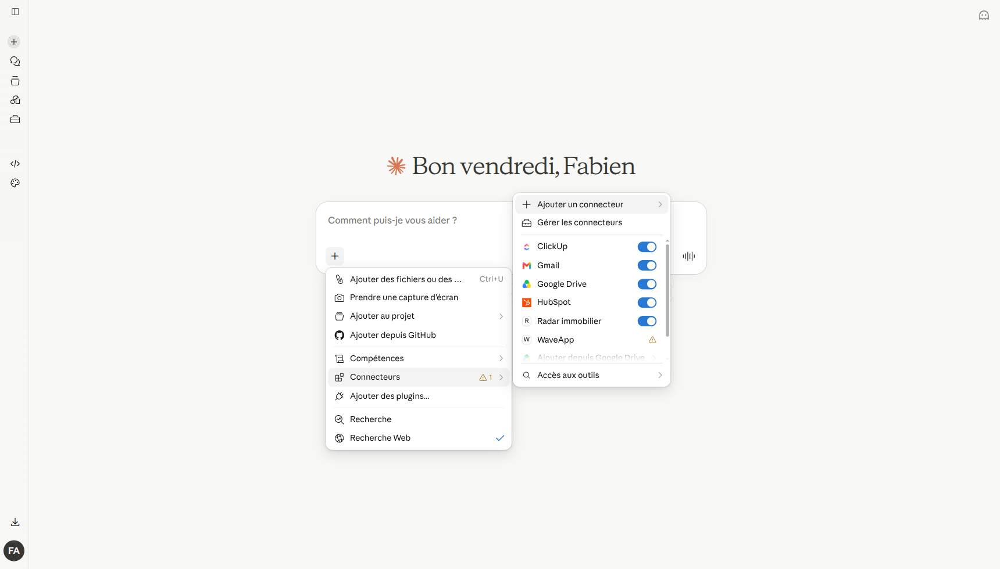

---

## 9. Méthodes disponibles

Les outils Radar sont en **lecture seule** ; seuls les outils d'artefacts écrivent
(une page publiée dans votre espace). Les paramètres ci-dessous sont ceux
réellement exposés par le serveur ; Claude les remplit lui-même à partir de votre
question. Les valeurs de `city` sont des **slugs** (ex. `longueuil`, `valleyfield`,
`delson`).

> **En préprod**, cinq outils répondent encore `not_wired_yet` (non raccordés) :
> `search_lots`, `get_lot_card`, `get_opportunity_dossier`, `list_documents` et
> `read_document_excerpt`. Pour un lot, passer par **Get lots GeoJSON**.

### 9.1 Recherche & fiches

| Outil (claude.ai) | Identifiant | Description | Paramètres | Scope |
|---|---|---|---|---|
| **Search lots** | `search_lots` | Recherche de lots par ville et critères. | `city` *(requis)*, `zone`, `no_lot`, `minArea` (m²), `limit` (1–100, défaut 20). | `immo:search` |
| **Get lot card** | `get_lot_card` | Fiche détaillée d'un lot (zonage, superficie, signaux liés). | `city` *(requis)*, `no_lot` *(requis, numéro cadastral exact)*. | `immo:read` |
| **Search signals** | `search_signals` | Recherche de signaux réglementaires par ville. | `city` *(requis)*, `etape` (ex. `avis_motion`, `adoption`, `consultation`), `query` (mot-clé), `showDiscarded` (signaux archivés, défaut `false`), `limit` (1–100, défaut 20). | `immo:search` |
| **Get opportunity dossier** | `get_opportunity_dossier` | Dossier d'opportunité consolidé (score, lots et signaux liés, rationale). | `city` *(requis)*, `opportunityId` *(requis)*. | `immo:read` |

### 9.2 Documents sources

| Outil (claude.ai) | Identifiant | Description | Paramètres | Scope |
|---|---|---|---|---|
| **List documents** | `list_documents` | Liste les documents sources archivés (procès-verbaux, etc.). | `city` (optionnel), `limit` (1–100, défaut 20). | `immo:documents:read` |
| **Read document excerpt** | `read_document_excerpt` | Lit un **extrait borné** d'un document source. La sortie passe par une **rédaction anti-PII**. | `documentId` *(requis)*, `offset` (défaut 0), `maxChars` (1–4000, défaut 1200). | `immo:documents:read` |
| **Get grille de zonage PDF** | `get_grille_pdf` | URL de la **grille de zonage PDF** (`grillePdfUrl`) d'une zone, quand la source municipale la porte. L'URL retournée est **publique**. | `city` *(requis)*, `zone` *(requis, ex. `H-203`)*. Retourne `found=false` si la zone est inconnue, `grillePdfUrl=null` si la zone existe sans grille. | `immo:documents:read` |
| **Get PV source PDF** | `get_pv_pdf` | URL servie du **procès-verbal source** (PDF archivé) d'un signal + métadonnées (ville, content-type). Le PDF n'est **jamais** inliné dans la réponse. | `rawRef` *(requis)* — référence brute du document (ex. `raw/proces-verbaux-<ville>/cas/<sha>.pdf`). | `immo:documents:read` |

### 9.3 Données géographiques (GeoJSON)

Ces deux outils renvoient des **FeatureCollection GeoJSON** et sont **bornés** pour
ne jamais inonder la conversation :

- `limit` : défaut **500**, maximum **2000** ;
- `bbox` **obligatoire** dès que `limit > 500` — emprise `[minLon, minLat, maxLon, maxLat]`
  en WGS84 (ex. `[-73.53, 45.52, -73.5, 45.55]`) ;
- une ville peut dépasser **15 000 lots** : on **pagine par bbox** ;
- la réponse indique `numberMatched` / `numberReturned` / `truncated`. Si
  `truncated=true`, **resserrez le bbox** ;
- garde-fou dur : une réponse ne peut pas dépasser ~1 Mo (sinon réduire `limit`
  ou le `bbox`).

| Outil (claude.ai) | Identifiant | Description | Paramètres | Scope |
|---|---|---|---|---|
| **Get zones GeoJSON** | `get_zones_geojson` | Zones de zonage d'une ville (code de zone, `kind`, grille PDF et propriétés sources). | `city` *(requis)*, `bbox`, `limit`. | `immo:read` |
| **Get lots GeoJSON** | `get_lots_geojson` | Lots cadastraux d'une ville, **enrichis côté serveur** : zone jointe (`zone.code/kind/densiteLogHa/usages/grillePdfUrl`), `zoneCode`, `multifamilial4plus` (+ `multifamilial4plusSource: grille｜heuristique`), `superficieM2`, `tod`/`priorite` quand la source les porte. | `city` *(requis)*, `bbox`, `limit`, **`only4Plus`** (ne garder que les lots `multifamilial4plus === true`), **`superficieMinM2`** (superficie minimale en m²). Les filtres s'appliquent sur la page récupérée. | `immo:read` |

### 9.4 Règlement et cycle de vie du zonage (nouveau)

| Outil (claude.ai) | Identifiant | Description | Paramètres | Scope |
|---|---|---|---|---|
| **Get règlement de zonage provenance** | `get_reglement_provenance` | Règlement de zonage en vigueur d'une ville : numéro, millésime, page source, URL publique, règlement modifié. Un champ absent vaut `null`, jamais deviné. | `muni_slug` *(requis)*, `zone_code` (accepté, sans effet). `found=false` si la grille de normes n'est pas publiée pour la ville. | `immo:read` |
| **Query zoning lifecycle events** | `query_zoning_events` | Chronologie du zonage : avis de motion, projets de règlement, adoptions, entrées en vigueur, abrogations. Un événement `planned` n'est jamais présenté comme adopté. | `muni_slug` *(requis)*, `zone_code`, `document_type` (`avis_motion`, `projet_reglement`, `adoption`, `entree_en_vigueur`, `abrogation`), `decision_state` (`planned`, `decided`). | `immo:read` |

### 9.5 Artefacts (nouveau, préprod)

Ces quatre outils publient et retrouvent **vos** pages. Le propriétaire est
toujours votre identité : un argument comme `owner` ou `tenant` est refusé.

| Outil | Description | Paramètres | Scope |
|---|---|---|---|
| `artifacts_ensure` | Crée votre artefact pour un nom donné, ou retrouve celui qui existe déjà. Retourne `artifactId`. | `bindingName` *(requis, 1–128 caractères)*, `idempotencyKey` *(requis, 1–256)*. | `immo:read` |
| `artifacts_publish` | Publie une nouvelle version. Retourne `releaseId`, `stableUrl` (adresse stable) et `pinnedUrl` (adresse de cette version). | `artifactId` *(requis)*, `idempotencyKey` *(requis)*, `files` *(requis, 1–32 fichiers `{ path, mimeType, text }`)*. Types : `text/html`, `text/css`, `text/javascript`, `application/json` ; **256 Kio** au total ; `index.html` est servi à la racine. | `immo:read` |
| `artifacts_list` | Liste les artefacts que vous pouvez lire. | `limit` (1–100, défaut 20), `offset`. | `immo:read` |
| `artifacts_get` | Métadonnées d'un artefact (état, version courante). | `artifactId` *(requis)*. | `immo:read` |

`idempotencyKey` protège contre les doubles publications : relancer le **même**
appel avec la **même** clé renvoie le même résultat sans nouvelle publication ;
pour un nouveau contenu, prendre une **nouvelle** clé.

---

## 10. Cas d'usage illustré

### 10.1 Interroger les données

Question posée dans une conversation (connecteur activé) :

> *« Avec le connecteur Radar immobilier, récupère les lots multifamiliaux 4+
> (only4Plus) à Delson. Combien y en a-t-il et donne-moi quelques numéros de lot en
> exemple ? »*

Claude reconnaît l'outil pertinent — **Get lots GeoJSON** (`get_lots_geojson`) — et
demande votre autorisation avant le premier appel (**« Toujours autoriser » / « Refuser »**).
C'est un garde-fou standard des connecteurs personnalisés.

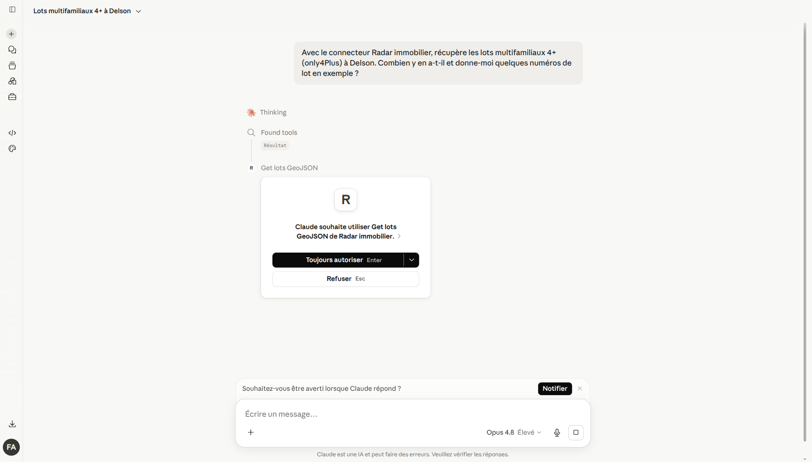

Après autorisation, Claude appelle l'outil avec `city = delson` et `only4Plus = true`,
récupère le GeoJSON borné, puis synthétise :

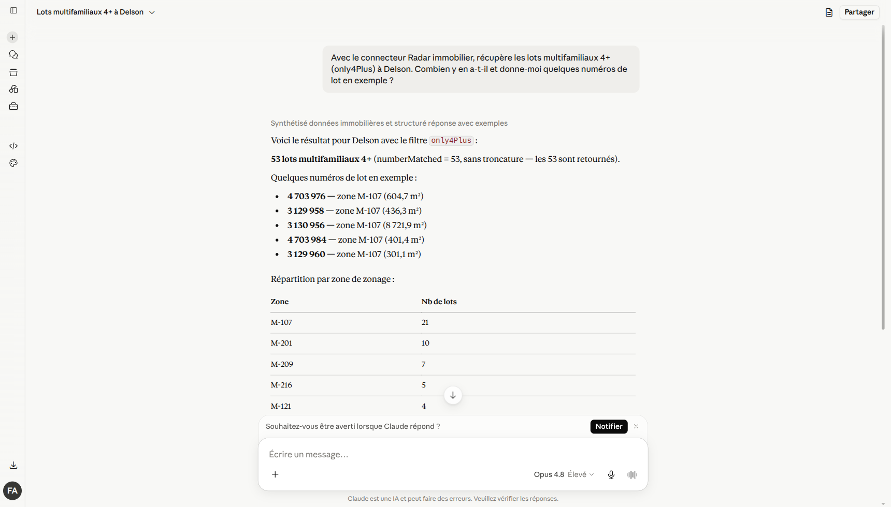

Réponse obtenue (données réelles) : **53 lots multifamiliaux 4+ à Delson**
(`numberMatched = 53`, `truncated = false` — les 53 sont retournés), avec des
exemples de numéros de lot, leur zone et leur superficie, et une répartition par zone
de zonage. Claude signale aussi que le drapeau `multifamilial4plus` provient ici de la
**source heuristique** (et non d'une grille de zonage extraite) — à valider au cas par
cas.

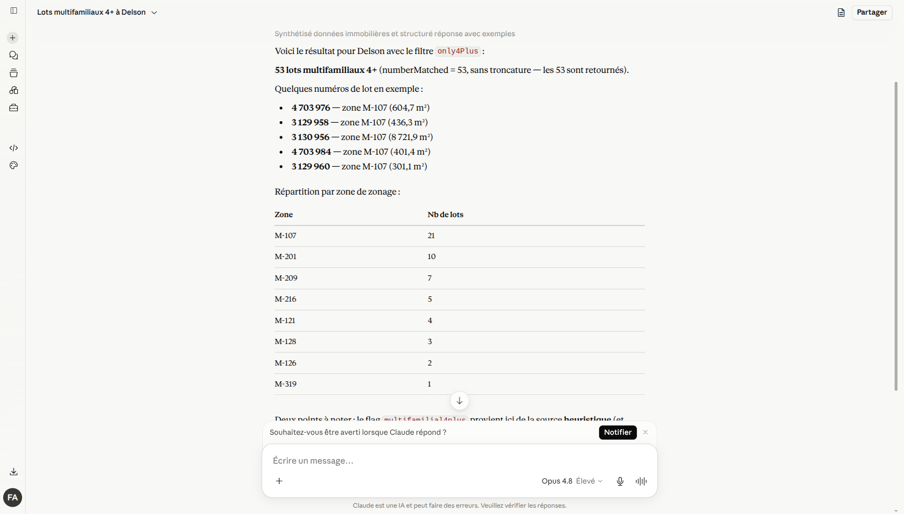

Quelques autres questions typiques :

- « Quels **signaux de rezonage récents** à Sainte-Catherine ? » → `search_signals`
- « Cherche les signaux **PPCMOI** dans Roussillon » → `search_signals` (`query`)
- « Montre-moi le **procès-verbal source** de ce signal » → `get_pv_pdf`
- « Donne-moi la **grille de zonage** de la zone H-203 à Longueuil » → `get_grille_pdf`
- « Quels **avis de motion** de zonage sont en cours à Longueuil ? » → `query_zoning_events`
- « Ouvre la **fiche** du lot 3 129 958 à Delson » → `get_lot_card`
  (en préprod : réponse `not_wired_yet`, passer par `get_lots_geojson`)

### 10.2 Générer un artefact pas à pas

Exemple sur le connecteur **préprod**. Le déroulé complet est schématisé en
[annexe A.2](#a2-flux-de-publication-et-douverture-dun-artefact).

**Étape 1 — La demande.** Dans une conversation où **Radar immobilier (préprod)**
est activé, taper :

> *« Avec Radar immobilier (préprod), publie un artefact : une page `index.html`
> qui affiche le titre « Test artefact préprod » et la date du jour. Utilise
> `artifacts_ensure` avec le nom `test-guide`, puis `artifacts_publish`, et
> donne-moi l'URL stable. »*

> **[Capture à venir — C3]** La demande tapée dans claude.ai, connecteur préprod
> activé.

**Étape 2 — `artifacts_ensure`.** Claude demande l'autorisation d'utiliser l'outil
(**« Toujours autoriser » / « Refuser »**), puis l'appelle. Il reçoit l'identifiant
de votre artefact (`artifactId`). Avec le même `bindingName`, on retrouve toujours
le même artefact.

**Étape 3 — `artifacts_publish`.** Claude envoie le fichier `index.html` et reçoit
l'adresse stable (`stableUrl`) et l'adresse de cette version (`pinnedUrl`).

> **[Capture à venir — C4]** Les blocs d'appel `artifacts_ensure` puis
> `artifacts_publish` dépliés dans la conversation, avec leurs réponses.

**Maquette de la conversation** (texte reconstitué à partir du contrat des
outils ; **ce n'est pas une capture**, les identifiants sont des exemples) :

```text
MAQUETTE — PAS UNE CAPTURE

Vous   : Avec Radar immobilier (préprod), publie un artefact : une page
         index.html qui affiche le titre « Test artefact préprod » et la date
         du jour. Utilise artifacts_ensure avec le nom test-guide, puis
         artifacts_publish, et donne-moi l'URL stable.

Claude : [outil artifacts_ensure]
         requête : { "bindingName": "test-guide",
                     "idempotencyKey": "test-guide-ensure-1" }
         réponse : { "artifactId": "0b5c7f1e-…", "created": true }

         [outil artifacts_publish]
         requête : { "artifactId": "0b5c7f1e-…",
                     "idempotencyKey": "test-guide-publish-1",
                     "files": [ { "path": "index.html",
                                  "mimeType": "text/html",
                                  "text": "<!doctype html>…<h1>Test artefact préprod</h1>…" } ] }
         réponse : { "artifactId": "0b5c7f1e-…", "releaseId": "7d2a…",
                     "stableUrl": "https://0b5c7f1e-….preprod.immo-pages.sent-tech.ca/",
                     "pinnedUrl": "https://7d2a….pinned.preprod.immo-pages.sent-tech.ca/" }

Claude : La page est publiée. Adresse stable :
         https://0b5c7f1e-….preprod.immo-pages.sent-tech.ca/
         Ouvrez-la dans votre navigateur ; l'application Radar vous demandera
         d'autoriser la lecture.
```

**Étape 4 — L'URL obtenue.** Claude répond avec l'adresse stable, de la forme
`https://<artifactId>.preprod.immo-pages.sent-tech.ca/`.

> **[Capture à venir — C5]** La réponse finale de Claude avec l'URL stable.

**Étape 5 — Ouvrir la page.** Cliquer sur l'URL :

1. le navigateur passe sur l'adresse de la version (`….pinned.preprod.immo-pages.sent-tech.ca`) ;
2. si vous n'êtes pas connecté à l'application Radar, l'écran de connexion
   s'affiche (application puis fournisseur d'identité, captures réelles
   ci-dessous) ;
3. l'application affiche **« Autoriser la lecture de vos paniers »** avec
   l'identifiant de la page, son auteur et sa version : cliquer sur
   **Autoriser et ouvrir** ;
4. la page publiée s'affiche. La session de lecture dure **15 minutes** ; au-delà,
   rouvrir l'URL.


> **[Capture à venir — C6]** La page de l'application « Autoriser la lecture de
> vos paniers » avec le bouton **Autoriser et ouvrir**.

> **[Capture à venir — C7]** La page publiée, ouverte sur l'hôte de contenu
> `….pinned.preprod.immo-pages.sent-tech.ca`.

Une adresse d'artefact qui n'existe pas répond `not_found` et n'affiche jamais
l'application :


**Vérifications rapides :**

- `artifacts_list` montre maintenant l'artefact ;
- `artifacts_get` donne `currentReleaseId` égal au `releaseId` reçu ;
- republier avec la **même** clé et le **même** fichier ne crée pas de nouvelle
  version ; la même clé avec un autre contenu répond `conflict`.

---

## 11. Dépannage

- **La fenêtre OAuth ne s'ouvre pas / erreur au moment de « Connecter »** — vérifier
  l'**ID client OAuth** (Paramètres avancés) : il doit valoir exactement `immo-mcp`
  (préprod : `immo-mcp-preprod`), sans espace, et le **secret** doit rester **vide**.
- **« Problème de connexion / La connexion a expiré »** — la session OAuth a expiré :
  rouvrir le connecteur et cliquer **Connecter** pour ré-autoriser. Si le problème
  persiste, **supprimer** puis **recréer** le connecteur (procédure de suppression
  ci-dessous, puis sections 5–6).
- **401 après connexion** — les autorisations n'ont pas été accordées : refaire le
  flux et **accepter** les scopes.
- **`scope_denied:immo:search`** — le scope `immo:search` n'a pas été accordé :
  reconnecter le connecteur et accepter tous les scopes.
- **`composition_account` ou `account_not_approved`** — votre compte n'est pas
  (ou plus) approuvé dans l'application : contacter l'équipe.
- **`workspace_missing` / `workspace_ambiguous`** — aucun espace de travail actif,
  ou plusieurs : contacter l'équipe. La publication d'artefacts n'est pas concernée.
- **`capability_unavailable`** — service momentanément indisponible : réessayer
  dans une minute (pour un artefact, avec la **même** clé). S'il persiste,
  contacter l'équipe.
- **`rate_limited` / `conflict`** sur un artefact — plus de 10 publications par
  minute (attendre une minute), ou quota atteint / clé réutilisée pour un autre
  contenu (prendre une nouvelle clé ; si le quota est atteint, contacter l'équipe).
- **Le connecteur n'apparaît pas / n'est pas utilisé dans une conversation** —
  l'activer dans **Rechercher et outils → Connecteurs** (il est **désactivé par
  défaut** dans chaque conversation, cf. section 8).
- **Un popup a été bloqué à l'ajout** — cliquez ensuite sur **Connecter** dans le
  détail du connecteur pour relancer l'autorisation.
- **Réponse GeoJSON tronquée** (`truncated=true`) ou « réponse trop grande » —
  demandez à Claude de **resserrer le bbox** ou de **réduire `limit`** (voir les
  bornes en section 9.3).

La liste complète des erreurs et de leur signification est en
[annexe A.3](#a3-erreurs-typées).

### Si vous avez déjà un connecteur « Radar immobilier » défaillant ou expiré : supprimez-le d'abord

Si un connecteur « Radar immobilier » existe déjà mais est cassé (état
**« Problème de connexion / La connexion a expiré »**), le plus simple pour repartir
proprement est de le supprimer puis de le recréer.

Cliquer sur le connecteur pour ouvrir son panneau de détail : on y voit son URL et son
état de connexion.

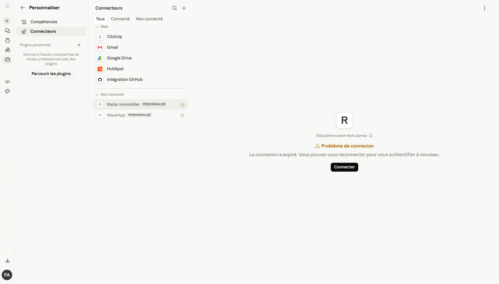

En haut à droite du panneau, ouvrir le menu **« … » (Plus d'options)** →
**Supprimer**, puis confirmer dans la boîte de dialogue **« Supprimer Radar
immobilier ? »**. Le connecteur disparaît de la liste.

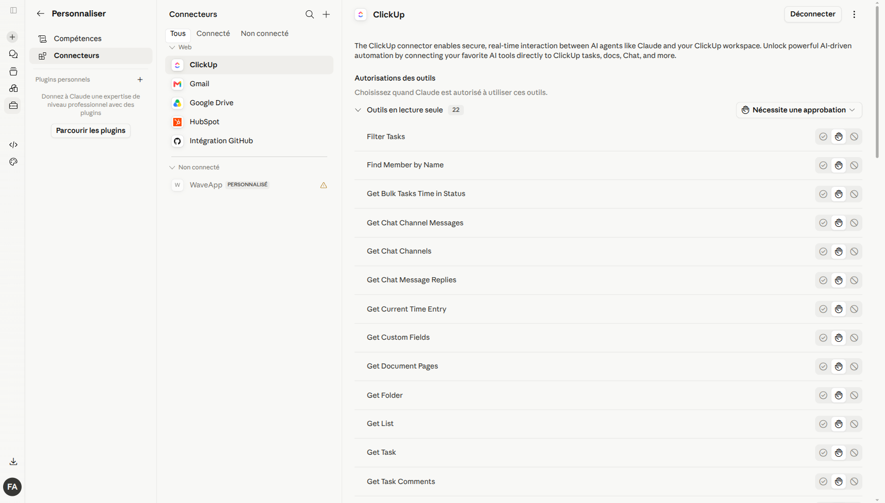

Recréez ensuite le connecteur en suivant les sections 5 (ajout) et 6 (autorisation
OAuth).

## 12. Références

- Documentation Anthropic : *Getting started with custom connectors using remote MCP*
  (`support.claude.com`).
- Runbook interne (déploiement, OAuth RS, manifests) :
  `docs/spec/mcp/immo-mcp-remote-deploy.md`.
- Fiche paramètres condensée : `docs/spec/mcp/claude-ai-connector-setup.md`.
- Activation préprod : `docs/runbooks/ARTIFACTS_PREPROD_ACTIVATION.md`,
  `docs/runbooks/uimcp-6h-search-signals-activation.md`,
  `RUNBOOK-PREPROD-MCP-RACCORDEMENTS.md`.

---

## Annexe A — Détails techniques (préprod)

Cette annexe sert à l'équipe et aux tests ; elle n'est pas nécessaire pour
utiliser le connecteur.

### A.1 Flux de connexion OAuth

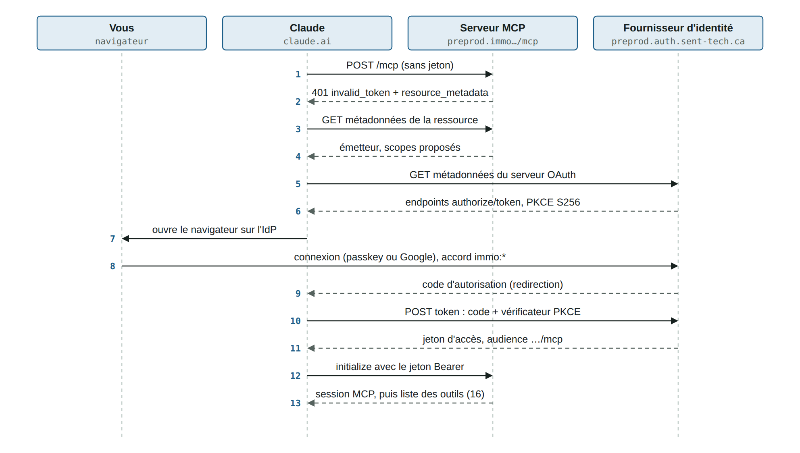

Avant toute connexion, le serveur MCP répond **401** avec l'adresse de son
document de découverte : c'est la première étape normale du flux.


### A.2 Flux de publication et d'ouverture d'un artefact

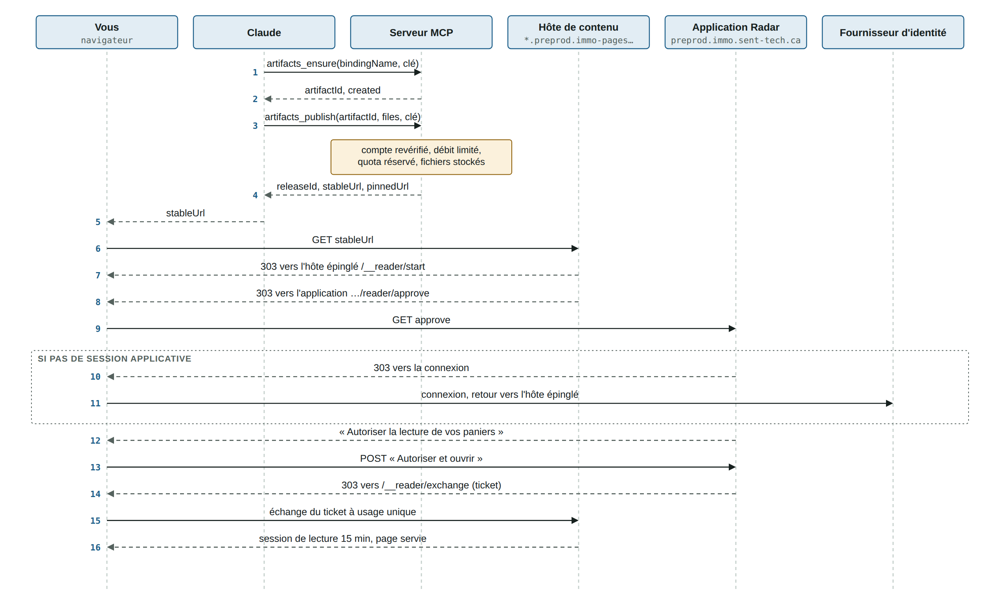

### A.3 Erreurs typées

Les erreurs d'outil reviennent dans la conversation avec un code `error`. Les
erreurs de recherche portent aussi `retryable`, `action` et un `correlationId` à
transmettre à l'équipe en cas de signalement.

| Code | Signification | Que faire |
|---|---|---|
| HTTP **401** `invalid_token` | Jeton absent, expiré, mauvais émetteur ou audience | Reconnecter le connecteur |
| `scope_denied:immo:search` (ou `:immo:documents:read`) | Scope non accordé | Reconnecter et accepter tous les scopes |
| `unauthenticated` (`action: reconnect_account`) | L'API a refusé l'identité déléguée | Reconnecter ; si cela persiste, contacter l'équipe |
| `composition_account` | **Compte suspendu** ou non approuvé (vérifié avant chaque appel), ou jeton qui revendique un espace de travail quitté | Faire rétablir l'approbation ou l'adhésion |
| `account_not_approved` (403) | Compte non approuvé, vu par l'API de recherche ou par la publication | Faire rétablir l'approbation |
| `workspace_missing` (403) | **Non membre** d'un espace de travail actif | Faire rétablir l'adhésion ; les artefacts restent possibles |
| `workspace_not_authorized`, `workspace_membership_required` (403) | Espace de travail non autorisé | Contacter l'équipe |
| `workspace_ambiguous` (409) | Plusieurs espaces de travail actifs | Configuration par l'équipe ; ne pas réessayer |
| `workspace_context_changed` (409) | L'adhésion a changé pendant l'appel | Relancer la recherche |
| `signal_capability_unavailable` (503) | Recherche de signaux fermée côté serveur | Contacter l'équipe |
| `capability_unavailable` (503), artefacts | Stockage ou base momentanément indisponible (`retryable: true`) ou fonction non configurée (`retryable: false`) | Réessayer avec la même clé ; sinon contacter l'équipe |
| HTTP 503 `composition_unavailable` | Le serveur n'a pas pu assembler ses outils | Contacter l'équipe |
| `account_binding_unavailable` | Base des comptes injoignable | Réessayer plus tard |
| `signal_cutover_in_progress` | Maintenance ou activation en cours | Réessayer plus tard |
| `rate_limited` (429) | **Quota de débit** : plus de 10 publications par minute | Attendre une minute, même clé |
| `conflict` (409) | **Quota** d'opérations ou d'octets atteint, ou clé réutilisée pour un autre contenu | Nouvelle clé ; si quota, contacter l'équipe |
| `invalid_request` | Paramètres invalides (champ interdit, chemin, type de fichier) | Corriger la demande |
| `access_denied` (403) | Publication sur un artefact dont vous n'êtes pas propriétaire | Utiliser `artifacts_ensure` pour votre propre artefact |
| `not_wired_yet:…` | Outil pas encore raccordé en préprod | Utiliser l'outil GeoJSON équivalent |

### A.4 Limites connues (préprod)

- **Acceptation à deux comptes non faite** : la séparation entre deux comptes
  (artefacts distincts, pas d'accès croisé, partage par ACL) n'a pas encore été
  testée en préprod ; elle reste `unverified`.
- **Récepteur strict désarmé** (`STRICT_RECEIVER_ARMED=0`) : les étapes 8 à 10
  du runbook (reçu A2, armement, essais compte suspendu et adhésion révoquée) ne
  sont pas enregistrées ; l'activation de la recherche reste `unverified`.
  Tester avec les comptes de test désignés.
- Cinq outils répondent `not_wired_yet` (section 9).
- Les captures marquées **« Capture à venir »** (C1 à C7) seront faites dès que
  le connecteur préprod sera ajouté sur le compte de l'owner.
