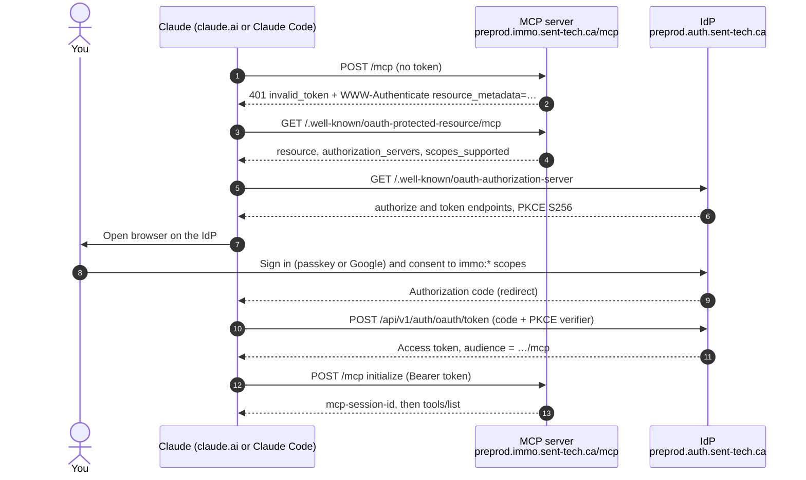
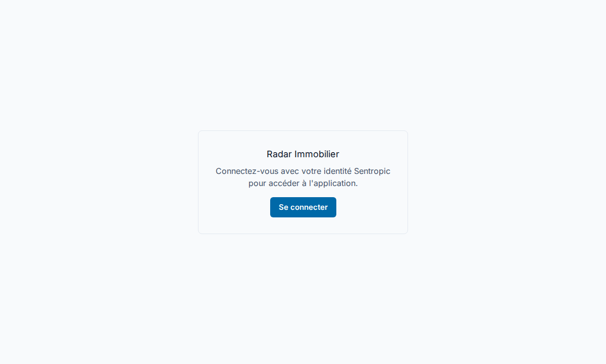
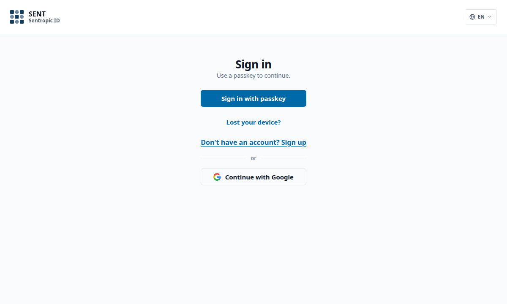
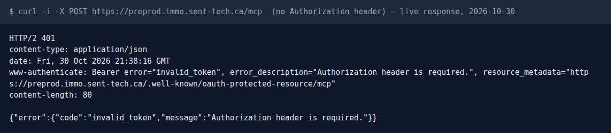
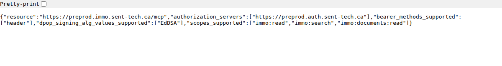
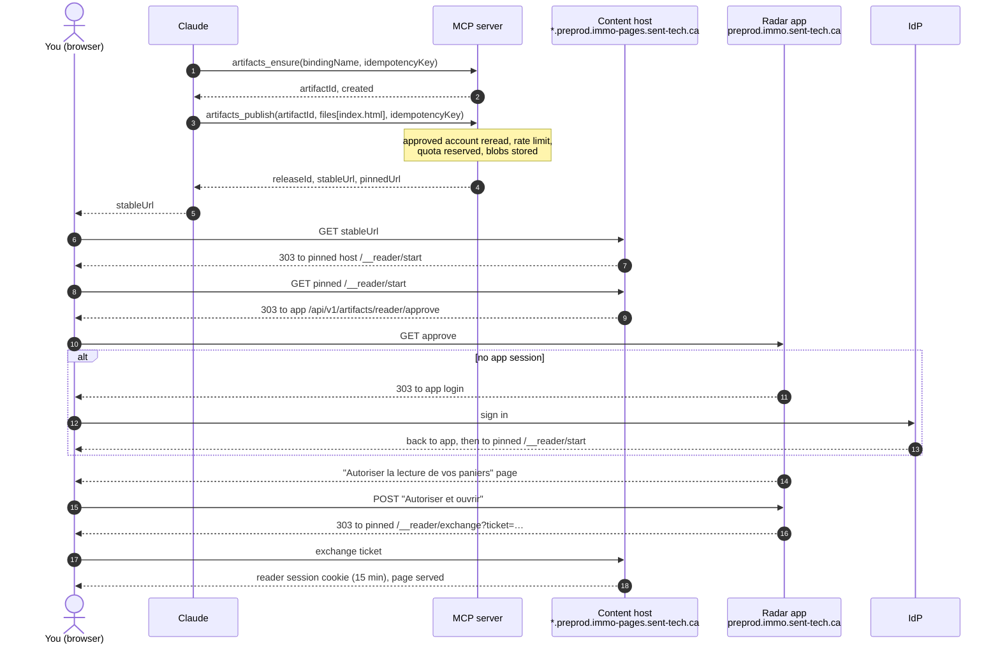
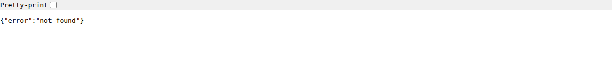

# Radar immobilier MCP server in preprod: user manual

| Item | Value |
| --- | --- |
| MCP endpoint | `https://preprod.immo.sent-tech.ca/mcp` |
| Identity provider | `https://preprod.auth.sent-tech.ca` |
| Published artifact hosts | `<artifact-uuid>.preprod.immo-pages.sent-tech.ca` (stable), `<release-uuid>.pinned.preprod.immo-pages.sent-tech.ca` (pinned) |
| Served API release | `6092169` (`GET /health` returned `sha: 609216947c48…` on 2026-10-30) |
| Source read for this manual | `origin/main` at `d25eb5ac2`, which contains `6092169` |
| Audience | Owner or tester with an approved preprod account |

This manual describes what a tester sees from the outside. It does not
replace the operator runbooks listed in [Sources](#9-sources).

## 1. What the MCP server does

The MCP server lets Claude read Radar immobilier data during a conversation:
regulatory signals, zoning and cadastral GeoJSON, zoning lifecycle events and
PDF links. It also lets Claude publish small HTML pages (artifacts) on the
`immo-pages` hosts, readable through the Radar application login.

Every call runs under your own identity. The server never takes identity,
workspace or ownership from tool arguments.

## 2. Before you start

- **Approved account.** Your Sentropic identity must have an `approved` account
  in the preprod application (`https://preprod.immo.sent-tech.ca`). The server
  rereads this status on every call.
- **One active workspace** for `search_signals`. The tool has no workspace
  selector: zero workspaces fails with `workspace_missing`, several fail with
  `workspace_ambiguous`. Publishing artifacts needs no workspace.
- **Scopes.** The `/mcp` route requires `immo:read`. Some tools need more:
  `search_signals` and `search_lots` need `immo:search`; the document tools need
  `immo:documents:read`. Grant all three when the consent screen offers them.
  With `immo:read` only, you can publish artifacts and read GeoJSON, but
  `search_signals` returns `scope_denied:immo:search`.
- **OAuth client ID.** The preprod IdP metadata (checked 2026-10-30) advertises
  no `registration_endpoint`, so clients cannot register themselves. You need a
  pre-registered public client ID. The preprod value is **not recorded in the
  repository** (`missing source`); ask the IdP owner. Production uses the public
  client `immo-mcp` with no secret (see
  `docs/guides/connecteur-mcp/guide-connecteur-claude-ai.md`).

## 3. Connect

### 3.1 OAuth flow



What you see on screen:

1. The Radar application itself, when not signed in, shows only a sign-in card.

   

2. The IdP sign-in screen. Use your passkey or Google. Nothing is typed into
   Claude itself.

   

3. Before sign-in, the MCP endpoint answers 401 with a pointer to its discovery
   document. This is the expected first step of the flow, not a fault.

   

   

### 3.2 claude.ai (custom connector)

Requires a Pro, Max, Team or Enterprise plan. On Team and Enterprise an
organization admin may have to add the connector.

1. Open **Customize → Connectors** (`https://claude.ai/customize/connectors`).
2. Click **+**, then **Add custom connector**.
3. Fill in:
   - **Name**: `Radar immobilier (preprod)`
   - **Remote MCP server URL**: `https://preprod.immo.sent-tech.ca/mcp`
4. Open **Advanced settings**: **OAuth Client ID** = the preprod client ID from
   section 2; **OAuth Client Secret** stays empty.
5. Click **Add**, open the connector, click **Connect**.
6. Sign in on the IdP screen (step 2 above) and accept the scopes.
7. The connector shows as connected and lists its tools. In each new
   conversation, enable it under **+ → Connectors**.

Screens of the claude.ai side for the production connector are in
`docs/guides/connecteur-mcp/assets/`; the preprod flow is the same apart from
the URL and client ID.

### 3.3 Claude Code

Command line:

```sh
claude mcp add --transport http \
  --client-id <PREPROD_CLIENT_ID> \
  --callback-port <PORT> \
  -s project immo-preprod https://preprod.immo.sent-tech.ca/mcp
```

Then, inside Claude Code, run `/mcp`, select `immo-preprod` and choose
**Authenticate**. A browser opens on the IdP sign-in screen. After consent,
`/mcp` shows the server as connected with its tools.

`--callback-port` fixes the local redirect port. Use it only if the IdP client
was registered with a fixed loopback redirect URI; whether the preprod client
requires one is `unverified`.

With `-s project`, the command writes this entry to `.mcp.json` (exact output of
Claude Code 2.1.314):

```json
{
  "mcpServers": {
    "immo-preprod": {
      "type": "http",
      "url": "https://preprod.immo.sent-tech.ca/mcp",
      "oauth": {
        "clientId": "<PREPROD_CLIENT_ID>",
        "callbackPort": 53682
      }
    }
  }
}
```

Note: the `.mcp.json` at the repository root declares `immo` as a **local stdio
server on synthetic fixtures** (`IMMO_MCP_DATA_MODE=mock`, stub identity). It
never talks to preprod. Use the `immo-preprod` entry above for preprod tests.

## 4. Tools

In preprod with artifacts in `general` mode, `tools/list` returns **16 tools**:
12 Radar tools (`packages/immo-mcp/src/tool-definitions.ts`) and 4 artifact
tools (`packages/immo-mcp/src/registry/artifact-profile.ts`). All Radar tools
are read-only.

Results are JSON text in the tool result. Failures set `isError: true` and carry
an `error` code (see [section 6](#6-errors)).

| Tool | Scope | Preprod behaviour |
| --- | --- | --- |
| `search_signals` | `immo:search` | Live, through the scoped API facade (runbook 6H, step 7) |
| `search_lots` | `immo:search` | Returns `not_wired_yet`; use `get_lots_geojson` |
| `get_lot_card` | `immo:read` | Returns `not_wired_yet` |
| `get_opportunity_dossier` | `immo:read` | Returns `not_wired_yet` |
| `list_documents` | `immo:documents:read` | Returns `not_wired_yet` |
| `read_document_excerpt` | `immo:documents:read` | Returns `not_wired_yet` |
| `get_zones_geojson` | `immo:read` | Reads the geo API; expected live, MCP call `unverified` |
| `get_lots_geojson` | `immo:read` | Reads the geo API; expected live, MCP call `unverified` |
| `get_grille_pdf` | `immo:documents:read` | Reads the geo API; expected live, MCP call `unverified` |
| `get_pv_pdf` | `immo:documents:read` | Reads `/api/documents/raw`; MCP call `unverified` |
| `get_reglement_provenance` | `immo:read` | Reads the geo API; `found=false` when the city has no norms layer |
| `query_zoning_events` | `immo:read` | Reads the geo API; `count=0` when the city has no events layer |
| `artifacts_ensure` | `immo:read` | Live in `general` mode |
| `artifacts_publish` | `immo:read` | Live in `general` mode |
| `artifacts_list` | `immo:read` | Live in `general` mode |
| `artifacts_get` | `immo:read` | Live in `general` mode |

City values are slugs: `longueuil`, `valleyfield`, `delson`, `sainte-catherine`…

Example results below come from the repository fixture
`packages/immo-mcp/src/fixtures/immo-tools.v1.json` (synthetic data) or from the
source code. They show the shape, not preprod data.

### 4.1 `search_signals`

Regulatory signals for a city.

| Parameter | Type | Default | Notes |
| --- | --- | --- | --- |
| `city` | string, required | | City slug |
| `etape` | string | | `avis_motion`, `adoption`, `consultation`… |
| `query` | string | | Free keyword |
| `showDiscarded` | boolean | `false` | Include archived signals |
| `limit` | integer 1–100 | 20 | |

```json
{ "name": "search_signals", "arguments": { "city": "longueuil", "etape": "avis_motion" } }
```

```json
{
  "city": "longueuil",
  "count": 1,
  "signals": [{
    "id": "sig-longueuil-001", "city": "longueuil", "type": "modification_zonage",
    "etape": "avis_motion", "regulatoryStatus": "anticipation", "etape_date": "2026-04-14",
    "reglement_number": "CO-2026-1187", "zone_ref": "H-203", "no_lot": "6 359 591",
    "summary": "Avis de motion pour permettre l'habitation multifamiliale jusqu'à 4 étages dans la zone H-203.",
    "source_document_id": "doc-longueuil-pv-2026-04-14"
  }]
}
```

The workspace is resolved server-side and is not returned.

### 4.2 `search_lots`

Lots by city and criteria. Parameters: `city` (required), `zone`, `no_lot`,
`minArea` (m²), `limit` (1–100, default 20). Preprod result:

```json
{ "error": "not_wired_yet:http_data_source GET /api/geo/:city/lots (use get_lots_geojson) base=… (only search_signals is wired to the real radar API in this seam)",
  "tool": "search_lots", "correlationId": "…" }
```

### 4.3 `get_lot_card`

Lot card (zoning, area, linked signals). Parameters: `city` (required),
`no_lot` (required, exact cadastral number). Preprod result: `not_wired_yet`,
same shape as 4.2.

### 4.4 `get_opportunity_dossier`

Opportunity dossier (score, linked lots and signals, rationale). Parameters:
`city` (required), `opportunityId` (required). Preprod result: `not_wired_yet`.

### 4.5 `list_documents`

Archived source documents. Parameters: `city`, `limit` (1–100, default 20).
Preprod result: `not_wired_yet`.

### 4.6 `read_document_excerpt`

Bounded excerpt of a source document, with PII redaction. Parameters:
`documentId` (required), `offset` (default 0), `maxChars` (1–4000, default 1200).
Preprod result: `not_wired_yet`.

### 4.7 `get_zones_geojson`

Zoning zones as a GeoJSON FeatureCollection.

| Parameter | Type | Default | Notes |
| --- | --- | --- | --- |
| `city` | string, required | | Slug |
| `bbox` | `[minLon, minLat, maxLon, maxLat]` | | Required when `limit` > 500 |
| `limit` | integer 1–2000 | 500 | |

```json
{ "name": "get_zones_geojson", "arguments": { "city": "longueuil", "limit": 50 } }
```

Result: `{ "city", "collectionId": "qc-zonage-longueuil", "featureCollection": {…}, "numberMatched", "numberReturned", "truncated" }`.
If `truncated` is `true`, narrow the `bbox`.

### 4.8 `get_lots_geojson`

Cadastral lots, enriched with the joined zone, `zoneCode`, `multifamilial4plus`
(+ source `grille` or `heuristique`) and `superficieM2`. Parameters: `city`
(required), `bbox`, `limit` (as 4.7), `only4Plus` (boolean),
`superficieMinM2` (m²). Filters apply to the fetched page.

```json
{ "name": "get_lots_geojson", "arguments": { "city": "delson", "only4Plus": true } }
```

Result: same envelope as 4.7, `collectionId: "qc-lots-delson"`.

### 4.9 `get_grille_pdf`

Public URL of a zone's zoning grid PDF. Parameters: `city`, `zone` (both
required).

```json
{ "found": true, "city": "longueuil", "zone": "H-203", "grillePdfUrl": "https://…/H-203.pdf" }
```

`found=false`: unknown zone. `grillePdfUrl=null`: zone without a grid.

### 4.10 `get_pv_pdf`

Served URL of a signal's source minutes (PDF). Parameter: `rawRef` (required,
for example `raw/proces-verbaux-longueuil/cas/<sha>.pdf`, as carried by
signals). The PDF is never inlined. Not found:

```json
{ "found": false, "rawRef": "pv/longueuil/2026-04-14.pdf", "note": "statut api: 404" }
```

### 4.11 `get_reglement_provenance`

Zoning by-law in force for a city: number, year, source page, public URL.
Parameters: `muni_slug` (required), `zone_code` (accepted, no effect).

```json
{ "found": true, "city": "longueuil", "reglement_url": "https://…/CO-2016-1187.pdf",
  "reglement_numero": "CO-2016-1187", "reglement_millesime": "2016",
  "reglement_page_source": "12", "has_ancien": true }
```

Missing fields are `null`, never guessed.

### 4.12 `query_zoning_events`

Zoning lifecycle timeline (notices of motion, draft by-laws, adoptions,
entry into force). Parameters: `muni_slug` (required), `zone_code`,
`document_type` (`avis_motion|projet_reglement|adoption|entree_en_vigueur|abrogation`),
`decision_state` (`planned|decided`).

```json
{ "city": "longueuil", "count": 1, "events": [{ "event_id": "evt-longueuil-001",
  "document_type": "avis_motion", "decision_state": "planned", "bylaw_numero": "CO-2026-1200",
  "date_iso": "2026-04-14", "zone_codes_resolus": [{ "zone_code": "H-203" }] }],
  "numberMatched": 1, "truncated": false }
```

`planned` is never an adoption.

### 4.13 `artifacts_ensure`

Creates, or finds again, your artifact for a binding name.

| Parameter | Type | Notes |
| --- | --- | --- |
| `bindingName` | string 1–128, required | Your own label; same name returns the same artifact |
| `idempotencyKey` | string 1–256, required | Reuse it only to retry the same call |
| `parameters` | object | Must be empty |

```json
{ "name": "artifacts_ensure", "arguments": { "bindingName": "manual-test", "idempotencyKey": "manual-test-ensure-1" } }
```

```json
{ "artifactId": "0b5c7f1e-…", "created": true }
```

### 4.14 `artifacts_publish`

Publishes a new release of an artifact you own.

| Parameter | Type | Notes |
| --- | --- | --- |
| `artifactId` | lowercase UUID, required | From `artifacts_ensure` |
| `idempotencyKey` | string 1–256, required | New key per new content |
| `files` | 1–32 entries, required | `{ path, mimeType, text }` or `{ path, mimeType, bytes }` |
| `profile` | flat object | Optional, primitives only |

Limits: 256 KiB decoded in total; MIME types `text/html`, `text/css`,
`text/javascript`, `application/json`; paths must not start with `api`,
`__artifacts`, `livez` or `health`. `index.html` is served at `/`.
Fields such as `actor`, `owner`, `tenant` or `storageScope` are refused
(`invalid_request`).

```json
{ "name": "artifacts_publish", "arguments": {
  "artifactId": "0b5c7f1e-…", "idempotencyKey": "manual-test-publish-1",
  "files": [{ "path": "index.html", "mimeType": "text/html",
              "text": "<!doctype html><title>MCP test</title><h1>Hello from preprod</h1>" }] } }
```

```json
{ "artifactId": "0b5c7f1e-…", "releaseId": "7d2a…", "manifest": "…", "digest": "…",
  "stableUrl": "https://0b5c7f1e-….preprod.immo-pages.sent-tech.ca/",
  "pinnedUrl": "https://7d2a….pinned.preprod.immo-pages.sent-tech.ca/" }
```

### 4.15 `artifacts_list`

Artifacts you can read in the preprod storage scope. Parameters: `limit`
(1–100, default 20), `offset` (default 0).

```json
{ "total": 1, "artifacts": [{ "artifactId": "0b5c7f1e-…", "ownerId": "<your sub>", "state": "active", "isPublic": false }] }
```

### 4.16 `artifacts_get`

Metadata of one artifact. Parameter: `artifactId` (required).

```json
{ "artifactId": "0b5c7f1e-…", "ownerId": "<your sub>", "storageScopeId": "radar-immobilier-preprod",
  "state": "active", "isPublic": false, "withdrawn": false, "currentReleaseId": "7d2a…", "grants": [] }
```

`grants` appears only for the owner. The exact `state` values come from the
artifacts library and are shown here as an example.

## 5. Test scenarios

### (a) Find the signals of a city

1. In a conversation with the connector enabled, ask:
   *"With Radar immobilier preprod, list the notices of motion in Longueuil."*
2. Claude calls `search_signals` with `{ "city": "longueuil", "etape": "avis_motion" }`.
   Accept the tool permission prompt.

**Expected result:** a JSON payload `{ city, count, signals }` where every
signal has `city = "longueuil"` and `etape = "avis_motion"`, and `count` equals
the number of items. The signals match what the Radar application shows for the
same account and city. An empty list (`count: 0`) is a valid answer when the
workspace has no such signal. If you get `scope_denied:immo:search`, reconnect
and grant `immo:search`.

### (b) Open a lot card or an opportunity dossier

1. Ask: *"Open the lot card of lot 6 359 591 in Longueuil."*
2. Claude calls `get_lot_card` with `{ "city": "longueuil", "no_lot": "6 359 591" }`.

**Expected result in preprod:** `isError: true` with
`"error": "not_wired_yet:http_data_source GET /api/geo/:city/lots?no_lot= …"`.
`get_opportunity_dossier` behaves the same way. This is the current contract,
not a regression.

**Working alternative:** ask for the lot through GeoJSON:
*"Get the lots of Delson with only4Plus and show lot 3 129 958 with its zone."*
Claude calls `get_lots_geojson` and reads the feature properties
(`zoneCode`, `zone.grillePdfUrl`, `superficieM2`, `multifamilial4plus`). Then
`get_grille_pdf` returns the grid PDF of that zone.

### (c) Publish an HTML artifact and open it



Steps:

1. Ask Claude: *"Using artifacts_ensure with bindingName `manual-test`, then
   artifacts_publish, publish a one-page HTML file `index.html` that says Hello
   from preprod, and give me the stable URL."*
2. Claude calls `artifacts_ensure`, then `artifacts_publish` (examples in 4.13
   and 4.14).
3. Open the `stableUrl` in a browser where you can sign in to the Radar
   application.
4. If you are signed out, sign in on the IdP screen.
5. The application shows **"Autoriser la lecture de vos paniers"** with the page
   ID, author and version. Click **Autoriser et ouvrir**.

**Expected result:**

- `artifacts_publish` returns `stableUrl` and `pinnedUrl` on
  `preprod.immo-pages.sent-tech.ca`.
- The browser ends on the pinned host and renders your HTML.
- `artifacts_list` now includes the artifact; `artifacts_get` shows
  `currentReleaseId` equal to the returned `releaseId`.
- Calling `artifacts_publish` again with the **same** `idempotencyKey` and the
  same files returns the same release without a new charge. The same key with
  different files returns `conflict`.

A URL for an artifact that does not exist answers `not_found` and never shows
the application:



## 6. Errors

Two layers can refuse a call. **HTTP errors** happen before any tool runs; the
client usually handles them. **Tool errors** come back as a tool result with
`isError: true` and a JSON `error` code.

| Situation | What you get | Meaning | What to do |
| --- | --- | --- | --- |
| No or expired token | HTTP **401**, `WWW-Authenticate: Bearer error="invalid_token"` | Token missing, expired, wrong issuer or audience | Reconnect the connector (claude.ai **Connect**, Claude Code `/mcp` → Authenticate) |
| Token lacks `immo:read` | HTTP 401 `invalid_token` or 403 `insufficient_scope`, depending on the `mcp-auth` revision (`unverified` on 0.2.1) | Coarse scope missing | Reconnect and accept all scopes |
| Tool scope missing | Tool error `scope_denied:immo:search` (or `:immo:documents:read`) | Token valid but scope not granted | Reconnect and grant the missing scope |
| Search API rejects the delegated credential | Tool error `unauthenticated`, `action: reconnect_account` | Token exchange or API check refused | Reconnect; if it persists, contact the operator |
| **Account suspended** or not approved | Tool error `composition_account` (account rechecked before every call); from the search facade, `account_not_approved` (403); from artifact admission, `account_not_approved` | Your account status is not `approved` | Ask the operator to restore approval. Your token stays valid but every call is refused |
| **Workspace: not a member** | `search_signals`: `workspace_missing` (403, "No authorized workspace is available") or `workspace_not_authorized` / `workspace_membership_required` (403). If your token asserts a workspace you no longer belong to: `composition_account` | No active membership for the search | Ask the operator to restore the membership. Artifacts still work: `general` mode needs no workspace |
| Several workspaces | `workspace_ambiguous` (409) | The tool has no workspace selector | Operator configuration; do not retry |
| Workspace changed during the call | `workspace_context_changed` (409, retryable) | Membership moved mid-call | Run the search again |
| **503 `capability_unavailable`**, search | `signal_capability_unavailable` (`upstreamStatus: 503`, `action: contact_operator`) | Search facade closed (`MCP_SIGNAL_SEARCH_ENABLED=0`) or scope unavailable | Contact the operator |
| **503 `capability_unavailable`**, artifacts | Tool error `{ "error": "capability_unavailable", "retryable": true }` | Artifact storage, database or approval check temporarily unavailable | Retry after a minute with the **same** `idempotencyKey`. `retryable: false` means the capability is not configured: contact the operator |
| Server composition down | HTTP 503 `{ "error": "composition_unavailable" }` | MCP server could not assemble its tools | Contact the operator |
| Account database unreachable | Tool error `account_binding_unavailable`, `retriable: true` | MCP cannot read your account status | Retry later |
| Activation or maintenance | `signal_cutover_in_progress` (retryable) | Search temporarily closed | Retry later |
| **Quota: rate** | `rate_limited` (429, retryable) | More than 10 artifact write attempts per minute for your account | Wait a minute, then retry with the same key |
| **Quota: ceiling** | `conflict` (409, not retryable) | Your durable operation or byte quota, or the preprod scope quota, is used up | Contact the operator to raise the quota |
| Same key, different content | `conflict` (409) | `idempotencyKey` reused for another payload | Use a new `idempotencyKey` |
| Bad arguments | `invalid_request` | Schema violation, forbidden field (`owner`, `tenant`…), bad path or MIME type | Fix the arguments |
| Not your artifact | `access_denied` (403) | Publishing to an artifact you do not own | Use `artifacts_ensure` for your own artifact |
| Session expired | JSON-RPC 404 "Unknown or expired MCP session" | 30 min idle or 8 h total | The client opens a new session; reconnect if it does not |

Search errors include `retryable`, `action` (`retry_later`, `contact_operator`,
`reconnect_account`) and a `correlationId`. Give the `correlationId` to the
operator when you report a problem.

## 7. Known limits

- **Two-account acceptance not done.** The artifacts runbook requires two
  approved accounts in two browser profiles (distinct artifacts, no cross-account
  access, shared-artifact ACL, cursor continuation across API restart, host
  isolation checks). This has not been run; artifact isolation between accounts
  is `unverified` in preprod.
- **Strict receiver disarmed.** Search runs with `STRICT_RECEIVER_ARMED=0`
  (runbook 6H, step 7). Steps 8–10 (digest-bound A2 receipt, arming, suspended
  account and revoked membership probes) are not recorded. Until then the API
  still accepts the plain human bearer path, and the activation stays
  `unverified`. Test only with designated test accounts.
- Five domain tools return `not_wired_yet`: `search_lots`, `get_lot_card`,
  `get_opportunity_dossier`, `list_documents`, `read_document_excerpt`.
- The preprod OAuth client ID for connectors is not documented in the
  repository.
- No authenticated MCP call was made while writing this manual. Tool results
  shown are shapes from fixtures and code, not preprod data.
- Mutations other than artifacts (notes, decisions) are not exposed.

## 8. Illustrations

| File | Content | Origin |
| --- | --- | --- |
| `assets/mcp/mcp-01-app-public-page.png` | Application signed out | Headless Chromium, 2026-10-30 |
| `assets/mcp/mcp-02-idp-sign-in.png` | IdP sign-in screen | Headless Chromium, reached from the app sign-in button, nothing typed |
| `assets/mcp/mcp-03-prm-discovery.png` | Protected resource metadata | Headless Chromium |
| `assets/mcp/mcp-04-mcp-401.png` | 401 of `/mcp` | Live `curl -i` output rendered in Chromium |
| `assets/mcp/mcp-05-content-host-unknown-artifact.png` | Content host, unknown artifact | Headless Chromium |

No screenshot contains a token, cookie value or secret.

## 9. Sources

- `packages/immo-mcp/src/tool-definitions.ts`, `server-http.ts`,
  `data-source.ts`, `signal-read-error.ts`, `account-binding.ts`,
  `artifact-binding.ts`, `registry/artifact-profile.ts`,
  `registry/artifact-provider.ts`, `registry/stateful-composition.ts`
- `packages/artifacts-host/src/` (admission, quotas, rate limit) and
  `@sentropic/artifacts@0.2.2` (tool schemas, failure codes)
- `api/src/artifacts/reader-opening.ts` (reader approval flow)
- `docs/runbooks/ARTIFACTS_PREPROD_ACTIVATION.md`
- `docs/runbooks/uimcp-6h-search-signals-activation.md`
- `RUNBOOK-PREPROD-MCP-RACCORDEMENTS.md`
- `docs/spec/SPEC_BASE_API.md`
- `.mcp.json` (local stdio example)
- `docs/guides/connecteur-mcp/guide-connecteur-claude-ai.md` (production connector)
