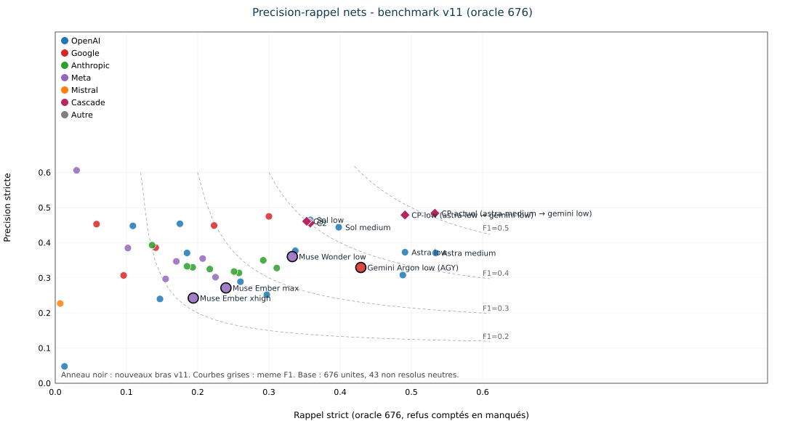
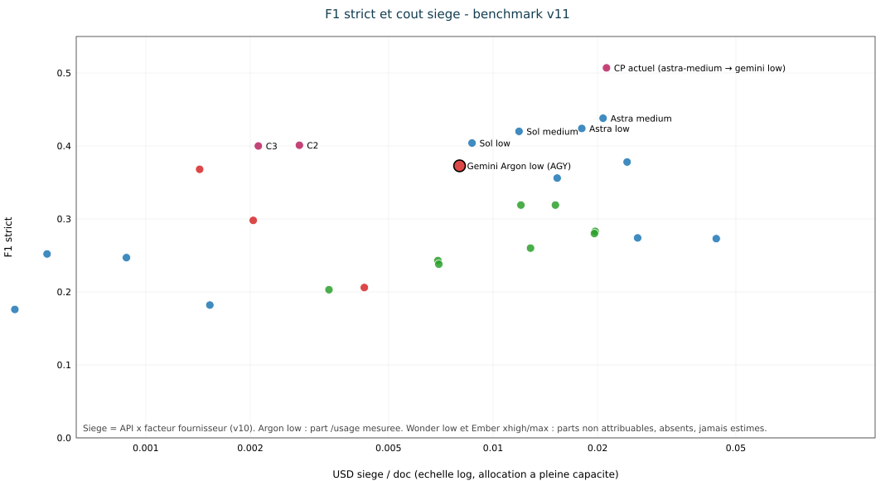
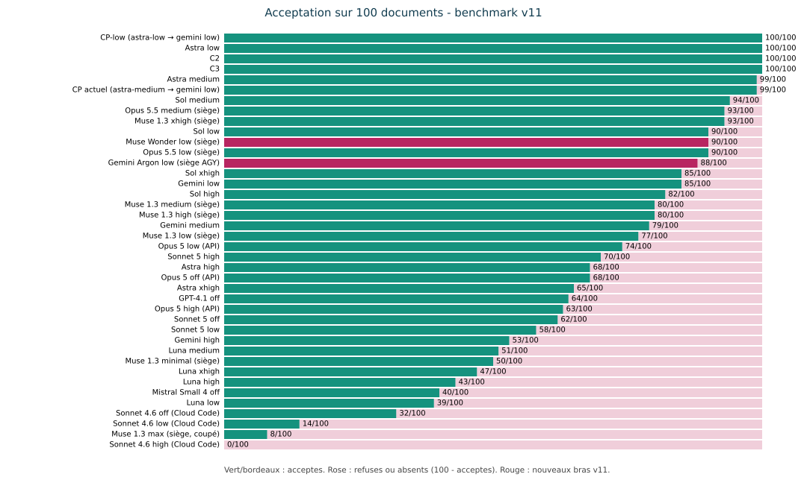
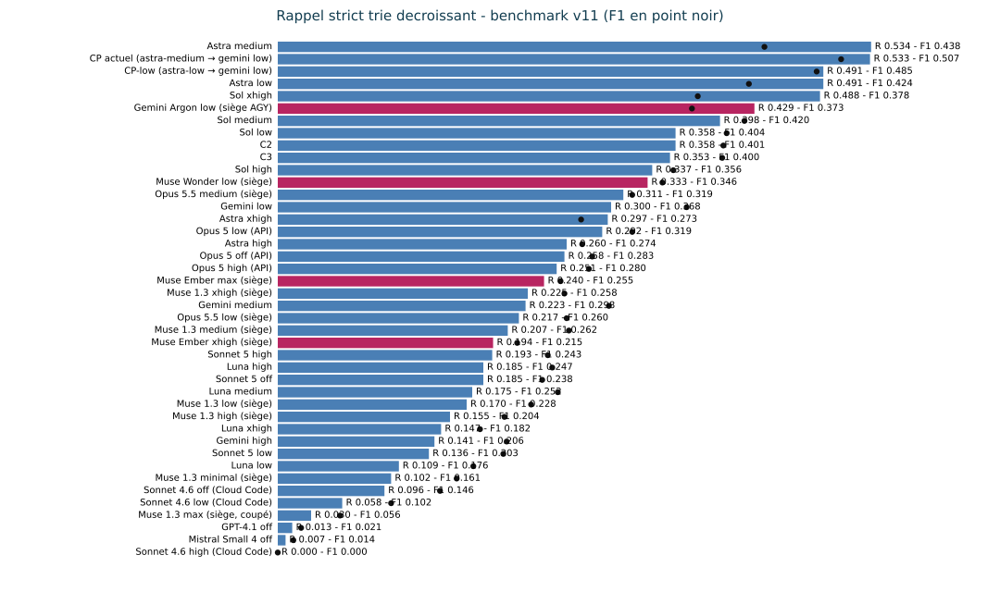

# Quel modèle pour lire les documents municipaux ?

**Benchmark v11 · Rapport complet · 9 novembre 2026** 
Rédaction : lane benchmark v11 (conductor i-cond) ; base v10 (v101b, oracle 674) et v11alpha (oracle 676, #725).

## 1. Résumé exécutif

Ce dossier **v11** (sans « alpha ») intègre les lignes v11alpha, le bras **Muse Wonder low** complet et le nouveau bras **Gemini Argon low**, selon strictement la même méthode que v11alpha : mêmes prompts gelés (revérifiés `count=100, fail=0`), même validateur v9 gelé + provenance, même scoreur oracle 676 (43 non résolus neutres). Différence de protocole, déclarée exactement : **concurrence 10** pour Muse Wonder low ; pour Gemini Argon low, échantillon final **mixte** — passage principal en concurrence 10 puis reprises séquentielles des échecs d'infrastructure (140 tentatives, 100 documents distincts réussis, 18 documents repris ; détail §2). Aucune valeur publiée en v10 ou v11alpha n'est altérée ; les nouvelles lignes s'ajoutent.

- **Muse Wonder low** (`muse-wonder-1.0`, siège Muse) : 90/100 acceptés, P 0.361, R 0.333, F1 strict 0.346 — rang 12 au tri par rappel.
- **Gemini Argon low** (`gemini-4-argon-low`, siège AGY / Gemini Ultra) : 88/100 acceptés, P 0.330, R 0.429, F1 strict 0.373 — rang 6 au tri par rappel.
- Le **combo CP actuel** reste en tête en F1 (0,507) ; aucun modèle seul ne l'égale. Le tri du tableau global v11 est par **rappel décroissant** (consigne du dossier), le F1 reste affiché.
- Coûts : équivalents API calculés depuis les jetons réels et des tarifs publics relevés sur **sources secondaires** datées (section 6 ; tarifs marqués `unverified`, aucune page tarifaire primaire citée avec URL exacte). Coût siège **Gemini Argon low mesuré par burn `/usage`** : 0,00801 USD/doc (part hebdomadaire mesurée × prix hebdomadaire du palier Google AI Ultra 20x à 199,99 USD/mois ; relevés bruts en section 6). Coût siège **Muse Wonder low : `missing source`** (compteur `muse usage` lu avant/après, bascule partagée avec les sessions du compte, non attribuable — relevés complets en section 6). Rien n'est estimé à la place.

## 2. Protocole

- Corpus : 100 documents du manifeste v101b (sha256 PDF vérifiés), prompts gelés sha256 identiques au v10, validation profil v9 + provenance, notation oracle v3 stricte sur **oracle 676** (#725, 43 non résolus neutres). Règle « Fair Benchmarking — No Cheating » (`rules/MASTER.md`) : métriques gelées avant notation, appliquées à l'identique, aucune fabrication, traçabilité complète.
- **Gemini Argon low** — modèle exact `gemini-4-argon-low` (catalogue AGY relevé le 2026-11-09 : `gemini-4-argon-{low,medium,high}`, effort encodé dans l'identifiant). Transport siège headless AGY, uniforme sur les 100 documents : `agy --model gemini-4-argon-low --input-format stream-json --output-format stream-json`, ligne d'entrée `{"event":"user","message":{"content":<octets du prompt gelé>}}`, fichier brut = `result.response` de l'événement final. Le canal stdin remplace le canal argv (`--print=<prompt>`) qui heurte la limite Linux de 128 Kio par argument (`spawn E2BIG`) sur les plus gros prompts gelés : un premier passage argv (53/100 documents, 3 erreurs d'outillage, arrêt E2BIG avant toute validation ni notation) est archivé sous `arms/gemini-argon-low/pass1-print-raw/` et n'est **pas** noté. La CLI AGY ajoute son propre contexte d'agent autour du prompt gelé : l'écart avec un appel API brut n'est **pas mesuré** (même réserve que les bras Opus 5.5 `claude -p` de v11alpha).
- **Surface d'accès AGY (déclaration complète)** — wrapper : CLI AGY (`agy`, Antigravity) en mode headless `stream-json` stdin/stdout, siège uniquement (aucune clé API ; aucun drapeau de restriction d'outils passé par le runner). Contexte ajouté : la CLI ajoute son propre contexte d'agent autour du contenu du tour utilisateur (les octets du prompt gelé, envoyés tels quels) ; écart avec un appel API brut **non mesuré** (même réserve que les bras Opus 5.5 `claude -p --system-prompt-file` de v11alpha). Répertoire de travail (`cwd`) du processus AGY : la racine du dépôt benchmark, qui contient `tmp/bench-wonder/` (prompts gelés, oracle 676, corpus, sorties des bras). Outils actifs : l'événement `init` du premier flux archivé liste 60 outils disponibles, dont `view_file`, `run_command`, `grep_search`, `search_web`, `call_mcp_tool`, `read_url_content`, en mode d'autorisation `request-review`, sans restriction appliquée par le runner. Usage effectif observé sur les 100 flux notés : étapes `user_input` puis `agent_response` uniquement, **aucun appel d'outil**, 100 événements `result` en `SUCCESS`. La comparaison avec les transports `claude -p --system-prompt-file` (v11alpha) et API reste donc asymétrique en surface d'accès déclarée, pas seulement en contexte ; aucun score n'est invalidé (aucun outil utilisé pendant l'extraction).
- **Muse Wonder low** — `muse-wonder-1.0`, `muse exec --provider meta --reasoning-effort low --prompt-file <prompt gelé>`, siège Muse, déjà exécuté (100/100, 0 événement quota). Colonnes complétées ici par capture d'usage `--json` sur l'échantillon burn (jetons réels fournisseur).
- Sièges uniquement, aucune clé API. Reprise sur quota de siège : attente 300 s, maximum 12 tentatives, jamais de bascule clé, le quota n'est jamais compté comme un refus. Argon : 0 événement(s) quota sur le passage noté ; Wonder : 0.
- **Concurrence** (au lieu de 1 en v11alpha), énoncée exactement : Muse Wonder low a été exécuté en concurrence 10. Pour Gemini Argon low, l'échantillon final noté est **mixte** : passage principal en concurrence 10, puis reprises **séquentielles** (concurrence 1, `run-arm-argon-retry.mjs`) des échecs d'infrastructure — le `meta.jsonl` du bras compte 140 tentatives pour 100 documents distincts réussis, 40 tentatives en erreur et 18 documents repris. Les latences p50/p90 des deux nouveaux bras sont mesurées sous cette concurrence et **ne sont pas comparables** aux colonnes de latence v10/v11alpha. P, R, F1 et acceptés ne dépendent pas de la concurrence.
- Incidents d'infrastructure Argon (jamais comptés comme refus ni quota) : erreurs de construction de boîte à outils AGY (`mcp_h2a_render_BarChart`, `$ref` distant résolu en URL fichier), authentification expirée et flux interrompus. Cause établie par reproduction : en séquentiel, aucune erreur d'outillage ; en rafale de 10 démarrages simultanés, les constructions de boîte à outils entrent en collision. Les échecs ont été repris par relances du runner (seules les sorties non vides sont sautées), les derniers documents en séquentiel avec la même commande et les mêmes octets. Les flux des réponses réussies ne contiennent aucun appel d'outil (étapes `user_input` puis `agent_response`) : la boîte à outils n'intervient pas dans l'extraction.

## 3. Tableau global — tri par rappel décroissant (oracle 676)

40 lignes : 38 lignes v11alpha recopiées sans rescoring, plus Muse Wonder low et Gemini Argon low. ᵃ = valeur du rapport v10 (oracle 674) telle que publiée en v11alpha. USD hors taxes ; `missing source` = jamais estimé.
<!-- page:wide -->
| # (rappel) | Modèle · effort | Acceptés /100 | P | R | F1 strict | Équiv. API USD/doc | USD siège/doc |
|---|---|---|---|---|---|---|---|
| 1 | Astra medium | 99 | 0.371 | 0.534 | 0.438 | 0.4689 | 0.0207 |
| 2 | CP actuel (astra-medium → gemini low) | 99 | 0.484 | 0.533 | 0.507 | 0.4813 | 0.0212 |
| 3 | CP-low (astra-low → gemini low) | 100 | 0.479 | 0.491 | 0.485 | missing source | missing source |
| 4 | Astra low | 100 | 0.373 | 0.491 | 0.424 | 0.4072 | 0.0180 |
| 5 | Sol xhigh | 85 | 0.308 | 0.488 | 0.378 | 0.5498 | 0.0243 |
| 6 | **Gemini Argon low (siège AGY)** | 88 | 0.330 | 0.429 | 0.373 | 0.2074 | 0.00801 |
| 7 | Sol medium ᵃ | 94 | 0.444 | 0.398 | 0.420 | 0.2686 | 0.0119 |
| 8 | Sol low ᵃ | 90 | 0.465 | 0.358 | 0.404 | 0.1967 | 0.00870 |
| 9 | C2 ᵃ | 100 | 0.456 | 0.358 | 0.401 | 0.0689 | 0.00277 |
| 10 | C3 ᵃ | 100 | 0.461 | 0.353 | 0.400 | 0.0543 | 0.00211 |
| 11 | Sol high | 82 | 0.377 | 0.337 | 0.356 | 0.3460 | 0.0153 |
| 12 | **Muse Wonder low (siège)** | 90 | 0.361 | 0.333 | 0.346 | 0.2731 | missing source |
| 13 | Opus 5.5 medium (siège) | 93 | 0.328 | 0.311 | 0.319 | 0.4999 | 0.0151 |
| 14 | Gemini low | 85 | 0.475 | 0.300 | 0.368 | 0.0376 | 0.00143 |
| 15 | Astra xhigh | 65 | 0.252 | 0.297 | 0.273 | 0.9929 | 0.0439 |
| 16 | Opus 5 low (API) ᵃ | 74 | 0.350 | 0.292 | 0.319 | 0.3976 | 0.0120 |
| 17 | Astra high | 68 | 0.289 | 0.260 | 0.274 | 0.5896 | 0.0261 |
| 18 | Opus 5 off (API) ᵃ | 68 | 0.314 | 0.258 | 0.283 | 0.6507 | 0.0197 |
| 19 | Opus 5 high (API) ᵃ | 63 | 0.318 | 0.251 | 0.280 | 0.6472 | 0.0196 |
| 20 | Muse 1.3 xhigh (siège) | 93 | 0.302 | 0.225 | 0.258 | 0.0343 | missing source |
| 21 | Gemini medium | 79 | 0.449 | 0.223 | 0.298 | 0.0539 | 0.00204 |
| 22 | Opus 5.5 low (siège) | 90 | 0.325 | 0.217 | 0.260 | 0.4239 | 0.0128 |
| 23 | Muse 1.3 medium (siège) | 80 | 0.355 | 0.207 | 0.262 | 0.0305 | missing source |
| 24 | Sonnet 5 high ᵃ | 70 | 0.330 | 0.193 | 0.243 | 0.2295 | 0.00694 |
| 25 | Luna high | 43 | 0.371 | 0.185 | 0.247 | 0.0199 | 0.00088 |
| 26 | Sonnet 5 off ᵃ | 62 | 0.333 | 0.185 | 0.238 | 0.2307 | 0.00698 |
| 27 | Luna medium | 51 | 0.454 | 0.175 | 0.252 | 0.0117 | 0.00052 |
| 28 | Muse 1.3 low (siège) | 77 | 0.347 | 0.170 | 0.228 | 0.0284 | missing source |
| 29 | Muse 1.3 high (siège) | 80 | 0.297 | 0.155 | 0.204 | 0.0310 | missing source |
| 30 | Luna xhigh ᵃ | 47 | 0.240 | 0.147 | 0.182 | 0.0346 | 0.00153 |
| 31 | Gemini high | 53 | 0.386 | 0.141 | 0.206 | 0.1123 | 0.00426 |
| 32 | Sonnet 5 low ᵃ | 58 | 0.393 | 0.136 | 0.203 | 0.1114 | 0.00337 |
| 33 | Luna low | 39 | 0.448 | 0.109 | 0.176 | 0.00949 | 0.00042 |
| 34 | Muse 1.3 minimal (siège) | 50 | 0.385 | 0.102 | 0.161 | 0.0279 | missing source |
| 35 | Sonnet 4.6 off (Cloud Code) | 32 | 0.307 | 0.096 | 0.146 | 0.1750 | missing source |
| 36 | Sonnet 4.6 low (Cloud Code) | 14 | 0.453 | 0.058 | 0.102 | 0.1478 | missing source |
| 37 | Muse 1.3 max (siège, coupé) | 8 | 0.606 | 0.030 | 0.056 | missing source | missing source |
| 38 | GPT-4.1 off | 64 | 0.048 | 0.013 | 0.021 | 0.0542 | missing source |
| 39 | Mistral Small 4 off | 40 | 0.227 | 0.007 | 0.014 | 0.00500 | missing source |
| 40 | Sonnet 4.6 high (Cloud Code) | 0 | N-A | 0.000 | 0.000 | missing source | missing source |

Lecture : le tri par rappel met Astra medium (R 0,534) et CP (R 0,533) en tête ; CP reste premier en F1 (0,507) et en précision (0,484). Gemini Argon low et Muse Wonder low se classent par leur rappel respectif (voir rangs ci-dessus). les coûts siège historiques valent `API × facteur fournisseur` mesuré par burn en v10 (Codex 0,044235 ; Google 0,037931 ; Claude 0,030248) ; Gemini Argon low reçoit un facteur mesuré par burn `/usage` (section 6), Muse Wonder low reste sans part attribuable : `missing source`.

## 4. Détail des bras siège

J = JSON invalide ; V = profil v9 refusé ; Pr = provenance ; T = transport / réponse vide. Pour les bras v11alpha, la colonne publiée était J · V · T (Pr non séparé : N-A ici, sans rescoring).

| Bras | Tentés | Acceptés | Échecs (J · V · Pr · T) | F1 net 4 doc | p50 s | p90 s | Sortie moy. (jetons) | Équiv. API USD/doc | USD siège/doc |
|---|---|---|---|---|---|---|---|---|---|
| Opus 5.5 low | 100 | 90 | 0 · 6 · N-A · 4 | 0.143 | 49 | 97 | 6188 | 0.4239 | 0.0128 |
| Opus 5.5 medium | 100 | 93 | 0 · 3 · N-A · 4 | 0.388 | 75 | 150 | 10269 | 0.4999 | 0.0151 |
| Muse 1.3 minimal | 100 | 50 | 18 · 32 · N-A · 0 | 0.167 | 27 | 45 | N-A | 0.0279 | missing source |
| Muse 1.3 low | 100 | 77 | 3 · 20 · N-A · 0 | 0.386 | 35 | 61 | N-A | 0.0284 | missing source |
| Muse 1.3 medium | 100 | 80 | 2 · 18 · N-A · 0 | 0.515 | 63 | 102 | N-A | 0.0305 | missing source |
| Muse 1.3 high | 100 | 80 | 10 · 10 · N-A · 0 | 0.415 | 76 | 147 | N-A | 0.0310 | missing source |
| Muse 1.3 xhigh | 100 | 93 | 3 · 4 · N-A · 0 | 0.241 | 107 | 157 | N-A | 0.0343 | missing source |
| **Muse Wonder low** | 100 | 90 | 1 · 9 · 0 · 0 | 0.306 | 48.3 ¹ | 108.1 ¹ | 5085 réelle (burn) | 0.2731 ² | missing source |
| **Gemini Argon low** | 100 | 88 | 0 · 12 · 0 · 0 | 0.338 | 134.6 ¹ | 266.1 ¹ | 15528 réelle (bras) | 0.2074 ³ | 0.00801 ⁴ |

¹ Concurrence : Wonder en concurrence 10 ; Argon en échantillon mixte (passage concurrence 10 + reprises séquentielles, voir §2) : non comparable aux latences v11alpha (concurrence 1). ² Tarif `muse-wonder-1.0` 4,00 / 0,20 (cache) / 20,00 USD par million de jetons (entrée / cache / sortie), relevé le 2026-11-03 sur **source secondaire** (voir §6 : tarif `unverified`, aucune page tarifaire primaire Meta citée) ; formule `[(I−C)×4 + C×0,20 + O×20]/10⁶` sur jetons réels du burn (n=10, seau S — voir limites §6). Avec raisonnement facturé en sortie : 0.2910. ³ Tarif `Gemini 4 Argon` 2,00 / 0,10 (cache) / 10,00 USD par million, relevé le 2026-11-03 sur **source secondaire** (voir §6 : tarif `unverified`, URL de la page tarifaire primaire Google non citée ; le passage à 4/20 au 2026-12-01 annoncé par ce relevé secondaire n'est pas vérifié sur source primaire) ; formule `[(I−C)×2 + C×0,10 + (O+T)×10]/10⁶` sur jetons réels du bras complet (n=100) ; burn (n=10, mesuré sous un autre mode d'invocation — voir §6) : 0.1351. ⁴ USD siège Argon : burn `/usage` (section 6), part hebdomadaire 0,000174153/doc × 45,9936 USD/semaine (Ultra 20x, 199,99 USD/mois) = 0,00801 USD/doc ; variante 5x cohérente (part ×4, 99,99 USD/mois) : 0,01602 USD/doc.

Détail Wonder : entrée réelle (burn n=10) 56791 / sortie réelle 5085 (raisonnement 893, cache 14665) ; bras complet : sortie estimée octets/4 4250 (unverified). Détail Argon : entrée réelle (bras, n=100) 26053 / sortie réelle 15528 (réflexion 0, cache 0). Scores secondaires (même scoreur) — Wonder : F1 broad 0.340, stage-tolerant 0.409, soft 0.355 (TP 225, FP 399, FN 451). Argon : F1 broad 0.365, stage-tolerant 0.447, soft 0.393 (TP 290, FP 590, FN 386).

<!-- page:wide -->

## 5. Latences

Les p50/p90 des bras v10/v11alpha (concurrence 1) restent ceux des rapports publiés (tableaux v10 §5 et v11alpha §3, non recopiés ici pour éviter toute altération). Nouveaux bras, concurrence 10 — **non comparables** : Muse Wonder low p50 48.3 s, p90 108.1 s ; Gemini Argon low p50 134.6 s, p90 266.1 s (temps mur des seules tentatives réussies distinctes ; échantillon final Argon mixte — passage principal en concurrence 10 et reprises séquentielles d'erreurs d'infrastructure, 140 tentatives pour 100 documents réussis, 18 documents repris — donc doublement non comparable ; événements quota Argon : 0). Sous concurrence 10, ces durées incluent l'attente d'ordonnancement du siège partagé.

## 6. Coûts, sièges et tests de burn

Un accès API facture les jetons ; un siège est un abonnement à quota. Le burn mesure la consommation de quota sur un échantillon fixe (10 documents gelés, les 10 premiers du manifeste), avec relevés avant/après quand le fournisseur expose un compteur. Méthode v10 : `C_siège = C_API × f`, `f = S / É_mois` extrapolé de la fraction de quota consommée. Sans bascule de compteur attribuable, aucun facteur n'est dérivé : `missing source`. Correctif du 2026-11-09 (lane COST) : AGY expose bien un compteur d'allocation via la commande slash `/usage`, lisible en headless ; l'affirmation inverse de la première version de ce dossier est retirée (méthode et relevés ci-dessous).

### Tarifs publics utilisés (source et date de relevé)

Statut des sources : aucun tarif ci-dessous n'est cité depuis la page tarifaire primaire du fournisseur avec son URL exacte. Chaque tarif est donc présenté explicitement comme relevé sur **source secondaire** et marqué `unverified` ; aucun n'est présenté comme une page officielle. Seule exception de disponibilité (pas de prix) : la page officielle des abonnements Google a été réouverte le 2026-11-09 (voir dernière ligne des sources §9).

| Objet | Tarif | Source | Relevé |
|---|---|---|---|
| `muse-wonder-1.0` (équivalent API) | 4,00 entrée / 0,20 cache / 20,00 sortie USD par M jetons — `unverified` | **Source secondaire** (agrégateur) : https://superagnt.com/muse/pricing ; sentisight.ai — aucune page tarifaire primaire Meta citée | 2026-11-03 |
| `Gemini 4 Argon` (équivalent API) | 2,00 entrée / 0,10 cache / 10,00 sortie USD par M jetons — `unverified` (le passage à 4/20 au 2026-12-01 vient du même relevé secondaire, non vérifié sur source primaire) | **Source secondaire** (agrégateur) : licenseware.io, se déclarant sourcé de la page Gemini Developer API pricing au 2026-11-03 — URL de la page primaire non citée ici | 2026-11-03 |
| Google AI Ultra (siège AGY) | Palier affiché par l'en-tête de la session interactive AGY le 2026-11-09 : « Google AI Ultra » (multiplicateur 5x/20x non affiché par `/usage`) — 99,99 USD/mois (5x) ; 199,99 USD/mois (20x), US — `unverified` | **Source secondaire** : lilachbullock.com ; whizi.io (relevés concordants). Page officielle https://gemini.google/subscriptions réouverte le 2026-11-09 (édition Canada, Argon confirmé sur Pro et Ultra) pour la disponibilité, sans prix US cité ici | octobre 2026 |
| Muse (siège) | Power Usage 50 USD/mois ; Maximum Usage 200 USD/mois (Wonder Full inclus). Palier lu sur ce siège par `muse usage` : « Muse Code Max Usage » (= Maximum Usage) — `unverified` | **Source secondaire** (agrégateur) : https://superagnt.com/muse/pricing — aucune page tarifaire primaire Meta citée | 2026-11-03 |

Paliers lus dans cette lane : AGY « Google AI Ultra » (en-tête interactif ; multiplicateur non affiché, le calcul siège Argon est donc publié au prix 20x avec la variante cohérente 5x en regard) ; Muse « Muse Code Max Usage » (= Maximum Usage, 200 USD/mois). Aucun autre palier n'entre dans les calculs. Les prix restent des relevés secondaires `unverified` (voir statut des sources ci-dessus), revérifiés le 2026-11-09 (blog.laozhang.ai du 2026-11-06 ; limitdigest.com vérifié le 2026-11-09 ; engineerfoodie.in du 2026-10-29).

### Burn Muse Wonder low (siège Muse, compteur exposé)

Échantillon : 10 premiers documents du manifeste, `muse exec --provider meta --model muse-wonder-1.0 --reasoning-effort low --json` séquentiel (run-burn-wonder-usage10). Un premier essai Saint-Polycarpe a échoué sur timeout du runtime Muse (exit 1, usage nul) puis a réussi à la reprise ; il n'est pas compté comme un refus. Jetons réels moyens : entrée 56791/doc, sortie 5085/doc, raisonnement 893/doc, cache 14665/doc. Ces entrées incluent le contexte propre de la CLI Muse (contexte d'agent autour du prompt gelé) : l'équivalent API surestime donc le coût du seul prompt gelé en API brute — même réserve que les bras `claude -p` de v11alpha.

Relevés d'allocation (`run.usage.allowance`, source `stream`) : hebdomadaire 13 % au 2026-11-09T16:18:31.212Z → 14 % au 2026-11-09T17:06:37.392Z (réinitialisation 2026-11-16T00:00:00.000Z). La fenêtre courte a basculé entre-temps (réinitialisation intermédiaire) et n'est pas comparable. Le compteur hebdomadaire est partagé avec toutes les sessions du compte, y compris la session conductrice : la bascule observée (+1 point entier, granularité ±1 point) n'est pas attribuable au seul échantillon. Relevés directs `muse usage` (sans tour modèle, lane COST du 2026-11-09, même échantillon séquentiel de 10 documents, `muse exec --json` ; jetons du burn mesuré : entrée 60 345/doc, sortie 4 875/doc) : palier « Muse Code Max Usage », hebdomadaire 19 % au 2026-11-09T20:28:54.912Z → 20 % au 2026-11-09T20:53:04.883Z (réinitialisation 2026-11-16T00:00:00.000Z), fenêtre courte 16 % → 19 % (réinitialisation 2026-11-09T21:26:11.000Z). Pendant ce burn, 15 à 16 processus Muse du même compte étaient actifs (sessions interactives, exécutions `muse exec` tierces et la session conductrice elle-même) : la bascule hebdomadaire de +1 point (granularité entière, identique en `muse usage --json` et en `run.usage.allowance`) couvre donc le burn plus cette activité concurrente. Si elle était attribuée en totalité au burn (hypothèse haute, réfutée par la fenêtre courte à +3 points), la part vaudrait 0,1 point/doc, soit 0,0460 USD/doc à 200 USD/mois. **USD siège/doc Muse Wonder low : `missing source`** (compteur lu par `muse usage` et par `run.usage.allowance`, dérivation non attribuable ; palier « Muse Code Max Usage » = Maximum Usage établi).

### Burn Gemini Argon low (siège AGY / Google AI Ultra, compteur `/usage` mesuré)

Échantillon : mêmes 10 documents, séquentiel (run-burn-argon). **Écart de mode d'invocation (déclaré)** : le burn publié ici a été mesuré sous le canal argv `agy --model gemini-4-argon-low --output-format json --print=<prompt>`, un mode **différent** de celui du bras noté (`stream-json` sur stdin, uniforme sur les 100 documents). L'équivalent API du burn (0.1351) est donc mesuré sous un autre transport que le bras et n'est pas strictement comparable ; l'équivalent principal (0.2074), calculé sur les jetons du bras `stream-json` complet, n'est pas affecté. Le runner versionné `run-burn-argon.mjs` utilise désormais le même mode `stream-json` que le bras noté, pour toute mesure future. Jetons réels moyens du burn : entrée 17616/doc, sortie 9983/doc, réflexion 0/doc (horodatages par document dans `burn-argon-usage10/*.usage.json`). Ces entrées incluent le contexte d'agent AGY (voir avertissement en synthèse ci-dessous). Lecture du compteur (lane COST du 2026-11-09) : `/usage` est une commande slash de la CLI AGY (alias `quota`, « View model quota usage »), lisible en headless par `agy -p "/usage"` (texte, pourcentages entiers) et `agy -p "/usage" --output-format json` (champ `command.data.groups[].buckets[].remaining_fraction`, précision fine). La commande ne consomme aucun jeton (`num_turns` 0, usage nul) et n'apparaît ni dans `--help` ni parmi les sous-commandes. Burn mesuré : mêmes 10 documents gelés, même runner que le burn initial (`agy --model gemini-4-argon-low --output-format json --print`), concurrence 1, aucun autre processus `agy` actif sur le siège pendant le burn (vérifié par `ps`). Relevés bruts — avant (2026-11-09T20:26:10.352Z) : `Gemini Models / Weekly Limit Remaining` fraction restante 0,9517107009887695 (texte 95 %, réinitialisation 2026-11-16T16:00:42Z), `Five Hour Limit Remaining` 0,8068429231643677 (texte 81 %, réinitialisation 2026-11-09T21:00:42Z) ; après (2026-11-09T20:47:12.377Z) : hebdomadaire 0,9499691724777222 (texte 95 %), fenêtre 5 h 0,7998764514923096 (texte 80 %). Les groupes `Claude and GPT models` restent à 1,0. Part consommée : hebdomadaire (0,9517107009887695 − 0,9499691724777222) / 10 = 0,000174153 par document (0,0174 % du quota hebdomadaire du siège ; capacité ≈ 5 742 documents/semaine, ≈ 24 966 documents/mois) ; fenêtre 5 h : 0,000696647 par document (contrôle croisé, fenêtre à réinitialisation glissante, non utilisée pour le prix). Jetons du burn mesuré : entrée 17 614/doc, sortie 10 410/doc (burn initial : entrée 17616/doc, voir ci-dessus). Prix : palier « Google AI Ultra », prix hebdomadaire = prix mensuel × 7 / 30,4375 jours. Au prix 20x de 199,99 USD/mois (45,9936 USD/semaine) : **USD siège/doc Gemini Argon low = 0,000174153 × 45,9936 = 0,00801 USD/doc**. Variante cohérente si le siège était en 5x (quota divisé par 4, part ×4, prix 99,99 USD/mois soit 22,9956 USD/semaine) : 0,01602 USD/doc (recalculée, non mesurée ; le multiplicateur n'est pas affiché par `/usage`). Équivalent API du burn : 0.1351 ; du bras complet (n=100, jetons réels `stream-json`) : 0.2074.

### Synthèse coûts des nouveaux bras

| Bras | Jetons entrée/doc | Jetons sortie/doc | Équiv. API USD/doc | USD siège/doc |
|---|---|---|---|---|
| Muse Wonder low | 56791 (burn n=10, CLI incluse) | 5085 (+ raisonnement 893) | 0.2731 | missing source |
| Gemini Argon low | 26053 (bras n=100, contexte AGY inclus) | 15528 (+ réflexion 0) | 0.2074 | 0.00801 ⁴ |

Avertissement « contexte CLI inclus » (les deux bras) : les jetons d'entrée incluent le contexte propre de la CLI — contexte d'agent de la CLI Muse pour Wonder (voir burn Wonder ci-dessus), contexte d'agent AGY pour Argon (non mesuré séparément, §2) — autour du prompt gelé. Les équivalents API ci-dessus surestiment donc le coût du seul prompt gelé en API brute, pour Argon comme pour Wonder (même réserve que les bras `claude -p` de v11alpha).

## 7. Graphiques

Graphiques régénérés en Node dans le style v101b (fond blanc, grille claire, DejaVu Sans) par `tools/bench-v11/build-v11-report.mjs` — les SVG v10 venaient de Matplotlib, non réutilisable sous la règle zéro Python du dépôt. Gemini Argon low est placé sur le graphique F1-coût siège (0,00801 USD/doc, burn `/usage`) ; Muse Wonder low en reste absent, faute de part attribuable.

## 8. Lecture

- Aucun modèle seul n'égale le combo CP (F1 0,507). Au tri par rappel, Astra medium et CP dominent ; les deux nouveaux bras se placent dans le peloton des bras siège (F1 Wonder 0.346, Argon 0.373).
- Muse Wonder low dépasse tous les bras Muse 1.3 de v11alpha (meilleur : medium 0,262) ; Gemini Argon low est le premier bras Gemini 4 mesuré sur ce banc (à comparer à Gemini 3.8 low 0,368, medium 0,298, high 0,206 — générations différentes, même oracle).
- Les refus des nouveaux bras sont dominés par le profil v9 (V), comme en v11alpha aux efforts bas ; le détail J · V · Pr · T est en section 4.
- Côté coûts, les équivalents API des nouveaux bras (0.2731 Wonder sur burn, 0.2074 Argon sur bras) restent très inférieurs à CP (0,48134), pour une qualité moindre : le compromis publié en v10 n'est pas renversé par ces deux lignes.

## 9. Limites et traçabilité

- Échantillon burn Wonder : 10 documents du seau S (petits) ; les moyennes de jetons ne se extrapolent pas sans réserve aux seaux M/L. Les entrées Muse incluent le contexte CLI (voir §6).
- Compteurs de siège : Muse lu (`muse usage`, texte et `--json`, plus `run.usage.allowance` par document) mais non attribuable (15 à 16 processus du même compte actifs pendant le burn, granularité entière) : USD siège/doc Wonder `missing source`. AGY lu par `/usage` en headless (fractions fines en JSON ; le texte seul, en points entiers 95 % → 95 %, aurait manqué le signal) : USD siège/doc Argon publié à 0,00801 (palier Ultra 20x) avec variante 5x cohérente à 0,01602. Échantillon de burn : 10 premiers documents du manifeste (seau S) ; la part par document n'est pas extrapolée aux seaux M/L sans réserve.
- Passage Argon argv archivé non noté (voir §2) ; erreurs d'outillage AGY (construction de boîte à outils MCP, `retryable:false`) reprises par relance du runner (seules les sorties non vides sont sautées) — jamais comptées comme refus modèle ni quota.
- Traçabilité par exécution du prompt réellement envoyé : les runners Argon versionnés (`run-arm-argon.mjs`, `run-arm-argon-retry.mjs`, `run-burn-argon.mjs`) enregistrent désormais `promptSha256` (sha256 du contenu du tour utilisateur réellement envoyé) et `startedAt` dans chaque ligne `meta.jsonl` / fichier d'usage. Pour le passage noté publié ici, antérieur à cet ajout, les `meta.jsonl` archivés ne portent ni l'un ni l'autre : la preuve repose sur la revérification octet par octet en amont (`prepare-prompts.mjs` : sha256 et longueurs contre `promptFreeze` du manifeste, `count=100, fail=0`) et sur le code du runner, qui envoie le contenu du fichier gelé tel quel comme contenu du tour utilisateur.
- Harnais versionné autonome : `tools/bench-v11/` (scripts, manifeste + `SHA256SUMS`, oracle 676, profil gelé, dépendance `sandbox/` ; PDF du corpus non conservés — seuls les textes vérifiés sont gardés). Racine paramétrable par `BENCH_DIR` (défaut : le harnais lui-même, résolu depuis l'emplacement du script) ; chaîne complète depuis le manifeste seul documentée dans `tools/bench-v11/README.md`. Preuves d'exécution du passage publié (clone, non versionnées) : `tmp/bench-wonder/full/arms/{muse-wonder-low,gemini-argon-low}/`, `tmp/bench-wonder/full/scores-{wonder,argon}.json`, `tmp/bench-wonder/full/burn-{wonder,argon}-usage10/`, `tmp/bench-wonder/full/prompts/verify.json`.
- Rapports v10 (`benchmark-v101b-2026-09-17.md`) et v11alpha (`benchmark-v11alpha-2026-09-29.md` + complément Wonder) intacts ; ce dossier les prolonge sans les modifier.

### Sources (prix et modèles, relevés publics)

- **Source secondaire** — tarifs `muse-wonder-1.0` (4,00 / 0,20 / 20,00 USD par M) et Muse Power 50 / Maximum 200 USD/mois : relevés concordants du 2026-11-03 (https://superagnt.com/muse/pricing ; sentisight.ai, « Muse Wonder Token Pricing » ; blog.laozhang.ai). Consultés pour ce dossier le 2026-11-09. Tarifs marqués `unverified` : aucune page tarifaire primaire Meta n'est citée avec son URL exacte.
- **Source secondaire** — tarifs `Gemini 4 Argon` (2,00 / 0,10 / 10,00 USD par M ; passage à 4/20 annoncé au 2026-12-01 par le même relevé, non vérifié) : relevés concordants du 2026-11-03 (licenseware.io, « Gemini API Cost per Million Tokens (November 2026) », se déclarant sourcé de la page Gemini Developer API pricing). Consultés le 2026-11-09. Tarifs marqués `unverified` : l'URL exacte de la page tarifaire primaire Google n'est pas citée ici.
- **Source secondaire** — Google AI Ultra 99,99 (5x) / 199,99 (20x) USD/mois US : relevés concordants d'octobre 2026 (lilachbullock.com ; whizi.io, lecture du 2026-10-11), tarifs marqués `unverified`. Page officielle https://gemini.google/subscriptions réouverte le 2026-11-09 (édition Canada, Argon confirmé sur Pro et Ultra) pour la disponibilité uniquement.
- Catalogue AGY du siège : `agy models` le 2026-11-09 (`gemini-4-argon-low` = « Gemini 4 Argon (Low) ») ; CLI `agy` headless `--input-format stream-json`.
