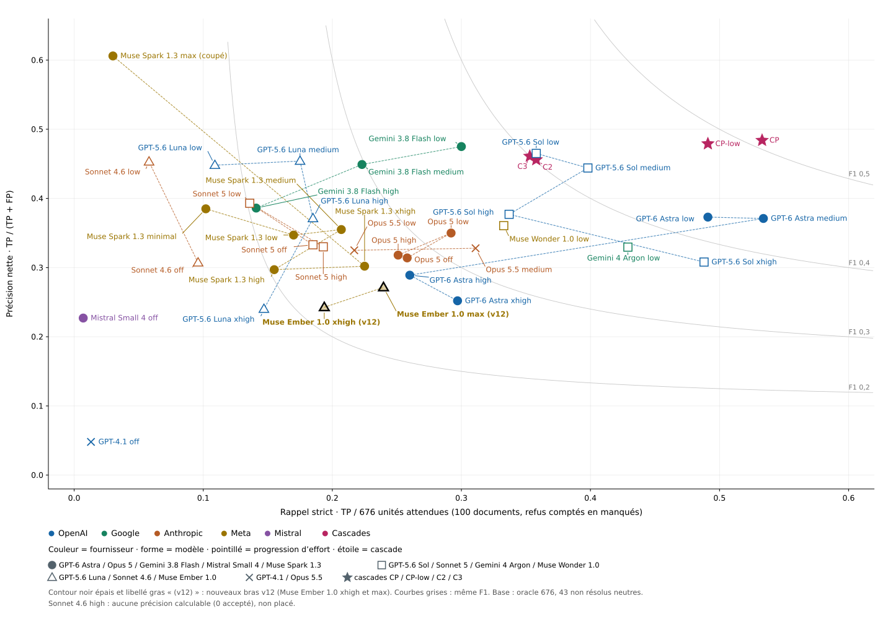
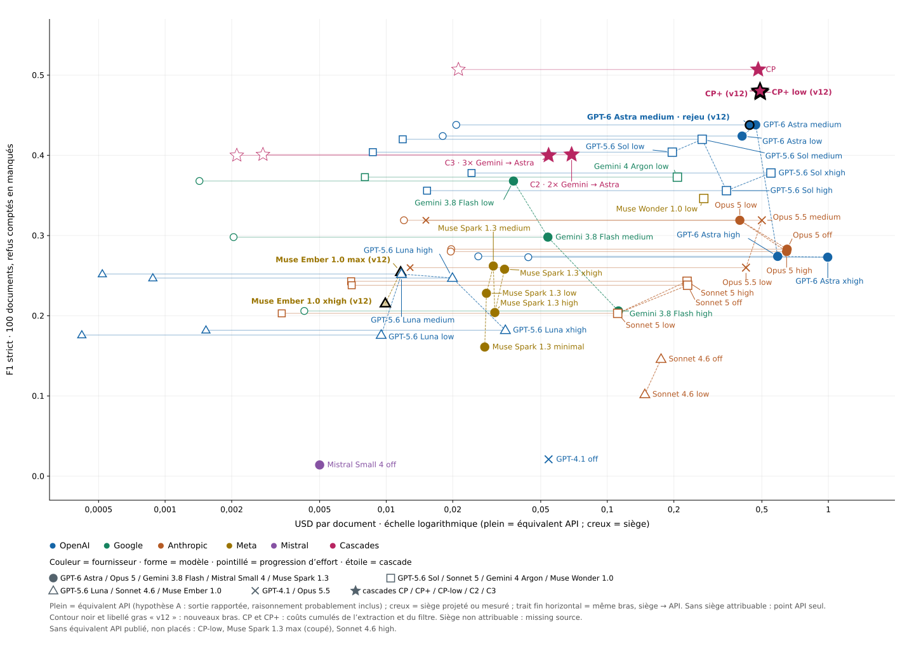
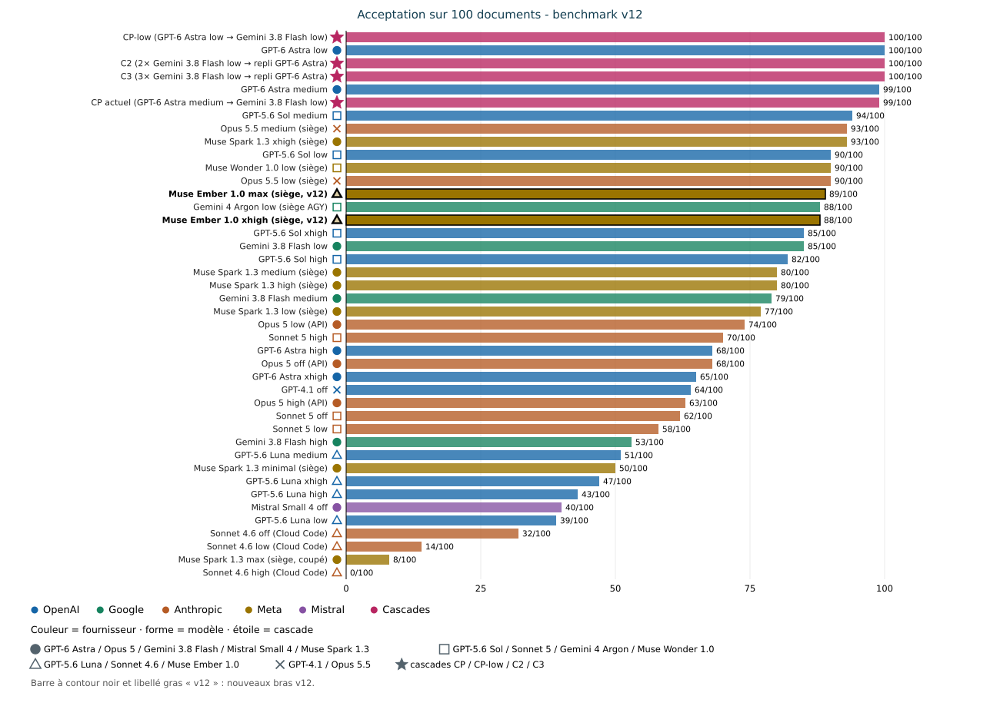
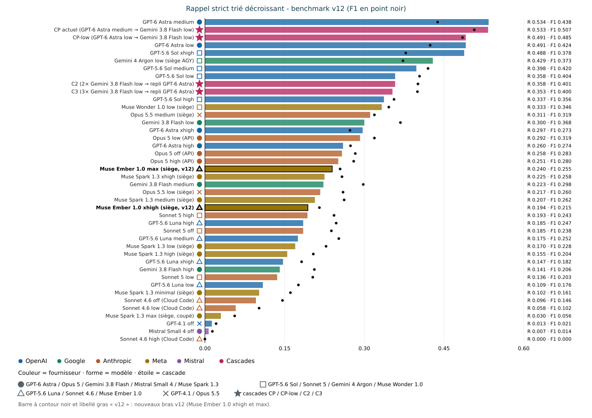

# Quel modèle pour lire les documents municipaux ?

**Benchmark v12 · Rapport complet · 13 novembre 2026**
Rédaction : lane benchmark B (conductor i-cond) ; base v11 (9 novembre 2026), v10 (v101b, oracle 674) et v11alpha (oracle 676, #725).

**Ce qui change depuis v11** (dossier `benchmark-v11-2026-11-09`, laissé intact) :

- deux nouveaux bras, **Muse Ember 1.0 xhigh et Muse Ember 1.0 max** (`muse-ember-1.0`, siège Muse), mesurés selon la même méthode, pour évaluer un secours du refresh après le retrait de Gemini (exécution 2026-11-13 UTC) ;
- les quatre graphiques reprennent le style du v10 (v101b) : couleur = fournisseur, forme = modèle, pointillé = progression d'effort, étoile = cascade, libellé à côté de chaque point ;
- noms complets des modèles, avec version, dans les tableaux et les graphiques (correspondance en §2) ;
- tableau « Meilleurs bras » ci-dessous, calculé depuis les données ;
- surface d'accès de la CLI Muse déclarée (§2, §9) : 1 appel(s) d'outil sur 200 documents Ember, 4 documents à deux réponses modèle ; score publié inchangé, sensibilité donnée, exclusion laissée à l'owner.
- cascade CP+ mesurée : GPT-6 Astra medium rejoué, puis Muse Spark 1.3 xhigh en relecteur ; résultats et quotas dans la section « CP+ mesurée ».

Toutes les valeurs v11 sont reprises sans modification ; seuls les rangs positionnels sont recalculés sur 42 lignes.

## Meilleurs bras (v12)

Calculé depuis les 42 lignes du tableau global (§3), le rejeu Astra et CP+ mesurée, oracle 676. Coûts en USD hors taxes par document ; `missing source` = non mesuré, jamais estimé. Le rapport F1 / coût est F1 strict divisé par le coût par document. Le rapport F1 / coût API dépend d'une hypothèse non tranchée : la page tarifaire Meta ne dit pas si les jetons de raisonnement Muse sont facturés comme sortie. Hypothèse A (convention du tableau global) : sortie rapportée, raisonnement probablement inclus ; hypothèse B : raisonnement facturé en sortie (Muse Ember 1.0 xhigh 0.0120, max 0.0154 ; Muse Wonder 1.0 low 0.2910 ; autres lignes inchangées). Gagnant selon A : Muse Ember 1.0 max (siège) ; selon B : GPT-5.6 Luna medium.

| Critère | Modèle complet | Effort | P | R | F1 strict | Équiv. API USD/doc | USD siège/doc | Valeur |
|---|---|---|---|---|---|---|---|---|
| Meilleur F1 strict (toutes lignes) | CP actuel : GPT-6 Astra → Gemini 3.8 Flash | medium → low | 0.484 | 0.533 | 0.507 | 0.4813 | 0.0212 | F1 0.507 |
| Meilleur rappel strict | GPT-6 Astra | medium | 0.371 | 0.534 | 0.438 | 0.4689 | 0.0207 | R 0.534 |
| Meilleur bras seul (hors cascade), F1 strict | GPT-6 Astra | medium | 0.371 | 0.534 | 0.438 | 0.4689 | 0.0207 | F1 0.438 |
| Meilleur rapport F1 / coût API — hypothèse A : sortie rapportée, raisonnement probablement inclus | Muse Ember 1.0 (siège) | max | 0.271 | 0.240 | 0.255 | 0.0116 | missing source | 21.9 F1 par USD/doc ; second : Muse Ember 1.0 xhigh (siège) 21.7 ; GPT-5.6 Luna medium (gagnant de l'autre hypothèse) : 21.5 |
| Meilleur rapport F1 / coût API — hypothèse B : raisonnement facturé en sortie | GPT-5.6 Luna | medium | 0.454 | 0.175 | 0.252 | 0.0117 | 0.00052 | 21.5 F1 par USD/doc ; second : GPT-5.6 Luna low 18.5 ; Muse Ember 1.0 max (siège) (gagnant de l'autre hypothèse) : 16.5 (coût API retenu : 0.0117) |
| Meilleur rapport F1 / coût — siège (lignes avec siège attribuable) | GPT-5.6 Luna | medium | 0.454 | 0.175 | 0.252 | 0.0117 | 0.00052 | 484.6 F1 par USD/doc |

## 1. Résumé exécutif

Le socle **v11** (sans « alpha ») intègre les lignes v11alpha, le bras **Muse Wonder low** complet et le nouveau bras **Gemini Argon low**, selon strictement la même méthode que v11alpha : mêmes prompts gelés (revérifiés `count=100, fail=0`), même validateur v9 gelé + provenance, même scoreur oracle 676 (43 non résolus neutres). Différence de protocole, déclarée exactement : **concurrence 10** pour Muse Wonder low ; pour Gemini Argon low, échantillon final **mixte** — passage principal en concurrence 10 puis reprises séquentielles des échecs d'infrastructure (140 tentatives, 100 documents distincts réussis, 18 documents repris ; détail §2). Aucune valeur publiée en v10 ou v11alpha n'est altérée ; les nouvelles lignes s'ajoutent.

- **Muse Wonder low** (`muse-wonder-1.0`, siège Muse) : 90/100 acceptés, P 0.361, R 0.333, F1 strict 0.346 — rang 12 au tri par rappel.
- **Gemini Argon low** (`gemini-4-argon-low`, siège AGY / Gemini Ultra) : 88/100 acceptés, P 0.330, R 0.429, F1 strict 0.373 — rang 6 au tri par rappel.
- **Muse Ember 1.0 xhigh** (`muse-ember-1.0`, siège Muse, nouveau en v12) : 88/100 acceptés, P 0.243, R 0.194, F1 strict 0.215 — rang 25 au tri par rappel ; équivalent API 0.00991 USD/doc (jetons réels du bras, n=100) ; USD siège/doc `missing source`.
- **Muse Ember 1.0 max** (`muse-ember-1.0`, siège Muse, nouveau en v12) : 89/100 acceptés, P 0.271, R 0.240, F1 strict 0.255 — rang 20 au tri par rappel ; équivalent API 0.0116 USD/doc (jetons réels du bras, n=100) ; USD siège/doc `missing source`.
- **Secours du refresh sans Gemini** (demande owner du 12/11) : Ember n'est pas un remplaçant à qualité égale de Gemini 3.8 Flash low. Meilleur effort mesuré : max, F1 0,255 contre 0,368 pour Gemini 3.8 Flash low et 0,346 pour Muse Wonder 1.0 low ; acceptation 89/100 ; équivalent API 0.0116 USD/doc. Secours plausible seulement en dernier recours bon marché, derrière Muse Wonder 1.0 low (détail §8).
- Sur les 42 lignes historiques, le **combo CP actuel** reste en tête en F1 (0,507) ; aucun modèle seul ne l'égale. Le tri du tableau global v12 est par **rappel décroissant** (consigne du dossier), le F1 reste affiché.
- Coûts : équivalents API calculés depuis les jetons réels et des tarifs publics relevés sur **sources secondaires** datées (section 6 ; tarifs marqués `unverified`, aucune page tarifaire primaire citée avec URL exacte). Coût siège **Gemini Argon low mesuré par burn `/usage`** : 0,00801 USD/doc (part hebdomadaire mesurée × prix hebdomadaire du palier Google AI Ultra 20x à 199,99 USD/mois ; relevés bruts en section 6). Coût siège **Muse Wonder low : `missing source`** (compteur `muse usage` lu avant/après, bascule partagée avec les sessions du compte, non attribuable — relevés complets en section 6). Rien n'est estimé à la place. Exception v12 : le tarif `muse-ember-1.0` est relevé sur la page primaire Meta (§6) ; coût siège Muse Ember 1.0 : `missing source` (compteur partagé, non attribuable).

## 2. Protocole

- Corpus : 100 documents du manifeste v101b (sha256 PDF vérifiés), prompts gelés sha256 identiques au v10, validation profil v9 + provenance, notation oracle v3 stricte sur **oracle 676** (#725, 43 non résolus neutres). Règle « Fair Benchmarking — No Cheating » (`rules/MASTER.md`) : métriques gelées avant notation, appliquées à l'identique, aucune fabrication, traçabilité complète.
- **Noms complets des modèles (v12)** — tableaux et graphiques : GPT-6 Astra = `gpt-6-astra` ; GPT-5.6 Sol = `gpt-5.6-sol` ; GPT-5.6 Luna = `gpt-5.6-luna` ; GPT-4.1 = `gpt-4.1` ; Gemini 4 Argon = `gemini-4-argon-low` ; Gemini 3.8 Flash = `gemini-3.8-flash` ; Opus 5.5 = `claude-opus-5-5` ; Opus 5 = `claude-opus-5` ; Sonnet 5 = `claude-sonnet-5` ; Sonnet 4.6 = `claude-sonnet-4.6` ; Muse Spark 1.3 = `muse-spark-1.3` ; Muse Wonder 1.0 = `muse-wonder-1.0` ; Muse Ember 1.0 = `muse-ember-1.0` ; Mistral Small 4 = `mistral-small-2603`. Cascades : CP actuel = GPT-6 Astra medium puis vérification Gemini 3.8 Flash low ; CP-low = GPT-6 Astra low puis Gemini 3.8 Flash low ; C2 = 2 essais Gemini 3.8 Flash low puis repli GPT-6 Astra (politique historique #719) ; C3 = 3 essais Gemini 3.8 Flash low puis repli GPT-6 Astra (variante documentaire v10). Sources : rapport v10 §« Noms des modèles » et §« les deux cascades reconstruites », v11alpha §1. Le texte courant garde les noms courts (Astra = GPT-6 Astra, etc.).
- **Gemini Argon low** — modèle exact `gemini-4-argon-low` (catalogue AGY relevé le 2026-11-09 : `gemini-4-argon-{low,medium,high}`, effort encodé dans l'identifiant). Transport siège headless AGY, uniforme sur les 100 documents : `agy --model gemini-4-argon-low --input-format stream-json --output-format stream-json`, ligne d'entrée `{"event":"user","message":{"content":<octets du prompt gelé>}}`, fichier brut = `result.response` de l'événement final. Le canal stdin remplace le canal argv (`--print=<prompt>`) qui heurte la limite Linux de 128 Kio par argument (`spawn E2BIG`) sur les plus gros prompts gelés : un premier passage argv (53/100 documents, 3 erreurs d'outillage, arrêt E2BIG avant toute validation ni notation) est archivé sous `arms/gemini-argon-low/pass1-print-raw/` et n'est **pas** noté. La CLI AGY ajoute son propre contexte d'agent autour du prompt gelé : l'écart avec un appel API brut n'est **pas mesuré** (même réserve que les bras Opus 5.5 `claude -p` de v11alpha).
- **Surface d'accès AGY (déclaration complète)** — wrapper : CLI AGY (`agy`, Antigravity) en mode headless `stream-json` stdin/stdout, siège uniquement (aucune clé API ; aucun drapeau de restriction d'outils passé par le runner). Contexte ajouté : la CLI ajoute son propre contexte d'agent autour du contenu du tour utilisateur (les octets du prompt gelé, envoyés tels quels) ; écart avec un appel API brut **non mesuré** (même réserve que les bras Opus 5.5 `claude -p --system-prompt-file` de v11alpha). Répertoire de travail (`cwd`) du processus AGY : la racine du dépôt benchmark, qui contient `tmp/bench-wonder/` (prompts gelés, oracle 676, corpus, sorties des bras). Outils actifs : l'événement `init` du premier flux archivé liste 60 outils disponibles, dont `view_file`, `run_command`, `grep_search`, `search_web`, `call_mcp_tool`, `read_url_content`, en mode d'autorisation `request-review`, sans restriction appliquée par le runner. Usage effectif observé sur les 100 flux notés : étapes `user_input` puis `agent_response` uniquement, **aucun appel d'outil**, 100 événements `result` en `SUCCESS`. La comparaison avec les transports `claude -p --system-prompt-file` (v11alpha) et API reste donc asymétrique en surface d'accès déclarée, pas seulement en contexte ; aucun score n'est invalidé (aucun outil utilisé pendant l'extraction).
- **Muse Wonder low** — `muse-wonder-1.0`, `muse exec --provider meta --reasoning-effort low --prompt-file <prompt gelé>`, siège Muse, déjà exécuté (100/100, 0 événement quota). Colonnes complétées ici par capture d'usage `--json` sur l'échantillon burn (jetons réels fournisseur).
- **Muse Ember 1.0 xhigh et Muse Ember 1.0 max** (nouveau en v12) — modèle exact `muse-ember-1.0`, commande `muse exec --provider meta --model muse-ember-1.0 --contributor-mode off --reasoning-effort {xhigh|max} --prompt-file <prompt gelé> --json`, siège Muse (palier « Muse Code Max Usage »), runner versionné `full/run-arm-ember.sh`, notation `full/score-ember.mjs` (même `scoreSource` que Wonder). Mêmes prompts gelés : reconstruits par `prepare-prompts.mjs` (`DONE ok=100 fail=0`, `verify.json` identique au `prompts-verify.json` versionné) et 100/100 octet-identiques aux prompts du bras Wonder. Corpus : 100/100 textes vérifiés par sha256 contre le manifeste (`dl-corpus.mjs`, reprise), une partie téléchargée ou relue depuis les caches PDF locaux, le reste (dont les 11 URL mortes) repris du clone d'exécution Wonder `tmp/bench-wonder`, chaque texte revérifié contre le manifeste. Même validateur v9 + provenance, même oracle 676. **`--contributor-mode off`** : avec `--preset empty`, la CLI résout `muse-ember-1.0` vers la variante cachée `muse-ember-1.0-contributor` (refus « lack access ») ; la commande du bras, sans `--preset`, résout `model_id` `muse-ember-1.0` avec et sans le drapeau (vérifié le 2026-11-13) ; le drapeau est passé pour figer l'identifiant public, et `model_id` `muse-ember-1.0` est relevé sur 100/100 et 100/100 documents. Répertoire de travail de la CLI : dossier vide hors dépôt, comme `/tmp/wonder-run` pour Wonder (même contexte CLI : espace non approuvé, aucune règle de projet chargée). **Écarts déclarés** : concurrence **4** (Wonder : 10) ; capture `--json` sur **le bras complet** (Wonder : bras en texte brut, puis burn `--json` n=10) — le texte terminal `run.terminal.completed` est extrait par `extract-usage.mjs` vers `raw/` avant validation, et les jetons réels couvrent tous les documents ; `--contributor-mode off` ajouté (absent de la commande Wonder). Événements quota : xhigh 0, max 0 ; garde hebdomadaire 85 % jamais atteinte.
- **Surface d'accès de la CLI Muse (bras Ember, déclaration complète)** — wrapper : CLI `muse exec` 1.4.18 en mode headless `--json`, siège uniquement (aucune clé API). Aucun drapeau de restriction d'outils n'est passé : ni `--disable-web-tools`, ni `--disable-reminders`, ni `--max-model-steps`. Outils disponibles : outils natifs de la CLI (dont `bash`, exécuté sur l'hôte), outils web non désactivés, et le serveur MCP utilisateur `h2a` activé (`muse mcp list`). Le flux `--json` n'expose pas le catalogue : la liste exacte et le nombre d'outils restent `unverified`. Skills chargées : 49 loaded · 1 warning · 33 details hidden (catalogue `skills_catalog` tronqué à 32 Ko ; espace non approuvé, skills de projet ignorées, délégation d'agent indisponible). **Appels d'outil observés : 1 document(s) sur 200** — Muse Ember 1.0 xhigh `sacre-coeur-2026-05-11` : `tool.bash` (success, fichiers `/tmp/build.js` et `/tmp/out.json`). Pour ce document, le modèle a écrit puis exécuté un script Node qui a produit le JSON ; la réponse finale est identique (JSON égal, vérifié le 2026-11-13) au fichier `/tmp/out.json` écrit par l'outil ; ce document est accepté et noté. **Tours supplémentaires : 4 document(s) sur 200** avec deux réponses modèle au lieu d'une — Muse Ember 1.0 xhigh `sacre-coeur-2026-05-11`, Muse Ember 1.0 xhigh `sainte-christine-2026-04-07`, Muse Ember 1.0 max `amherst-2026-06-08`, Muse Ember 1.0 max `val-racine-2026-06-09`. Le second tour suit un rappel de la CLI (`verify-reminder` ou `goal-reminder`) ou le retour de l'outil ; les 196 autres documents ont une seule réponse modèle. Les tâches de rappel (`skill-reminder`, `goal-reminder`, `verify-reminder`) sont proposées par la CLI sur chaque document. **Le score publié n'est pas modifié** : l'exclusion éventuelle du document avec appel d'outil est laissée à l'owner (sensibilité en §8 et §9). Risque déclaré : le script de l'outil écrit dans `/tmp` de l'hôte (`/tmp/build.js`, `/tmp/out.json`) ; en concurrence 4, deux documents utilisant les mêmes chemins pourraient entrer en collision. Un seul document a utilisé un outil ici, donc aucune collision n'a eu lieu entre documents Ember ; un autre processus de la machine écrivant ces chemins n'est pas exclu (`unverified`). Pour **Muse Wonder low**, la même surface est `unverified` : le bras a été capturé en texte brut, sans flux d'événements.
- Sièges uniquement, aucune clé API. Reprise sur quota de siège : attente 300 s, maximum 12 tentatives, jamais de bascule clé, le quota n'est jamais compté comme un refus. Argon : 0 événement(s) quota sur le passage noté ; Wonder : 0.
- **Concurrence** (au lieu de 1 en v11alpha), énoncée exactement : Muse Wonder low a été exécuté en concurrence 10. Pour Gemini Argon low, l'échantillon final noté est **mixte** : passage principal en concurrence 10, puis reprises **séquentielles** (concurrence 1, `run-arm-argon-retry.mjs`) des échecs d'infrastructure — le `meta.jsonl` du bras compte 140 tentatives pour 100 documents distincts réussis, 40 tentatives en erreur et 18 documents repris. Les latences p50/p90 des deux bras v11 (Muse Wonder low, Gemini Argon low) sont mesurées sous cette concurrence et **ne sont pas comparables** aux colonnes de latence v10/v11alpha. P, R, F1 et acceptés ne dépendent pas de la concurrence.
- Incidents d'infrastructure Argon (jamais comptés comme refus ni quota) : erreurs de construction de boîte à outils AGY (`mcp_h2a_render_BarChart`, `$ref` distant résolu en URL fichier), authentification expirée et flux interrompus. Cause établie par reproduction : en séquentiel, aucune erreur d'outillage ; en rafale de 10 démarrages simultanés, les constructions de boîte à outils entrent en collision. Les échecs ont été repris par relances du runner (seules les sorties non vides sont sautées), les derniers documents en séquentiel avec la même commande et les mêmes octets. Les flux des réponses réussies ne contiennent aucun appel d'outil (étapes `user_input` puis `agent_response`) : la boîte à outils n'intervient pas dans l'extraction.

## 3. Tableau global — tri par rappel décroissant (oracle 676)

42 lignes : 38 lignes v11alpha recopiées sans rescoring, plus Muse Wonder low et Gemini Argon low (9 novembre), puis Muse Ember 1.0 xhigh et Muse Ember 1.0 max (nouveaux en v12). ᵃ = valeur du rapport v10 (oracle 674) telle que publiée en v11alpha. USD hors taxes ; `missing source` = jamais estimé.
<!-- page:wide -->
| # (rappel) | Modèle · effort | Acceptés /100 | P | R | F1 strict | Équiv. API USD/doc | USD siège/doc |
|---|---|---|---|---|---|---|---|
| 1 | GPT-6 Astra medium | 99 | 0.371 | 0.534 | 0.438 | 0.4689 | 0.0207 |
| 2 | CP actuel (GPT-6 Astra medium → Gemini 3.8 Flash low) | 99 | 0.484 | 0.533 | 0.507 | 0.4813 | 0.0212 |
| 3 | CP-low (GPT-6 Astra low → Gemini 3.8 Flash low) | 100 | 0.479 | 0.491 | 0.485 | missing source | missing source |
| 4 | GPT-6 Astra low | 100 | 0.373 | 0.491 | 0.424 | 0.4072 | 0.0180 |
| 5 | GPT-5.6 Sol xhigh | 85 | 0.308 | 0.488 | 0.378 | 0.5498 | 0.0243 |
| 6 | **Gemini 4 Argon low (siège AGY)** | 88 | 0.330 | 0.429 | 0.373 | 0.2074 | 0.00801 |
| 7 | GPT-5.6 Sol medium ᵃ | 94 | 0.444 | 0.398 | 0.420 | 0.2686 | 0.0119 |
| 8 | GPT-5.6 Sol low ᵃ | 90 | 0.465 | 0.358 | 0.404 | 0.1967 | 0.00870 |
| 9 | C2 (2× Gemini 3.8 Flash low → repli GPT-6 Astra) ᵃ | 100 | 0.456 | 0.358 | 0.401 | 0.0689 | 0.00277 |
| 10 | C3 (3× Gemini 3.8 Flash low → repli GPT-6 Astra) ᵃ | 100 | 0.461 | 0.353 | 0.400 | 0.0543 | 0.00211 |
| 11 | GPT-5.6 Sol high | 82 | 0.377 | 0.337 | 0.356 | 0.3460 | 0.0153 |
| 12 | **Muse Wonder 1.0 low (siège)** | 90 | 0.361 | 0.333 | 0.346 | 0.2731 | missing source |
| 13 | Opus 5.5 medium (siège) | 93 | 0.328 | 0.311 | 0.319 | 0.4999 | 0.0151 |
| 14 | Gemini 3.8 Flash low | 85 | 0.475 | 0.300 | 0.368 | 0.0376 | 0.00143 |
| 15 | GPT-6 Astra xhigh | 65 | 0.252 | 0.297 | 0.273 | 0.9929 | 0.0439 |
| 16 | Opus 5 low (API) ᵃ | 74 | 0.350 | 0.292 | 0.319 | 0.3976 | 0.0120 |
| 17 | GPT-6 Astra high | 68 | 0.289 | 0.260 | 0.274 | 0.5896 | 0.0261 |
| 18 | Opus 5 off (API) ᵃ | 68 | 0.314 | 0.258 | 0.283 | 0.6507 | 0.0197 |
| 19 | Opus 5 high (API) ᵃ | 63 | 0.318 | 0.251 | 0.280 | 0.6472 | 0.0196 |
| 20 | **Muse Ember 1.0 max (siège)** | 89 | 0.271 | 0.240 | 0.255 | 0.0116 | missing source |
| 21 | Muse Spark 1.3 xhigh (siège) | 93 | 0.302 | 0.225 | 0.258 | 0.0343 | missing source |
| 22 | Gemini 3.8 Flash medium | 79 | 0.449 | 0.223 | 0.298 | 0.0539 | 0.00204 |
| 23 | Opus 5.5 low (siège) | 90 | 0.325 | 0.217 | 0.260 | 0.4239 | 0.0128 |
| 24 | Muse Spark 1.3 medium (siège) | 80 | 0.355 | 0.207 | 0.262 | 0.0305 | missing source |
| 25 | **Muse Ember 1.0 xhigh (siège)** | 88 | 0.243 | 0.194 | 0.215 | 0.00991 | missing source |
| 26 | Sonnet 5 high ᵃ | 70 | 0.330 | 0.193 | 0.243 | 0.2295 | 0.00694 |
| 27 | GPT-5.6 Luna high | 43 | 0.371 | 0.185 | 0.247 | 0.0199 | 0.00088 |
| 28 | Sonnet 5 off ᵃ | 62 | 0.333 | 0.185 | 0.238 | 0.2307 | 0.00698 |
| 29 | GPT-5.6 Luna medium | 51 | 0.454 | 0.175 | 0.252 | 0.0117 | 0.00052 |
| 30 | Muse Spark 1.3 low (siège) | 77 | 0.347 | 0.170 | 0.228 | 0.0284 | missing source |
| 31 | Muse Spark 1.3 high (siège) | 80 | 0.297 | 0.155 | 0.204 | 0.0310 | missing source |
| 32 | GPT-5.6 Luna xhigh ᵃ | 47 | 0.240 | 0.147 | 0.182 | 0.0346 | 0.00153 |
| 33 | Gemini 3.8 Flash high | 53 | 0.386 | 0.141 | 0.206 | 0.1123 | 0.00426 |
| 34 | Sonnet 5 low ᵃ | 58 | 0.393 | 0.136 | 0.203 | 0.1114 | 0.00337 |
| 35 | GPT-5.6 Luna low | 39 | 0.448 | 0.109 | 0.176 | 0.00949 | 0.00042 |
| 36 | Muse Spark 1.3 minimal (siège) | 50 | 0.385 | 0.102 | 0.161 | 0.0279 | missing source |
| 37 | Sonnet 4.6 off (Cloud Code) | 32 | 0.307 | 0.096 | 0.146 | 0.1750 | missing source |
| 38 | Sonnet 4.6 low (Cloud Code) | 14 | 0.453 | 0.058 | 0.102 | 0.1478 | missing source |
| 39 | Muse Spark 1.3 max (siège, coupé) | 8 | 0.606 | 0.030 | 0.056 | missing source | missing source |
| 40 | GPT-4.1 off | 64 | 0.048 | 0.013 | 0.021 | 0.0542 | missing source |
| 41 | Mistral Small 4 off | 40 | 0.227 | 0.007 | 0.014 | 0.00500 | missing source |
| 42 | Sonnet 4.6 high (Cloud Code) | 0 | N-A | 0.000 | 0.000 | missing source | missing source |

Lecture : le tri par rappel met Astra medium (R 0,534) et CP (R 0,533) en tête ; CP reste premier en F1 (0,507) et en précision (0,484). Gemini Argon low et Muse Wonder low se classent par leur rappel respectif (voir rangs ci-dessus). les coûts siège historiques valent `API × facteur fournisseur` mesuré par burn en v10 (Codex 0,044235 ; Google 0,037931 ; Claude 0,030248) ; Gemini Argon low reçoit un facteur mesuré par burn `/usage` (section 6), Muse Wonder low reste sans part attribuable : `missing source`. Nouveau en v12 : Muse Ember 1.0 xhigh au rang 25 (R 0,194, F1 0,215), Muse Ember 1.0 max au rang 20 (R 0,240, F1 0,255) ; USD siège/doc `missing source` (compteur Muse partagé, non attribuable, §6).

## CP+ mesurée

Mesure réelle du 13 novembre 2026 UTC. GPT-6 Astra medium extrait les 100 documents. Muse Spark 1.3 xhigh relit ensuite les sorties acceptées. Le filtre CP reste inchangé. Aucun acte ne peut être ajouté. Le compte « acceptés » désigne les sorties Astra passées au filtre. Les 42 lignes du tableau global restent intactes.

| Bras | Acceptés /100 | P | R | F1 strict | Actes jugés | Actes retirés | Équiv. API USD/doc | USD siège/doc |
|---|---|---|---|---|---|---|---|---|
| GPT-6 Astra medium (publié) | 99 | 0.371 | 0.534 | 0.438 | — | — | 0.4689 | 0.0207 |
| GPT-6 Astra medium (rejeu v12) | 100 | 0.391 | 0.497 | 0.438 | — | — | 0.44027 | missing source |
| CP publié (Astra medium → Gemini 3.8 Flash low) | 99 | 0.484 | 0.533 | 0.507 | 912 | 229 | 0.4813 | 0.0212 |
| CP+ (Astra medium → Muse Spark 1.3 xhigh) | 100 | 0.467 | 0.494 | 0.480 | 852 | 143 | 0.49055 | missing source |

Le rejeu gagne en précision face à Astra medium publié, mais perd en rappel. Son F1 reste à 0,438. CP+ porte le F1 du rejeu de 0,438 à 0,480. Il reste sous le CP publié : P 0,467 contre 0,484 ; R 0,494 contre 0,533 ; F1 0,480 contre 0,507. Son équivalent API est aussi supérieur : 0,49055 contre 0,48134 USD/doc. Ces deux cascades partent de passages Astra distincts. Le tableau « Meilleurs bras » inclut les deux nouvelles mesures. Ses gagnants restent inchangés. Le v12 ne pose aucune décision.

Notation : oracle 676, 43 non résolus neutres, scoreur strict inchangé. Rejeu : TP 336, FP 523, FN 340. CP+ : TP 334, FP 381, FN 342. Le gain du filtre se mesure contre le rejeu qui lui sert de source. Le bras publié reste une autre exécution.

Relecture : 100 invocations CLI abouties et 3 tentatives interrompues ; 103 tâches de réponse modèle observées dans les flux, y compris les tentatives interrompues. Le scoreur vérifie dans meta.jsonl 100 réponses valides, une par document, 0 doublon. Il reproduit aussi chaque sortie filtrée depuis la décision archivée. Bilan : 852 actes jugés, 143 retirés. Décisions absentes ou invalides : 0 actes conservés. Extraits « soutenu » non retrouvés : 0 actes conservés. Ces règles sont celles de CP. Le bloc de filtre garde le SHA-256 cf015e57c6e1cd1404efc7e22ddb014da0e4851aba9befea9ef39cae46094b68. Les 99 messages CP archivés ont été reproduits octet pour octet avant le lancement.

**Transport et surface d’accès.** Rejeu : `CodexRuntimeClient`, llm-mesh 0.19.3, siège Codex, `gpt-6-astra`, effort medium, messages système et utilisateur gelés, format JSON objet. Aucun plafond de sortie, comme dans le bras v10/v11alpha. Le validateur v9 et la provenance sont inchangés. Le SDK reçoit un seul appel de génération par tentative. Aucun outil, skill ou tour d’agent n’est fourni. Le cwd de l’orchestrateur est vide, hors dépôt. Concurrence 4.

Relecteur : CLI Muse 1.4.18, siège, modèle public muse-spark-1.3, effort xhigh, --contributor-mode off, --json. Cwd vide hors dépôt. Concurrence 4. Aucun drapeau de restriction d’outils, de rappels ou de tours. Outils natifs, dont bash ; web non désactivé ; serveur MCP h2a configuré et activé. Exécution dans un conteneur Node 24, avec le binaire Muse du siège. Le catalogue exact d’outils et la disponibilité effective des outils hôtes restent unverified. Observation sur 103 flux : 0 document(s) avec outil ; 0 avec plusieurs réponses modèle. Histogramme des réponses : {"1":103}. Skills déclarées par la CLI : Skills: 47 loaded · 1 warning · 16 details hidden. Les preuves détaillées sont dans surface.json.

Documents avec outil : aucun. Documents à plusieurs réponses : aucun. Le contexte d’agent et les outils disponibles diffèrent d’un appel API brut. Cette surface est déclarée ; aucun document avec outil n’est exclu après coup.

**Quotas et reprises.** Codex hebdomadaire : 67 % avant → 79 % après ; 0 événement(s) quota. Muse hebdomadaire : 84 % au lancement → 85 % à la fin. La relecture s’est arrêtée au seuil de 85 %, après 64 documents. Trois tentatives en cours ont été interrompues. Sur consigne de l’owner (« n’arrête pas à 85 % »), elle a repris sans seuil. Les documents déjà relus ont été sautés. Un relancement intermédiaire a été interrompu à 78 documents, puis repris de la même façon. Les trois START de meta.jsonl précèdent respectivement 0, 64, 78 réponses valides. La dernière reprise termine 22 documents et en saute 78. Bilan cumulé : 100 décisions valides sur 100, 0 échec final, aucun doublon. Le résumé du dernier processus ne décrit pas seul toute la campagne. Les compteurs sont partagés avec les autres sessions du compte. Aucun coût siège n’est attribuable : missing source.

**Coûts.** Jetons réels sur les deux étages. Dénominateur : 100 documents du corpus. Extraction : entrée 1511249, sortie rapportée 578283. Relecture : entrée 4486203, cache 3043484, sortie rapportée 651386, raisonnement 577084. Tarifs Astra repris du calculateur v10 : 10 / 50 USD par million, entrée / sortie, sans réduction de cache. Tarif Spark confirmé sur la page primaire https://dev.meta.ai/models/muse-spark/ le 13 novembre 2026 : 1,25 / 0,15 / 4,25 USD par million, entrée / cache / sortie. Équivalent du second étage seul : 0.05028 USD par document du corpus.

Hypothèse A : sortie rapportée, raisonnement probablement inclus. Le coût CP+ du tableau additionne les deux étages. Hypothèse B : ajout séparé du raisonnement Muse, soit 0.51508 USD par document pour CP+. La page Meta ne tranche pas ce point. Les entrées Muse incluent le contexte propre de la CLI. Ce coût ne représente donc pas un appel API limité au seul prompt du filtre.

Périmètre du coût Muse : 100 invocations abouties avec usage enregistré. Les trois tentatives interrompues figurent dans l’audit des 103 flux, mais sans reçu d’usage exploitable. Leur coût API équivalent est missing source. Le montant CP+ du tableau est donc le total mesuré disponible ; il ne chiffre pas ces trois interruptions.

**Incident et exclusion.** Un premier passage a reçu des écritures de plusieurs runners. Il contient 99 réponses distinctes. Les traces montrent 16 fenêtres de tentatives réussies qui se chevauchent, attente d’acquisition comprise. La limite globale de quatre appels ne peut pas être attestée. Ce passage est archivé sous astra-medium-rejeu-overlap-20261113 et exclu des scores et coûts du tableau. Un lancement s’est terminé avec le code 137. Les conteneurs restants ont été arrêtés ou ont terminé. Les 100 documents ont ensuite été rejoués par un seul runner verrouillé. Le scoreur vérifie un maximum de quatre tentatives simultanées sur ce nouveau passage. Codex était à 61 % au premier contrôle de la lane, puis à 67 % avant ce nouveau rejeu. Ces variations de compteur partagé ne sont pas attribuées à un coût siège.

Preuves locales : tools/bench-v11/full/arms/astra-medium-rejeu/ et cp-plus-muse13-xhigh/ ; scores-astra-rejeu.json et scores-cp-plus.json. Runners, filtre et scoreur sont versionnés dans le harnais. Les sorties brutes et reçus sont conservés localement, hors Git.

## 4. Détail des bras siège

J = JSON invalide ; V = profil v9 refusé ; Pr = provenance ; T = transport / réponse vide. Pour les bras v11alpha, la colonne publiée était J · V · T (Pr non séparé : N-A ici, sans rescoring).

| Bras | Tentés | Acceptés | Échecs (J · V · Pr · T) | F1 net 4 doc | p50 s | p90 s | Sortie moy. (jetons) | Équiv. API USD/doc | USD siège/doc |
|---|---|---|---|---|---|---|---|---|---|
| Opus 5.5 low | 100 | 90 | 0 · 6 · N-A · 4 | 0.143 | 49 | 97 | 6188 | 0.4239 | 0.0128 |
| Opus 5.5 medium | 100 | 93 | 0 · 3 · N-A · 4 | 0.388 | 75 | 150 | 10269 | 0.4999 | 0.0151 |
| Muse Spark 1.3 minimal | 100 | 50 | 18 · 32 · N-A · 0 | 0.167 | 27 | 45 | N-A | 0.0279 | missing source |
| Muse Spark 1.3 low | 100 | 77 | 3 · 20 · N-A · 0 | 0.386 | 35 | 61 | N-A | 0.0284 | missing source |
| Muse Spark 1.3 medium | 100 | 80 | 2 · 18 · N-A · 0 | 0.515 | 63 | 102 | N-A | 0.0305 | missing source |
| Muse Spark 1.3 high | 100 | 80 | 10 · 10 · N-A · 0 | 0.415 | 76 | 147 | N-A | 0.0310 | missing source |
| Muse Spark 1.3 xhigh | 100 | 93 | 3 · 4 · N-A · 0 | 0.241 | 107 | 157 | N-A | 0.0343 | missing source |
| **Muse Wonder 1.0 low** | 100 | 90 | 1 · 9 · 0 · 0 | 0.306 | 48.3 ¹ | 108.1 ¹ | 5085 réelle (burn) | 0.2731 ² | missing source |
| **Gemini 4 Argon low** | 100 | 88 | 0 · 12 · 0 · 0 | 0.338 | 134.6 ¹ | 266.1 ¹ | 15528 réelle (bras) | 0.2074 ³ | 0.00801 ⁴ |
| **Muse Ember 1.0 xhigh** | 100 | 88 | 3 · 9 · 0 · 0 | 0.233 | 18.3 ⁵ | 25.9 ⁵ | 10492 réelle (bras) | 0.00991 ⁶ | missing source |
| **Muse Ember 1.0 max** | 100 | 89 | 2 · 9 · 0 · 0 | 0.209 | 22.3 ⁵ | 36.3 ⁵ | 14005 réelle (bras) | 0.0116 ⁶ | missing source |

¹ Concurrence : Wonder en concurrence 10 ; Argon en échantillon mixte (passage concurrence 10 + reprises séquentielles, voir §2) : non comparable aux latences v11alpha (concurrence 1). ² Tarif `muse-wonder-1.0` 4,00 / 0,20 (cache) / 20,00 USD par million de jetons (entrée / cache / sortie), relevé le 2026-11-03 sur **source secondaire** (voir §6 : tarif `unverified`, aucune page tarifaire primaire Meta citée) ; formule `[(I−C)×4 + C×0,20 + O×20]/10⁶` sur jetons réels du burn (n=10, seau S — voir limites §6). Avec raisonnement facturé en sortie : 0.2910. ³ Tarif `Gemini 4 Argon` 2,00 / 0,10 (cache) / 10,00 USD par million, relevé le 2026-11-03 sur **source secondaire** (voir §6 : tarif `unverified`, URL de la page tarifaire primaire Google non citée ; le passage à 4/20 au 2026-12-01 annoncé par ce relevé secondaire n'est pas vérifié sur source primaire) ; formule `[(I−C)×2 + C×0,10 + (O+T)×10]/10⁶` sur jetons réels du bras complet (n=100) ; burn (n=10, mesuré sous un autre mode d'invocation — voir §6) : 0.1351. ⁴ USD siège Argon : burn `/usage` (section 6), part hebdomadaire 0,000174153/doc × 45,9936 USD/semaine (Ultra 20x, 199,99 USD/mois) = 0,00801 USD/doc ; variante 5x cohérente (part ×4, 99,99 USD/mois) : 0,01602 USD/doc.

⁵ Ember : concurrence 4, temps mur de la dernière tentative par document ; non comparable aux latences v11alpha (concurrence 1) ni à Wonder (concurrence 10). ⁶ Tarif `muse-ember-1.0` 0,10 / 0,004 (cache) / 0,50 USD par million de jetons (entrée / cache / sortie, contexte ≤ 200 k ; au-delà 0,30 / 0,012 / 1,50), relevé le 2026-11-13 sur la **page primaire Meta** https://dev.meta.ai/models/muse-ember/ ; formule `[(I−C)×0,10 + C×0,004 + O×0,50]/10⁶` par document, palier haut appliqué au-delà de 200 000 jetons d'entrée (xhigh : 0 document(s) ; max : 0 document(s)), moyenne sur les jetons réels du bras complet. Avec raisonnement facturé en sortie : xhigh 0.0120, max 0.0154 (la page primaire ne dit pas si le raisonnement est inclus dans la sortie).

Détail Wonder : entrée réelle (burn n=10) 56791 / sortie réelle 5085 (raisonnement 893, cache 14665) ; bras complet : sortie estimée octets/4 4250 (unverified). Détail Argon : entrée réelle (bras, n=100) 26053 / sortie réelle 15528 (réflexion 0, cache 0). Scores secondaires (même scoreur) — Wonder : F1 broad 0.340, stage-tolerant 0.409, soft 0.355 (TP 225, FP 399, FN 451). Argon : F1 broad 0.365, stage-tolerant 0.447, soft 0.393 (TP 290, FP 590, FN 386).

Détail Ember (nouveau en v12) — xhigh : entrée réelle (bras, n=100) 51249 / sortie réelle 10492 (raisonnement 4193, cache 4819) ; F1 broad 0.210, stage-tolerant 0.306, soft 0.253 (TP 131, FP 409, FN 545). max : entrée réelle (bras, n=100) 50896 / sortie réelle 14005 (raisonnement 7562, cache 4871) ; F1 broad 0.246, stage-tolerant 0.353, soft 0.300 (TP 162, FP 435, FN 514).

<!-- page:wide -->

## 5. Latences

Les p50/p90 des bras v10/v11alpha (concurrence 1) restent ceux des rapports publiés (tableaux v10 §5 et v11alpha §3, non recopiés ici pour éviter toute altération). Bras v11 (Muse Wonder low, Gemini Argon low), concurrence 10 — **non comparables** : Muse Wonder low p50 48.3 s, p90 108.1 s ; Gemini Argon low p50 134.6 s, p90 266.1 s (temps mur des seules tentatives réussies distinctes ; échantillon final Argon mixte — passage principal en concurrence 10 et reprises séquentielles d'erreurs d'infrastructure, 140 tentatives pour 100 documents réussis, 18 documents repris — donc doublement non comparable ; événements quota Argon : 0). Sous concurrence 10, ces durées incluent l'attente d'ordonnancement du siège partagé. Nouveau en v12, Muse Ember en concurrence 4 (non comparable non plus) : xhigh p50 18.3 s, p90 25.9 s ; max p50 22.3 s, p90 36.3 s.

## 6. Coûts, sièges et tests de burn

Un accès API facture les jetons ; un siège est un abonnement à quota. Le burn mesure la consommation de quota sur un échantillon fixe (10 documents gelés, les 10 premiers du manifeste), avec relevés avant/après quand le fournisseur expose un compteur. Méthode v10 : `C_siège = C_API × f`, `f = S / É_mois` extrapolé de la fraction de quota consommée. Sans bascule de compteur attribuable, aucun facteur n'est dérivé : `missing source`. Correctif du 2026-11-09 (lane COST) : AGY expose bien un compteur d'allocation via la commande slash `/usage`, lisible en headless ; l'affirmation inverse de la première version de ce dossier est retirée (méthode et relevés ci-dessous).

### Tarifs publics utilisés (source et date de relevé)

Statut des sources : aucun tarif ci-dessous n'est cité depuis la page tarifaire primaire du fournisseur avec son URL exacte. Chaque tarif est donc présenté explicitement comme relevé sur **source secondaire** et marqué `unverified` ; aucun n'est présenté comme une page officielle. Seule exception de disponibilité (pas de prix) : la page officielle des abonnements Google a été réouverte le 2026-11-09 (voir dernière ligne des sources §9).

Exception ajoutée en v12 : le tarif `muse-ember-1.0` est relevé sur la **page primaire Meta** (URL exacte dans le tableau), concordant avec deux relevés secondaires (llmgateway.io, llmreference.com).

| Objet | Tarif | Source | Relevé |
|---|---|---|---|
| `muse-wonder-1.0` (équivalent API) | 4,00 entrée / 0,20 cache / 20,00 sortie USD par M jetons — `unverified` | **Source secondaire** (agrégateur) : https://superagnt.com/muse/pricing ; sentisight.ai — aucune page tarifaire primaire Meta citée | 2026-11-03 |
| `Gemini 4 Argon` (équivalent API) | 2,00 entrée / 0,10 cache / 10,00 sortie USD par M jetons — `unverified` (le passage à 4/20 au 2026-12-01 vient du même relevé secondaire, non vérifié sur source primaire) | **Source secondaire** (agrégateur) : licenseware.io, se déclarant sourcé de la page Gemini Developer API pricing au 2026-11-03 — URL de la page primaire non citée ici | 2026-11-03 |
| `muse-ember-1.0` (équivalent API) | 0,10 entrée / 0,004 cache / 0,50 sortie USD par M jetons (contexte ≤ 200 k) ; 0,30 / 0,012 / 1,50 au-delà | **Page primaire Meta** : https://dev.meta.ai/models/muse-ember/ ; concordant : llmgateway.io/models/muse-ember-1.0, llmreference.com (Meta Model API) | 2026-11-13 |
| Google AI Ultra (siège AGY) | Palier affiché par l'en-tête de la session interactive AGY le 2026-11-09 : « Google AI Ultra » (multiplicateur 5x/20x non affiché par `/usage`) — 99,99 USD/mois (5x) ; 199,99 USD/mois (20x), US — `unverified` | **Source secondaire** : lilachbullock.com ; whizi.io (relevés concordants). Page officielle https://gemini.google/subscriptions réouverte le 2026-11-09 (édition Canada, Argon confirmé sur Pro et Ultra) pour la disponibilité, sans prix US cité ici | octobre 2026 |
| Muse (siège) | Power Usage 50 USD/mois ; Maximum Usage 200 USD/mois (Wonder Full inclus). Palier lu sur ce siège par `muse usage` : « Muse Code Max Usage » (= Maximum Usage) — `unverified` | **Source secondaire** (agrégateur) : https://superagnt.com/muse/pricing — aucune page tarifaire primaire Meta citée | 2026-11-03 |

Paliers lus dans cette lane : AGY « Google AI Ultra » (en-tête interactif ; multiplicateur non affiché, le calcul siège Argon est donc publié au prix 20x avec la variante cohérente 5x en regard) ; Muse « Muse Code Max Usage » (= Maximum Usage, 200 USD/mois). Aucun autre palier n'entre dans les calculs. Les prix restent des relevés secondaires `unverified` (voir statut des sources ci-dessus), revérifiés le 2026-11-09 (blog.laozhang.ai du 2026-11-06 ; limitdigest.com vérifié le 2026-11-09 ; engineerfoodie.in du 2026-10-29).

### Burn Muse Wonder low (siège Muse, compteur exposé)

Échantillon : 10 premiers documents du manifeste, `muse exec --provider meta --model muse-wonder-1.0 --reasoning-effort low --json` séquentiel (run-burn-wonder-usage10). Un premier essai Saint-Polycarpe a échoué sur timeout du runtime Muse (exit 1, usage nul) puis a réussi à la reprise ; il n'est pas compté comme un refus. Jetons réels moyens : entrée 56791/doc, sortie 5085/doc, raisonnement 893/doc, cache 14665/doc. Ces entrées incluent le contexte propre de la CLI Muse (contexte d'agent autour du prompt gelé) : l'équivalent API surestime donc le coût du seul prompt gelé en API brute — même réserve que les bras `claude -p` de v11alpha.

Relevés d'allocation (`run.usage.allowance`, source `stream`) : hebdomadaire 13 % au 2026-11-09T16:18:31.212Z → 14 % au 2026-11-09T17:06:37.392Z (réinitialisation 2026-11-16T00:00:00.000Z). La fenêtre courte a basculé entre-temps (réinitialisation intermédiaire) et n'est pas comparable. Le compteur hebdomadaire est partagé avec toutes les sessions du compte, y compris la session conductrice : la bascule observée (+1 point entier, granularité ±1 point) n'est pas attribuable au seul échantillon. Relevés directs `muse usage` (sans tour modèle, lane COST du 2026-11-09, même échantillon séquentiel de 10 documents, `muse exec --json` ; jetons du burn mesuré : entrée 60 345/doc, sortie 4 875/doc) : palier « Muse Code Max Usage », hebdomadaire 19 % au 2026-11-09T20:28:54.912Z → 20 % au 2026-11-09T20:53:04.883Z (réinitialisation 2026-11-16T00:00:00.000Z), fenêtre courte 16 % → 19 % (réinitialisation 2026-11-09T21:26:11.000Z). Pendant ce burn, 15 à 16 processus Muse du même compte étaient actifs (sessions interactives, exécutions `muse exec` tierces et la session conductrice elle-même) : la bascule hebdomadaire de +1 point (granularité entière, identique en `muse usage --json` et en `run.usage.allowance`) couvre donc le burn plus cette activité concurrente. Si elle était attribuée en totalité au burn (hypothèse haute, réfutée par la fenêtre courte à +3 points), la part vaudrait 0,1 point/doc, soit 0,0460 USD/doc à 200 USD/mois. **USD siège/doc Muse Wonder low : `missing source`** (compteur lu par `muse usage` et par `run.usage.allowance`, dérivation non attribuable ; palier « Muse Code Max Usage » = Maximum Usage établi).

### Burn Gemini Argon low (siège AGY / Google AI Ultra, compteur `/usage` mesuré)

Échantillon : mêmes 10 documents, séquentiel (run-burn-argon). **Écart de mode d'invocation (déclaré)** : le burn publié ici a été mesuré sous le canal argv `agy --model gemini-4-argon-low --output-format json --print=<prompt>`, un mode **différent** de celui du bras noté (`stream-json` sur stdin, uniforme sur les 100 documents). L'équivalent API du burn (0.1351) est donc mesuré sous un autre transport que le bras et n'est pas strictement comparable ; l'équivalent principal (0.2074), calculé sur les jetons du bras `stream-json` complet, n'est pas affecté. Le runner versionné `run-burn-argon.mjs` utilise désormais le même mode `stream-json` que le bras noté, pour toute mesure future. Jetons réels moyens du burn : entrée 17616/doc, sortie 9983/doc, réflexion 0/doc (horodatages par document dans `burn-argon-usage10/*.usage.json`). Ces entrées incluent le contexte d'agent AGY (voir avertissement en synthèse ci-dessous). Lecture du compteur (lane COST du 2026-11-09) : `/usage` est une commande slash de la CLI AGY (alias `quota`, « View model quota usage »), lisible en headless par `agy -p "/usage"` (texte, pourcentages entiers) et `agy -p "/usage" --output-format json` (champ `command.data.groups[].buckets[].remaining_fraction`, précision fine). La commande ne consomme aucun jeton (`num_turns` 0, usage nul) et n'apparaît ni dans `--help` ni parmi les sous-commandes. Burn mesuré : mêmes 10 documents gelés, même runner que le burn initial (`agy --model gemini-4-argon-low --output-format json --print`), concurrence 1, aucun autre processus `agy` actif sur le siège pendant le burn (vérifié par `ps`). Relevés bruts — avant (2026-11-09T20:26:10.352Z) : `Gemini Models / Weekly Limit Remaining` fraction restante 0,9517107009887695 (texte 95 %, réinitialisation 2026-11-16T16:00:42Z), `Five Hour Limit Remaining` 0,8068429231643677 (texte 81 %, réinitialisation 2026-11-09T21:00:42Z) ; après (2026-11-09T20:47:12.377Z) : hebdomadaire 0,9499691724777222 (texte 95 %), fenêtre 5 h 0,7998764514923096 (texte 80 %). Les groupes `Claude and GPT models` restent à 1,0. Part consommée : hebdomadaire (0,9517107009887695 − 0,9499691724777222) / 10 = 0,000174153 par document (0,0174 % du quota hebdomadaire du siège ; capacité ≈ 5 742 documents/semaine, ≈ 24 966 documents/mois) ; fenêtre 5 h : 0,000696647 par document (contrôle croisé, fenêtre à réinitialisation glissante, non utilisée pour le prix). Jetons du burn mesuré : entrée 17 614/doc, sortie 10 410/doc (burn initial : entrée 17616/doc, voir ci-dessus). Prix : palier « Google AI Ultra », prix hebdomadaire = prix mensuel × 7 / 30,4375 jours. Au prix 20x de 199,99 USD/mois (45,9936 USD/semaine) : **USD siège/doc Gemini Argon low = 0,000174153 × 45,9936 = 0,00801 USD/doc**. Variante cohérente si le siège était en 5x (quota divisé par 4, part ×4, prix 99,99 USD/mois soit 22,9956 USD/semaine) : 0,01602 USD/doc (recalculée, non mesurée ; le multiplicateur n'est pas affiché par `/usage`). Équivalent API du burn : 0.1351 ; du bras complet (n=100, jetons réels `stream-json`) : 0.2074.

### Muse Ember xhigh et max (siège Muse, compteur exposé, non attribuable)

Pas de burn séparé : la capture `--json` couvre le bras complet (100 documents par effort), donc les jetons réels et le relevé `run.usage.allowance` existent pour chaque document. Relevés directs `muse usage --json` (sans tour modèle) : palier « Muse Code Max Usage » ; fenêtres d'exécution (meta.jsonl) : bras xhigh du 2026-11-13T01:06:25.557Z au 2026-11-13T01:15:02.385Z, bras max du 2026-11-13T01:15:05.110Z au 2026-11-13T01:25:41.721Z. Relevés du chien de garde (`muse-weekly-log.jsonl`) : 78 % hebdomadaire (fenêtre courte 12 %) au 2026-11-13T01:06:24Z, avant le premier bras ; 78 % hebdomadaire (fenêtre courte 12 %) au 2026-11-13T01:06:48Z, pendant le bras xhigh ; 79 % hebdomadaire (fenêtre courte 13 %) au 2026-11-13T01:16:49Z, pendant le bras max. Les deux premiers relevés viennent du lancement puis du redémarrage du chien de garde. Aucun relevé consigné après la fin des bras. Seuil d'arrêt 85 % jamais atteint (garde par document du runner et chien de garde). Relevés `run.usage.allowance` (source `stream`) : xhigh 78 % au 2026-11-13T01:06:40.614Z → 78 % au 2026-11-13T01:15:01.992Z ; max 79 % au 2026-11-13T01:15:17.475Z → 79 % au 2026-11-13T01:25:41.074Z. Le compteur hebdomadaire est partagé avec toutes les sessions du compte : un aveugle de classification tournait sur le même siège, et d'autres sessions `muse exec` du compte étaient actives au lancement. La bascule observée (granularité ±1 point entier) n'est donc pas attribuable aux bras Ember : **USD siège/doc `missing source`** pour les deux efforts, jamais estimé.

### Synthèse coûts des bras v11 et v12

| Bras | Jetons entrée/doc | Jetons sortie/doc | Équiv. API USD/doc | USD siège/doc |
|---|---|---|---|---|
| Muse Wonder 1.0 low | 56791 (burn n=10, CLI incluse) | 5085 (+ raisonnement 893) | 0.2731 | missing source |
| Gemini 4 Argon low | 26053 (bras n=100, contexte AGY inclus) | 15528 (+ réflexion 0) | 0.2074 | 0.00801 ⁴ |
| Muse Ember 1.0 xhigh | 51249 (bras n=100, CLI incluse) | 10492 (+ raisonnement 4193) | 0.00991 | missing source |
| Muse Ember 1.0 max | 50896 (bras n=100, CLI incluse) | 14005 (+ raisonnement 7562) | 0.0116 | missing source |

Avertissement « contexte CLI inclus » (Muse Wonder low et Gemini Argon low, bras v11) : les jetons d'entrée incluent le contexte propre de la CLI — contexte d'agent de la CLI Muse pour Wonder (voir burn Wonder ci-dessus), contexte d'agent AGY pour Argon (non mesuré séparément, §2) — autour du prompt gelé. Les équivalents API ci-dessus surestiment donc le coût du seul prompt gelé en API brute, pour Argon comme pour Wonder (même réserve que les bras `claude -p` de v11alpha).

Même avertissement pour Muse Ember (nouveau en v12) : les entrées incluent le contexte d'agent de la CLI Muse, non mesuré séparément ; l'équivalent API surestime donc le coût du seul prompt gelé.

## 7. Graphiques

Graphiques v12 générés en Node par `tools/bench-v11/charts-v12.mjs` (règle zéro Python), dans le style du v10 (v101b, Matplotlib) : couleur = fournisseur, forme = modèle, pointillé = progression d'effort d'un même modèle (off → minimal → low → medium → high → xhigh → max), étoile = cascade, libellé posé à côté de chaque point avec des traits de rappel courts, courbes de même F1 en gris clair. Noms complets des modèles avec version ; C2 et C3 sont distingués par leur politique de reprise (2 ou 3 essais Gemini avant le repli Astra). Le graphique F1-coût reprend la lecture v10 : équivalent API en plein, siège en creux, reliés pour un même bras (convention A : sortie rapportée, raisonnement probablement inclus). Lignes avec point API seul (siège `missing source`, 14) : GPT-6 Astra medium (rejeu v12), CP+ (GPT-6 Astra medium → Muse Spark 1.3 xhigh), Muse Wonder 1.0 low, Muse Ember 1.0 max, Muse Spark 1.3 xhigh, Muse Spark 1.3 medium, Muse Ember 1.0 xhigh, Muse Spark 1.3 low, Muse Spark 1.3 high, Muse Spark 1.3 minimal, Sonnet 4.6 off, Sonnet 4.6 low, GPT-4.1 off, Mistral Small 4 off. Lignes absentes du graphique F1-coût, faute d'équivalent API publié (3) : CP-low (GPT-6 Astra low → Gemini 3.8 Flash low), Muse Spark 1.3 max (siège, coupé), Sonnet 4.6 high. Les graphiques ajoutent le rejeu Astra et CP+ aux 42 mesures historiques. Bras v12 (Muse Ember 1.0 xhigh et max, Astra medium rejoué et CP+) : contour noir épais et libellé gras « v12 ». Contrôle automatique des libellés : 0 chevauchement(s) sur précision-rappel, 0 sur F1-coût ; rendus vérifiés à l'œil.

## 8. Lecture

- Sur les 42 lignes historiques, aucun modèle seul n'égale le combo CP (F1 0,507). Au tri par rappel, Astra medium et CP dominent ; les deux bras v11 (Muse Wonder low, Gemini Argon low) se placent dans le peloton des bras siège (F1 Wonder 0.346, Argon 0.373).
- Muse Wonder low dépasse tous les bras Muse 1.3 de v11alpha (meilleur : medium 0,262) ; Gemini Argon low est le premier bras Gemini 4 mesuré sur ce banc (à comparer à Gemini 3.8 low 0,368, medium 0,298, high 0,206 — générations différentes, même oracle).
- Les refus des bras v11 et v12 (Wonder, Argon, Ember) sont dominés par le profil v9 (V), comme en v11alpha aux efforts bas ; le détail J · V · Pr · T est en section 4.
- Côté coûts, les équivalents API des deux bras v11 (0.2731 Wonder sur burn, 0.2074 Argon sur bras) restent très inférieurs à CP (0,48134), pour une qualité moindre : le compromis publié en v10 n'est pas renversé par ces deux lignes.
- **Ember comme secours du refresh (nouveau en v12)** : Gemini est retiré du refresh ; la question est de savoir si Ember peut tenir le rôle de secours. À qualité égale, les mesures disent non. Muse Ember 1.0 max (P 0,271, R 0,240, F1 0,255) et Muse Ember 1.0 xhigh (P 0,243, R 0,194, F1 0,215) restent sous Gemini 3.8 Flash low (P 0,475, R 0,300, F1 0,368) ; Muse Wonder 1.0 low : P 0,361, R 0,333, F1 0,346. Ember se place au niveau des Muse Spark 1.3 ou en dessous (Muse Spark 1.3 medium 0,262, Muse Spark 1.3 xhigh 0,258). Sa précision (0,271) est inférieure à celle de Gemini 3.8 Flash low (0,475) : plus de faux positifs à filtrer en aval. Atouts : acceptation (xhigh 88/100, max 89/100) et coût. Facteurs de coût par bras (équivalent API, raisonnement non facturé) : Muse Ember 1.0 xhigh 0.00991 USD/doc : 3,8 fois moins cher que Gemini 3.8 Flash low (0.0376) et 27,6 fois moins cher que Muse Wonder 1.0 low (0.2731, burn) ; Muse Ember 1.0 max 0.0116 USD/doc : 3,2 fois moins cher que Gemini 3.8 Flash low (0.0376) et 23,5 fois moins cher que Muse Wonder 1.0 low (0.2731, burn). Muse Ember 1.0 max domine Muse Ember 1.0 xhigh (P, R, F1), pour un équivalent API 0.0116 contre 0.00991. Sensibilité à l'appel d'outil observé (§2) : Muse Ember 1.0 xhigh sans sacre-coeur-2026-05-11 (compté refusé) : P 0,236, R 0,185, F1 0,207 ; la conclusion ne change pas. Conclusion : Muse Ember 1.0 max est un secours plausible de dernier rang (disponibilité sur le siège Muse, coût, acceptation), pas un remplaçant de Gemini 3.8 Flash low. À qualité mesurée, Muse Wonder 1.0 low reste le meilleur secours mono-modèle du siège Muse. Une cascade CP avec Ember en second étage n'a pas été mesurée : `not covered`.

## 9. Limites et traçabilité

- Échantillon burn Wonder : 10 documents du seau S (petits) ; les moyennes de jetons ne se extrapolent pas sans réserve aux seaux M/L. Les entrées Muse incluent le contexte CLI (voir §6).
- Compteurs de siège : Muse lu (`muse usage`, texte et `--json`, plus `run.usage.allowance` par document) mais non attribuable (15 à 16 processus du même compte actifs pendant le burn, granularité entière) : USD siège/doc Wonder `missing source`. AGY lu par `/usage` en headless (fractions fines en JSON ; le texte seul, en points entiers 95 % → 95 %, aurait manqué le signal) : USD siège/doc Argon publié à 0,00801 (palier Ultra 20x) avec variante 5x cohérente à 0,01602. Échantillon de burn : 10 premiers documents du manifeste (seau S) ; la part par document n'est pas extrapolée aux seaux M/L sans réserve.
- Muse Ember (nouveau en v12) : jetons réels sur le bras complet (pas d'échantillon burn) ; concurrence 4 ; compteur hebdomadaire Muse partagé avec un aveugle de classification et d'autres sessions du compte, donc USD siège/doc `missing source`. Les runners versionnés `run-arm-ember.sh` et `watch-muse-weekly.sh` (lecture `muse usage --json` toutes les 10 minutes, arrêt à 85 %) enregistrent `promptSha256`, `startedAt`, `model_id` et le pourcentage hebdomadaire par document.
- Surface d'accès Muse (bras Ember, §2) : outils non restreints (dont `bash` sur l'hôte et le serveur MCP `h2a`, catalogue exact `unverified`) ; 1 appel(s) d'outil observé(s) sur 200 documents (Muse Ember 1.0 xhigh `sacre-coeur-2026-05-11`), 4 documents à deux réponses modèle, skills : 49 loaded · 1 warning · 33 details hidden. Sensibilité, score publié inchangé : Muse Ember 1.0 xhigh avec `sacre-coeur-2026-05-11` compté refusé : 87/100 acceptés, P 0,236, R 0,185, F1 0,207 (publié : P 0,243, R 0,194, F1 0,215) ; l'exclusion est une décision owner. Risque de collision sur `/tmp/out.json` et `/tmp/build.js` en concurrence 4 (écriture dans `/tmp` de l'hôte). Muse Wonder low : surface `unverified` (bras capturé en texte brut).
- Passage Argon argv archivé non noté (voir §2) ; erreurs d'outillage AGY (construction de boîte à outils MCP, `retryable:false`) reprises par relance du runner (seules les sorties non vides sont sautées) — jamais comptées comme refus modèle ni quota.
- Traçabilité par exécution du prompt réellement envoyé : les runners Argon versionnés (`run-arm-argon.mjs`, `run-arm-argon-retry.mjs`, `run-burn-argon.mjs`) enregistrent désormais `promptSha256` (sha256 du contenu du tour utilisateur réellement envoyé) et `startedAt` dans chaque ligne `meta.jsonl` / fichier d'usage. Pour le passage noté publié ici, antérieur à cet ajout, les `meta.jsonl` archivés ne portent ni l'un ni l'autre : la preuve repose sur la revérification octet par octet en amont (`prepare-prompts.mjs` : sha256 et longueurs contre `promptFreeze` du manifeste, `count=100, fail=0`) et sur le code du runner, qui envoie le contenu du fichier gelé tel quel comme contenu du tour utilisateur.
- Harnais versionné autonome : `tools/bench-v11/` (scripts, manifeste + `SHA256SUMS`, oracle 676, profil gelé, dépendance `sandbox/` ; PDF du corpus non conservés — seuls les textes vérifiés sont gardés). Racine paramétrable par `BENCH_DIR` (défaut : le harnais lui-même, résolu depuis l'emplacement du script) ; chaîne complète depuis le manifeste seul documentée dans `tools/bench-v11/README.md`. Preuves d'exécution du passage publié (clone, non versionnées) : `tmp/bench-wonder/full/arms/{muse-wonder-low,gemini-argon-low}/`, `tmp/bench-wonder/full/scores-{wonder,argon}.json`, `tmp/bench-wonder/full/burn-{wonder,argon}-usage10/`, `tmp/bench-wonder/full/prompts/verify.json`.
- Rapports v10 (`benchmark-v101b-2026-09-17.md`) et v11alpha (`benchmark-v11alpha-2026-09-29.md` + complément Wonder) intacts ; ce dossier les prolonge sans les modifier.

### Sources (prix et modèles, relevés publics)

- **Source secondaire** — tarifs `muse-wonder-1.0` (4,00 / 0,20 / 20,00 USD par M) et Muse Power 50 / Maximum 200 USD/mois : relevés concordants du 2026-11-03 (https://superagnt.com/muse/pricing ; sentisight.ai, « Muse Wonder Token Pricing » ; blog.laozhang.ai). Consultés pour ce dossier le 2026-11-09. Tarifs marqués `unverified` : aucune page tarifaire primaire Meta n'est citée avec son URL exacte.
- **Source secondaire** — tarifs `Gemini 4 Argon` (2,00 / 0,10 / 10,00 USD par M ; passage à 4/20 annoncé au 2026-12-01 par le même relevé, non vérifié) : relevés concordants du 2026-11-03 (licenseware.io, « Gemini API Cost per Million Tokens (November 2026) », se déclarant sourcé de la page Gemini Developer API pricing). Consultés le 2026-11-09. Tarifs marqués `unverified` : l'URL exacte de la page tarifaire primaire Google n'est pas citée ici.
- **Source secondaire** — Google AI Ultra 99,99 (5x) / 199,99 (20x) USD/mois US : relevés concordants d'octobre 2026 (lilachbullock.com ; whizi.io, lecture du 2026-10-11), tarifs marqués `unverified`. Page officielle https://gemini.google/subscriptions réouverte le 2026-11-09 (édition Canada, Argon confirmé sur Pro et Ultra) pour la disponibilité uniquement.
- Catalogue AGY du siège : `agy models` le 2026-11-09 (`gemini-4-argon-low` = « Gemini 4 Argon (Low) ») ; CLI `agy` headless `--input-format stream-json`.
- **Page primaire Meta** — tarif `muse-ember-1.0` (0,10 / 0,004 / 0,50 USD par M jusqu'à 200 k de contexte ; 0,30 / 0,012 / 1,50 au-delà) : https://dev.meta.ai/models/muse-ember/, consultée le 2026-11-13 ; concordant avec llmgateway.io/models/muse-ember-1.0 et llmreference.com/model/muse-ember/meta-model-api (sorti le 2026-11-09 selon ces pages). La page ne dit pas si le raisonnement est facturé comme sortie.
