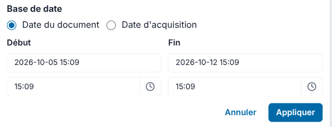
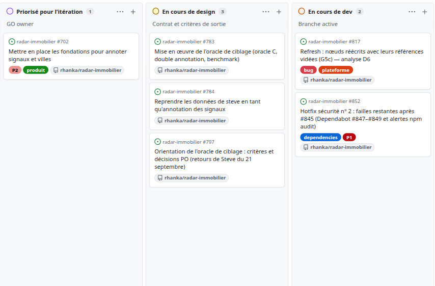

# Rapport d'activité — 14 septembre → 11 octobre 2026

**Périmètre** : plateforme Radar immobilier (immo), socle géographique (geo), déploiements et exploitation.  
**Fenêtre** : Montréal/Toronto `2026-09-14T00:00:00-04:00` → `2026-10-11T23:59:59-04:00`, soit 28 jours.  
**Document distinct** : les montants et allocations figurent dans le [rapport de coûts consolidé](https://claude.ai/artifact/MDaw8FoKTpeYGqj3NraB2T).  
**Rapports précédents** : référence de rédaction **12 août → 10 septembre** ; version publiée **10 août → 13 septembre**, [PR #691](https://github.com/rhanka/radar-immobilier/pull/691).

**Méthode** : cartes et commentaires GitHub, PR fusionnées, tags et journaux Track retrouvés, sans assimiler une fusion à une recette. Les observations et captures du **12 octobre**, ainsi que la lecture du dossier Steve **provisoire v0.9.1 daté du 12 octobre** et de la première analyse de ses **constats transversaux**, sont identifiées séparément.

---

## 1. Synthèse exécutive

Le mois fait progresser la **fiabilité des données et de l'exploitation** : rafraîchissement municipal automatique, sauvegardes PostgreSQL et documents pour immo et geo, restauration de préproduction, dates documentaires et filtres partageables. Un défaut majeur de collision entre villes a été corrigé, puis **357 villes ont été réparées en production**. La mesure de qualité d'extraction a aussi été élargie à **100 documents**, ce qui a changé le choix de politique d'extraction.

L'autre chantier majeur est l'**instruction des retours de Steve du 21 septembre** : conserver ses annotations, distinguer les données manquantes des choix métier et préparer un ciblage mesurable. La dernière version provisoire du dossier recense **24 désaccords sur 113 lignes évaluables**. Elle prépare les décisions et la réalisation ; elle ne démontre pas encore une amélioration du ciblage en production. L'onglet **« constats transversaux »** ajoute des retours techniques et des demandes produit à instruire. Au **12 octobre**, la première analyse Astra et un plan d'action sont disponibles ; **la contradiction Opus du club des 3 reste à faire**.

La période compte **84 PR immo fusionnées**, **25 PR geo fusionnées**, **6 versions immo publiées par tags annotés**, de **v1.2.7 à v1.2.12**, et le passage geo à **v0.6.2**. Ces volumes incluent code, correctifs, documentation et suivi ; ils ne représentent pas autant de fonctionnalités distinctes.

La gestion passe maintenant par les **cartes du [Kanban GitHub](https://github.com/users/rhanka/projects/3/views/2)** : elles portent les demandes, les arbitrages et les preuves de sortie. À la clôture, plusieurs sujets restent ouverts, notamment **Brigham**, la **restauration quotidienne refusée faute de sauvegarde assez récente**, l'**oracle de ciblage** et les **dettes de sécurité restantes**.

| Volet | Livré / point de vigilance |
| --- | --- |
| **immo** | **84 PR** ; dates documentaires, liens de filtres, préréglages semaine/mois, correction de la clé des données par ville, réparation de production et connecteur MCP préprod |
| **geo** | **25 PR** ; sauvegardes et restaurations PostgreSQL/PostGIS + S3, contrôle des jointures et porte de sauvegarde avant déploiement |
| **exploitation** | Rafraîchissement à quatre créneaux quotidiens ; protection contre les tâches bloquées ; sauvegardes séparées ; sauvegarde quotidienne en échec et restauration refusée le 11 octobre |
| **suivi** | **256 événements Track retrouvés dans la fenêtre**, **44 créations d'items**, **13 décisions créées**, **5 items distincts passés à done** ; dernier événement retrouvé le **4 octobre**, puis suivi par GitHub |

---

## 2. Livraisons immo

« En prod » s'appuie ci-dessous sur une preuve datée dans les cartes, et pas seulement sur la présence du code dans `main`.

| Chantier / cartes | PR principales | État à la clôture |
| --- | --- | --- |
| **Rafraîchissement et benchmark** — [#697](https://github.com/rhanka/radar-immobilier/issues/697), [#703](https://github.com/rhanka/radar-immobilier/issues/703) : choix de modèle, vérification des sorties, balayage des villes, sélection du document récent et journal par document | #687–#689, #711, #714–#722, #732, #733, #735, #736 | Succès prod attesté le **29 septembre** ; reprise le **4 octobre** après les arrêts mémoire. Dépend encore des sources municipales, des quotas de modèles et des documents mis de côté |
| **Dates documentaires et partage des filtres** — [#786](https://github.com/rhanka/radar-immobilier/issues/786), [#787](https://github.com/rhanka/radar-immobilier/issues/787), [#788](https://github.com/rhanka/radar-immobilier/issues/788) | #789–#793, #800, #823 | En prod depuis **v1.2.8** ; reprise du stock partielle et dates inconnues conservées |
| **Dernière semaine / dernier mois** — [#836](https://github.com/rhanka/radar-immobilier/issues/836) ; correction du filtre résidentiel pour les signaux précoces indéterminés | #824, #834 | Correction résidentiel (#824) en prod en **v1.2.11** ; préréglages (#834) en prod en **v1.2.12**, après validation de Farid |
| **Données propres à chaque ville** — [#812](https://github.com/rhanka/radar-immobilier/issues/812), suites [#817](https://github.com/rhanka/radar-immobilier/issues/817) | #819, #820, #825, #832, #853 | Clé par ville en prod, **v1.2.11** ; 357 villes réparées. Outillage Brigham fusionné le 11 octobre, opération finale non attestée dans la fenêtre |
| **Robustesse de la collecte et continuité du rafraîchissement** — [#663](https://github.com/rhanka/radar-immobilier/issues/663), [#805](https://github.com/rhanka/radar-immobilier/issues/805), [#842](https://github.com/rhanka/radar-immobilier/issues/842) | #713, #728, #729, #730, #735, #806, #838 | Tranches pour les traitements en masse ; gros fichiers mis de côté en **v1.2.9** ; horaires et gardien portés par **v1.2.12** |
| **Authentification et MCP préprod** — [#799](https://github.com/rhanka/radar-immobilier/issues/799), [#835](https://github.com/rhanka/radar-immobilier/issues/835) | #718, #798, #837 | Login préprod confirmé le **4 octobre** ; MCP préprod déclaré testé et fonctionnel le **10 octobre** |
| **Sécurité des dépendances** — [#845](https://github.com/rhanka/radar-immobilier/issues/845) | #846 | **10 mises à jour** regroupées et en prod en **v1.2.12** ; alertes restantes suivies par #850/#852 |

### Retrouver les mêmes signaux avec une date explicite

Les cartes **#786/#787** partent d'un cas concret : pour la même période, Val-des-Monts affichait **2 signaux dans la liste et 6 dans le détail**. Les deux chemins utilisaient des règles de date différentes. Le filtre distingue désormais la **date du document**, utilisée par défaut, de la **date d'acquisition**. Ce choix est placé dans l'onglet **Personnalisé** ; les périodes relatives utilisent la date documentaire. Les filtres et la période sont conservés dans l'URL lors du partage et des déplacements entre niveaux géographiques.

La recette préprod publiée le **3 octobre**, sur une copie des données prod, retrouve **4 résultats dans la liste comme dans le détail** pour le cas du 29–30 septembre, puis **12 dans les deux vues** en mode acquisition sur la période 28 septembre–1er octobre. Farid confirme le correctif le même jour sur **#786**, avant sa promotion en v1.2.8.

La carte **#836** ajoute ensuite **Dernière semaine** et **Dernier mois** devant les horizons de 3, 6 et 12 mois. La dernière semaine devient le défaut, tandis qu'un lien comportant une période explicite la conserve.

*Capture de production du 12 octobre vers 19:11 UTC, sur v1.2.13, après la période : semaine et mois précèdent les horizons plus longs. Les 25 signaux / 16 villes sont un relevé après clôture de la vue « Dernière semaine », pas le total mensuel. La carte centrale était encore en chargement ; cette image illustre les commandes, sans constituer une recette des résultats.*

*Même session de production : « Date du document » et « Date d'acquisition » sont accessibles dans Personnalisé. Aucun filtre n'a été appliqué pendant la prise ; les dates affichées appartiennent au relevé du 12 octobre.*

La carte **#788** traite la qualité des dates en amont. L'inventaire du 1er octobre identifie **22 297 documents uniques**, dont **17 937 sans date documentaire complète exploitable persistée**. La correction lit les informations disponibles sans LLM, puis complète la date dans la passe de signaux existante lorsqu'elle manque. La reprise de production du **3 octobre** traite **1 008 villes**, en écrit **354**, et met à jour **29 626 références**, dont **7 943 avec une date documentaire**. Les **205 villes en écart** sont laissées intactes ; pour **21 villes**, la base refuse la projection, c'est-à-dire l'écriture des données préparées. Ces chiffres comptent des références, pas autant de nouveaux documents ou signaux.

La dette de dates reste mesurable : le relevé du **5 octobre à 22:59 à Montréal** (**6 octobre à 02:59 UTC**) trouve une date documentaire sur au moins une référence pour **1 338 des 11 536 signaux observés**, soit **11,6 %**. Ce relevé précède la réparation générale du 10 octobre ; aucun taux global après celle-ci n'est inventé. Les signaux sans date ne peuvent pas être considérés comme récents par simple date de création en base.

Deux retours de recette de **Farid (PO)** rendent les sorties visibles sur les cartes : le **27 septembre**, **#703** consigne **165 nouveaux signaux après le 1er juillet sur 20 villes, en préprod uniquement** ; son commentaire du **5 octobre au soir** sur **#805** consigne **65 signaux chargés en production pour les dates du 1er au 5 octobre, sur 18 villes**. Ces relevés portent sur deux vues et périodes différentes ; ils ne s'additionnent pas et ne mesurent pas la couverture ou le débit de tout le parc.

### Réparer les preuves provenant d'une autre ville

Le diagnostic du **4 octobre** constate **226 villes en écart entre stockage et base**, avec notamment **164 nœuds dans 109 villes portant des preuves d'une autre ville**. La cause est la clé des nœuds : un identifiant local tel qu'un numéro de règlement pouvait remplacer celui d'une autre municipalité.

La correction **#825**, servie en **v1.2.11**, rattache chaque objet et ses liens à leur ville. La migration de production du 9 octobre conserve **43 912 objets (nœuds) et 51 011 liens (arêtes)**, sans suppression. Après répétition en préprod, la réparation du **10 octobre** remet **357 villes** en cohérence avec leurs propres données stockées ; le contrôle consigné donne **zéro écart sur 357/357**, et **20 villes refusées par les contrôles de sécurité**, laissées intactes.

Les reprises ciblées suivantes règlent notamment Dixville, Nominingue et Victoriaville. **Brigham conserve le seul nœud étranger résiduel mesuré** : sa projection demande **21 suppressions voulues et une perte de propriété explicitement acceptée**. L'outillage correspondant est fusionné par **#853 le 11 octobre**. Sa publication **v1.2.13 date du 12 octobre** ; la réparation finale de Brigham reste une suite de **#817** à la clôture.

### Mesurer l'extraction sur une référence plus large

Le benchmark passe d'une mesure initiale sur **4 documents / 35 éléments** à **100 documents / 674 éléments**, puis **676 après correction**. Les anciens scores ne sont donc pas comparés comme s'ils utilisaient la même référence.

Sur la référence corrigée, la politique **Astra medium puis vérification Gemini low** atteint une **précision de 0,484**, un **rappel de 0,533** et un **F1 strict de 0,507**, contre **0,424** pour Astra low dans le tableau comparatif. La précision mesure la part des actes extraits qui sont justes ; le rappel, la part des actes attendus retrouvés ; F1 combine les deux. La vérification peut retirer les actes non soutenus par le document. La version intermédiaire du benchmark **v11alpha** ajoute les essais via abonnements **Opus 5.5** et **Muse 1.3** ; certains efforts restent partiels et les graphiques/PDF v11 ne sont pas régénérés.

Cette mesure porte sur l'extraction des actes. La pertinence pour Steve — résidentiel, assouplissement, densification — exige un **jeu de référence de ciblage distinct**. Les cartes **#783/#784/#797** séparent la capitalisation de ses annotations, les décisions PO et l'implémentation. Des documents de référence sont produits (#794/#822), mais le dossier et ses questions sont encore réitérés le 10 octobre : aucune bascule du ciblage C n'est présentée comme acquise.

### Exploiter les retours de Steve pour préparer l'annotation et le ciblage

Les retours du **21 septembre** donnent lieu au dossier #794, à une référence conservée par #822 et à la séparation de l'orientation produit (**#797**), de la reprise des annotations (**#784**) et de l'évaluation du ciblage (**#783**). Le travail du mois consiste à analyser les écarts, expliciter les critères et préparer les décisions. **L'import des retours et le nouveau parcours d'annotation ne sont pas attestés comme livrés à la clôture.**

Le [dossier Steve v0.9.1](https://claude.ai/artifact/BUfEuxY55negg3z6bjgEVS), **non finalisé et daté du 12 octobre**, précise les grands chiffres disponibles à la rédaction. Ces agrégats historiques ne constituent ni une nouvelle campagne du mois ni une mesure de tout le parc municipal.

| Périmètre du dossier provisoire | Chiffres à date / portée |
| --- | --- |
| **Classeur et corpus retenu** | **124 lignes de triage**, dont **121 retenues dans 51 villes** ; classements de Steve : **39 Pertinent**, **29 À surveiller**, **53 Non pertinent**. Une ligne n'est pas nécessairement une occasion indépendante |
| **Analyse des désaccords avec la règle historique** | **113 lignes évaluables** : **24 désaccords**, soit **21,2 %** (24 / 113), et **89 accords** calculés par différence ; **8 autres lignes** restent hors comparaison parce qu'un tag contesté peut changer le résultat |
| **Causes des 24 désaccords** | **7 cas de classement**, **3 de règle ou de regroupement**, **14 d'information à compléter ou à dater** ; les causes restent à confirmer par les pièces, notamment les informations supposées postérieures au signal |
| **Ancien lot d'essais exploratoires** | **61 lignes**, dont **35 utiles** pour Steve (20 Pertinent + 15 À surveiller). La sélection historique **B** en montre **37**, dont **26 utiles** : rappel utile **74,3 %**, précision utile **70,3 %** ; **2 Pertinent et 7 À surveiller** sont masqués |

Les **24 désaccords** comparent Steve à une **règle de classement historique**, tandis que **B** désigne les filtres de sa vue. Ces deux constats ne comptent donc pas les mêmes erreurs. L'accord de trois IA reste un élément de revue ; il ne remplace pas le jugement attribué à Steve, ni une vérification documentaire.

L'enseignement principal est que le ciblage dépend aussi des **preuves accessibles à la date du signal** et du **regroupement des pièces d'un même dossier**. Un effet résidentiel non établi doit rester explicite ; un doublon de ligne ne doit pas devenir une deuxième occasion. Les contributions de Steve et les analyses de son assistant doivent conserver leur auteur et leur source. La prochaine annotation doit permettre de retrouver le cas, commenter ou contester une version et relier le retour à la ville, au signal ou à sa preuve.

Sur le lot de 61 lignes, l'ancien essai **Astra v1** montre **25 lignes, dont 24 utiles** : **12 lignes de moins à examiner que B, mais 2 utiles supplémentaires masqués**. Aucun des **9 essais IA historiques** ne satisfait la proposition « zéro Pertinent masqué ». Le futur **C**, fondé sur des tags documentés puis une règle explicite, n'a pas encore été mesuré. Les résultats historiques déjà exposés ne peuvent plus servir de test indépendant ; l'audit détaillé des valeurs de tags et de leur répartition reste incomplet.

Le dossier fait aussi entrer le **temps disponible pour agir** dans l'évaluation. Dans son scénario pédagogique — **5 dossiers par jour, 30 min par dossier, action après 1 jour, disponibilité médiane de 7 jours**, potentiel égal, sans priorité ni report du surplus — les utiles préservés sur 100 seraient **44 pour B contre 61 pour Astra v1 avec 1 h/jour**, puis **67 contre 62 avec 2 h/jour**. À **2 h/jour**, deux témoins donneraient **79 pour B sans « Précoce »** et **72 pour tout laisser visible sans priorité** ; le premier obtient le meilleur résultat des quatre dans ce scénario. Cela rejoint la piste de Farid sur **#761** : réexaminer « Précoce » lorsque les signaux sont actualisés quotidiennement. Ces calculs justifient de mesurer la charge, les délais et les priorités avec Steve. **Ils restent des hypothèses de scénario, sans débit réel, temps gagné ni ROI mesuré, et ne justifient aucune bascule.**

La suite consiste à retrouver les sources des 24 cas, préciser avec Steve la veille des contraintes et des séries de projets, puis tester le candidat sur des entrées datées après gel des critères. L'objectif proposé protège les Pertinents et mesure ce qui est traité à temps ; sa ratification et la bascule de B vers C restent à décider.

### Constats transversaux de Steve — analyse à terminer

L'onglet **« constats transversaux » du classeur de Steve** contient **77 constats**, distincts des 24 désaccords de classement : identifiants et numéros de règlement, sources documentaires, écarts entre API et affichage, filtres, étapes d'un même dossier et fonctions de suivi, jusqu'à l'échelle MRC. **18 portent la mention « Erreur vérifiée » dans la source** ; les autres comprennent questions, améliorations, exigences, informations et pistes V2. Ces mentions décrivent le triage historique et ne constituent pas une nouvelle vérification des défauts en production. Les corrections et retraits présents dans le classeur doivent être conservés.

**État de l'analyse au 12 octobre, après clôture** : l'auteur Astra a terminé une première analyse, produit un registre des 77 constats et proposé un plan d'action. **La contradiction Opus du club des 3 n'est pas faite ; l'analyse reste en cours et les conclusions et priorités restent à confirmer.** Les anomalies signalées doivent encore être reproduites sur la version actuelle, avec les objets, documents, dates et filtres concernés, avant de conclure à un correctif nécessaire.

La reprise des retours prévue par **#784/#702** doit inclure ces contributions comme **bugs signalés, questions ou demandes d'amélioration**, rattachées aux villes, signaux ou documents effectivement identifiés. La qualification du modèle d'annotation et de l'import doit vérifier ces rattachements, l'attribution, les sources et la restitution des feedbacks depuis les objets concernés. Le plan propose de rapprocher les vérifications de filtres de **#761**, les identités et preuves des suites de **#812/#817** et **#700/#701**, puis les choix de suivi et de ciblage de **#760/#797**. Ces rattachements orientent le travail à faire ; ils n'attestent pas la résolution des constats ni leur import.

---

## 3. Livraisons geo

Geo compte **25 PR fusionnées** dans la fenêtre et un passage des six packages à **v0.6.2** le 25 septembre, heure de Montréal.

- **Sauvegardes quotidiennes et restaurations** : PostgreSQL/PostGIS et objets S3 ont leur circuit dédié ; les manifestes distinguent sauvegarde complète et partielle, contrôlent l'intégrité et bornent les requêtes (#391, #396, #402, #403, #405, #407–#409).
- **Restauration PostgreSQL préprod** : la partie base de données est ajoutée, puis un défaut réel de restauration des extensions PostGIS est corrigé. **#412 vérifie deux restaurations en local avec la copie de sauvegarde réelle de production**, sans accès en écriture à celle-ci ; ces essais ne prouvent pas deux restaurations du cluster préprod. Un test synthétique antérieur avait laissé passer ce défaut (#411/#412).
- **Cohérence des jointures immo↔geo** : identifiants canoniques de lots, identifiants servis et reçus de cycle communs alimentent le contrôle de la restauration d'ensemble (#397/#399).
- **Protection des déploiements** : sauvegarde complète exigée avant mise en prod, durcissement des workflows sensibles et réduction des réservations CPU des tâches de copie et de sauvegarde (#394/#395, #400/#401, #404, #410, #413/#414).

Les chantiers **[DAG geo #384](https://github.com/rhanka/geo/issues/384)**, **[plan 3D #385](https://github.com/rhanka/geo/issues/385)** et **[BDZI/GRHQ #386](https://github.com/rhanka/geo/issues/386)** restent à suivre par leurs cartes. L'historique de la période ne démontre ni la migration complète du pipeline PV vers le DAG ni la mise en service de cette vague de couches environnementales. La compatibilité MapLibre 6 et geo v0.6.3 sont fusionnées le **12 octobre**, hors du bilan des quatre semaines.

---

## 4. Déploiements et exploitation

| Élément | Mesure / état documenté |
| --- | --- |
| Versions immo dans la période | **6 tags annotés** : v1.2.7 (28 sept.), v1.2.8 (3 oct.), v1.2.9 (4 oct.), v1.2.10 (4 oct.), v1.2.11 (9 oct.), v1.2.12 (10 oct.), dates de Montréal. v1.2.6 précède la fenêtre ; v1.2.13 est taguée le 12 octobre |
| Version observée après clôture | Le 12 octobre, `/build.json` et `/health` prod et préprod répondent sur **ea90951 = v1.2.13**. Cela ne transforme pas cette publication en livraison de la période |
| Rafraîchissement | Balayage municipal corrigé par #736. Horaires prod posés le **10 octobre** : **05:00 / 11:00 / 17:00 / 23:00 UTC** ; préprod appliqués par le déploiement de #838 le **9 octobre** : **00:00 / 06:00 / 12:00 / 18:00 UTC**. Gardien des tâches restées en attente au-delà de 15 min (#842) |
| Gros documents | Le PDF de **172 Mo / 903 pages** de Saint-Augustin-de-Desmaures provoquait des arrêts mémoire répétés depuis le 29 septembre. **v1.2.9** borne la taille, trace les tentatives et met les documents en échec de côté ; la collecte en flux reste confiée à geo/engram dans #699 |
| Sauvegardes et restauration | Circuits quotidiens immo et geo livrés, restauration d'ensemble et contrôle des correspondances entre les deux produits développés (PR de sauvegarde et de restauration entre #742 et #781, et geo #391–#412). **La sauvegarde immo prévue le 11 octobre à 02:23 UTC — le 10 octobre à 22:23 à Montréal — échoue faute de démarrage avant son délai maximal.** Des copies d'une date commune ne prouvent pas un instant de sauvegarde atomique ; #769 porte encore la sauvegarde coordonnée, la perte de données et le délai de reprise acceptables |
| Restauration quotidienne | **#844** arme la restauration prod→préprod à **04:00 UTC** le 10 octobre. Le retour du **11 octobre** indique un refus : sauvegarde de plus de **24 h**. L'automatisation est configurée ; son fonctionnement quotidien nominal n'est pas validé |
| Capacité d'hébergement | Le **9 octobre**, des tâches de rafraîchissement restent bloquées **4 h 30** par l'attachement de leur volume, tout en gardant du CPU réservé ; elles empêchent une sauvegarde avant release (#842). Le **11 octobre**, la capacité réservée du nœud unique empêche la sauvegarde quotidienne de démarrer (#844, diagnostic du 12 octobre). La consolidation doit donc être suivie sur plusieurs cycles |
| Sécurité | Les 10 mises à jour de **#845** sont en prod. Audit racine consigné : **50 → 40 alertes**, critical **6 → 3**, high **10 → 6**. La migration MapLibre 6 (#850) et le second lot (#852) restent ouverts à la clôture |

La reprise après restauration a aussi nécessité de remettre l'authentification préprod sur son propre fournisseur d'identité, puis d'aligner les identités et consentements. **#799** est confirmé résolu le 4 octobre ; **#807** conserve le contrôle systématique après restauration, et **#808** le contrôle de validité des sessions après disparition d'un compte.

**Observations après clôture — 12 octobre.** La carte **#817** atteste ensuite la réparation de Brigham en préprod puis en prod, sur v1.2.13 : **21 nœuds et 17 liens supprimés**, perte déclarée appliquée, puis **zéro nœud étranger sur les 1 008 villes contrôlées en prod**. La carte **#844** identifie le blocage des sauvegardes : le nœud unique n'a plus assez de capacité CPU non réservée pour les lancer. Son diagnostic signale aussi l'échec du passage prévu le **12 octobre à 02:23 UTC**, soit le **11 octobre à 22:23 à Montréal** : son lancement appartient à la fenêtre, son échec est communiqué après clôture. Après réduction des réservations de la plateforme, la sauvegarde manuelle s'achève en **72 min** ; un deuxième nœud est également ajouté le même jour. **Le cycle quotidien sauvegarde→restauration reste à observer le 13 octobre.** Ces suites ne sont pas comptées comme des livraisons des quatre semaines.

---

## 5. Action items de la période — pilotage par cartes

Le Kanban est mis en place les **15–16 septembre**, puis simplifié avec le PO : fusion des doublons, retrait des cartes de pur suivi et conservation des demandes concrètes. Une carte fermée pour doublon ou retrait ne compte pas comme une fonctionnalité livrée. Les commentaires datés sont utilisés pour le pointage ci-dessous ; les colonnes du tableau observé le 12 octobre ne sont pas prises pour un instantané de clôture.

Le circuit va de la **priorisation** au **design**, au **développement** et à la **revue interne**, puis à la **recette PO en préprod**, à la **promotion en prod** lorsque la carte la demande, et à la **fermeture sur preuve**. Farid priorise les cartes, ajoute des demandes et consigne ses recettes ; l'équipe relie les PR et les preuves. Les transitions retrouvées sont incomplètes : **#835** annonce une sortie fonctionnelle dans ses commentaires sans événement de statut retrouvé. Chaque changement doit donc conserver un commentaire daté avec version, résultat et validation.

**Suite des points ouverts du rapport publié précédent** : le rafraîchissement, alors dormant en prod, est désormais actif ; **#682 a été fermée sans fusion et remplacée par #711**, puis le circuit a évolué par les PR suivantes. Le succès prod du **29 septembre** est attesté dans #805, sans date initiale d'armement établie. La récupération exhaustive des règlements reste au backlog de **#700**, sans preuve d'extension complète dans la fenêtre. Le risque de capacité de la machine consolidée s'est réalisé : les incidents et leur suite sont détaillés au §4.

*Extrait du tableau relevé le 12 octobre : les cartes portent la priorité et l'étape de travail. Cet état courant illustre le pilotage ; le pointage du mois reste fondé sur les preuves datées de la période.*

Légende : ✓ fait (preuve) · ◐ partiel/en cours · ☐ à faire

| Cartes | Demande / sortie attendue | État au 11 octobre |
| --- | --- | --- |
| [#697](https://github.com/rhanka/radar-immobilier/issues/697) / [#703](https://github.com/rhanka/radar-immobilier/issues/703) | Stabiliser l'extraction et mettre en production le rafraîchissement | ✓ Circuit livré et actif ; surveillance et amélioration du rappel restent nécessaires |
| [#786](https://github.com/rhanka/radar-immobilier/issues/786) / [#787](https://github.com/rhanka/radar-immobilier/issues/787) / [#836](https://github.com/rhanka/radar-immobilier/issues/836) | Filtrer selon une date explicite et partager la même vue | ✓ Livré ; semaine/mois en prod après validation PO |
| [#788](https://github.com/rhanka/radar-immobilier/issues/788) | Détecter et reprendre les dates documentaires | ◐ Correction et reprise livrées ; couverture historique encore incomplète |
| [#812](https://github.com/rhanka/radar-immobilier/issues/812) / [#817](https://github.com/rhanka/radar-immobilier/issues/817) | Supprimer les collisions et terminer les réparations ciblées | ◐ Clé corrigée, 357 villes réparées ; Brigham et document en échec à Sainte-Clotilde encore suivis |
| [#698](https://github.com/rhanka/radar-immobilier/issues/698) / [#769](https://github.com/rhanka/radar-immobilier/issues/769) / [#844](https://github.com/rhanka/radar-immobilier/issues/844) | Sauvegarder, restaurer les deux produits et vérifier le cycle | ◐ Implémentations livrées ; restauration quotidienne refusée le 11 octobre, sauvegarde coordonnée et plan de reprise d'activité (PRA) encore incomplets |
| [#799](https://github.com/rhanka/radar-immobilier/issues/799) / [#835](https://github.com/rhanka/radar-immobilier/issues/835) | Rétablir le login et tester le MCP préprod | ✓ Login confirmé le 4 octobre ; MCP testé le 10 octobre |
| [#845](https://github.com/rhanka/radar-immobilier/issues/845) / [#850](https://github.com/rhanka/radar-immobilier/issues/850) / [#852](https://github.com/rhanka/radar-immobilier/issues/852) | Corriger les dépendances vulnérables | ◐ Premier lot en prod ; migration et second lot à terminer |
| [#783](https://github.com/rhanka/radar-immobilier/issues/783) / [#784](https://github.com/rhanka/radar-immobilier/issues/784) / [#797](https://github.com/rhanka/radar-immobilier/issues/797) | Capitaliser les annotations et les constats transversaux de Steve, puis définir le ciblage C | ◐ Dossiers et référence en travail ; réponse aux constats transversaux à compléter, arbitrages et mise en œuvre encore ouverts |
| [#796](https://github.com/rhanka/radar-immobilier/issues/796) | Expliciter qui décide et qui valide | ◐ Dossier de rôles proposé ; décisions et adoption à compléter |
| [#702](https://github.com/rhanka/radar-immobilier/issues/702), [#699](https://github.com/rhanka/radar-immobilier/issues/699), [#700](https://github.com/rhanka/radar-immobilier/issues/700) / [#701](https://github.com/rhanka/radar-immobilier/issues/701), geo [#384–#386](https://github.com/rhanka/geo/issues/384) | Collaboration, DAG/migration, règlements/croisements, 3D et couches environnementales | ☐ Pas de preuve de sortie complète dans la période ; demandes conservées au backlog |

**Pointage : 3 sorties faites, 6 partielles, 1 groupe de chantiers à poursuivre.** Ce tableau couvre les demandes principales ; ce n'est pas un taux d'achèvement du projet. Les items Track ont parfois une portée plus large que la carte qui leur est liée.

---

## 6. Prochaines étapes

### Analyse de l'activité et capacité d'évolution

Le mois prolonge le passage du PoC à une production régulièrement actualisée. Deux charges se cumulent : **résorber l'héritage des données et des intégrations**, comme les collisions de preuves et le MCP préprod, puis **stabiliser les cycles d'exploitation**, comme la mémoire, les horaires, les sauvegardes et la restauration. La première demande des reprises ciblées ; la seconde demande plusieurs cycles réussis et observés. Elles expliquent une part importante de l'activité malgré un nombre limité de nouveaux parcours visibles. Les historiques établissent les travaux, mais ne donnent pas un relevé exhaustif du temps passé.

La sécurité demeure récurrente. Le premier lot de dépendances réduit les alertes sans fermer les suites ; améliorer l'automatisation des mises à jour, des vérifications et des preuves de promotion peut diminuer les interventions futures. De même, l'instruction du dossier Steve et l'alignement du mode de travail — rôle du PO, arbitrages, cartes, critères de sortie et validation — préparent les évolutions et mobilisent durablement de la capacité.

**Pour la prochaine itération, l'hypothèse de planification reste prudente** : réserver encore **environ un quart de la capacité** aux données et à l'exploitation, puis prévoir la sécurité, les décisions et les validations. La **capacité d'évolution est ainsi à cadrer à moins de la moitié du total**. Ces ordres de grandeur traduisent une orientation de planification, pas une ventilation de temps mesurée. La charge de stabilisation devrait décroître à mesure que les reprises et automatismes sont éprouvés ; aucun rythme de diminution ni niveau de stabilité complet n'est garanti.

La priorité produit proposée est donc un **premier parcours de nouvelle annotation**, avec la reprise préparée des retours de Steve, **y compris les constats transversaux**. Un lot concret doit permettre de retrouver la bonne cible, conserver l'origine, annoter près de la carte et vérifier les révisions et les droits. Son import dépend de la qualification du modèle commun ; l'estimation et la recette par carte fixeront la portée effectivement livrable. Le nouveau ciblage reste un chantier d'évaluation distinct.

### Priorités à confirmer et sorties à vérifier

**Attendu du PO et de Steve** :

- **Recetter par carte** : rattacher les cas observés aux filtres (#786/#836), à la cohérence des preuves (#812/#817) et à la restauration (#844), avec ville, période, lien et résultat attendu.
- **Préciser la veille et la capacité d'usage** (#797/#761) : terminer les vérifications internes des 24 cas, puis soumettre à Steve les choix sur les contraintes et les séries de projets. Relever son budget quotidien, les durées de lecture et d'investigation, et les délais de disponibilité. Les données manquantes et les décisions métier restent distinctes.
- **Borner le premier lot d'annotation dans GitHub** (#702/#784) : choisir les cibles et le parcours à recetter. Tri des opportunités (#760), filtres (#761), règlements/croisements (#700/#701), DAG et couches geo (#384/#386) restent ordonnés au backlog. Les anciens « horizons indicatifs » inscrits dans les cartes — par exemple le **6 octobre** pour #702 — ne sont pas reconduits comme engagements nouveaux.

**De notre côté** :

- **Terminer l'analyse des constats transversaux de Steve** : réaliser la contradiction Opus du club des 3 à partir de l'analyse Astra et du plan d'action disponibles au 12 octobre, puis consolider les conclusions et priorités. Rattacher les suites aux cartes existantes, préparer la reproduction des anomalies sur la version actuelle et qualifier l'impact sur le modèle d'annotation et l'import **#784/#702**. Chaque feedback doit conserver sa source et ses corrections, avec un rattachement vérifié à l'objet concerné ; les décisions de filtres et de suivi restent à confirmer avec le PO et Steve.
- **Préparer la nouvelle annotation et les retours de Steve** (#784/#702) : qualifier les sources, l'attribution et les rattachements ; préparer l'import sous le contrat commun, puis livrer un premier parcours d'annotation avec preuve de recette. Inclure dans le cadrage le **lien direct ouvrant la fiche d'un signal** ([#855](https://github.com/rhanka/radar-immobilier/issues/855)), demandé le 11 octobre au soir pour retrouver les cas du dossier. Le dossier provisoire décrit la cible ; il ne prouve pas son implémentation.
- **Clore la recette des suites de #817** : rattacher la preuve de réparation de Brigham du 12 octobre à la validation de la carte et analyser le document en échec à Sainte-Clotilde.
- **Valider une restauration quotidienne nominale** (#844) : après la sauvegarde manuelle réussie et l'ajout de capacité du 12 octobre, obtenir un cycle planifié complet, puis vérifier santé et reprise du rafraîchissement sans écraser une recette PO en cours. Revoir aussi la réservation CPU de l'étape de sauvegarde de la base et son délai maximal, qui compte la phase d'attente.
- **Remesurer les dates et la fraîcheur** (#788/#703) après réparation : volumes effectivement traités, documents mis de côté, références datées, inconnues et signaux visibles. Un pod terminé ne suffit pas à prouver la fraîcheur municipale.
- **Achever la sécurité** (#850/#852) et les contrôles après restauration (#807/#808), en conservant les exceptions et validations sur leurs cartes.
- **Suivre la dépendance de collecte en flux** (#699/#384) : conserver l'exigence et les preuves de mémoire bornée auprès de **geo et engram**, qui portent sa réalisation. Ce suivi ne constitue pas un engagement d'évolution immo simultané au premier lot d'annotation ; le rafraîchissement actuel reste distinct du DAG cible.
- **Tenir ensemble cartes, PR et Track** : mise à jour des preuves de sortie sur la carte, PR liées, validation PO identifiable et rattachement au porteur Track. Les cartes absorbées restent référencées ; les fusions ne ferment pas automatiquement une demande plus large.

**Préparation de l'évaluation, à estimer séparément** : compléter l'audit descriptif historique (#783/#797), choisir de nouveaux cas admissibles et figer tags, règles, budget et critères avant le test. La campagne comparera la version B réellement servie à C avec preuves, charge et incertitude ; son calendrier sera fixé après estimation, sans bascule présumée.

---

*Rapport établi et complété le 12 octobre 2026. Sources : rapport du mois précédent ; historique GitHub immo et cartes geo/plateforme liées, commentaires et transitions ; PR fusionnées sur la fenêtre horaire ; objets de tags ; journaux Track local, `main`, worktrees et versions historiques, réunis en lecture seule par identifiant d'événement (1 265 événements uniques, aucun conflit de contenu retrouvé). Aucune entrée Track postérieure au 4 octobre n'a été retrouvée. Complément d'analyse : dossier Steve non finalisé v0.9.1 du 12 octobre, notamment §2, §4.3 et annexes A1/A5/A6 ; ses agrégats historiques sont vérifiés dans les textes sources, sans nouveau dépouillement des annotations privées. Ajout sur les constats transversaux : CSV de l'onglet, première analyse Astra et PLAN-ACTION du 12 octobre ; contradiction Opus encore à faire. Les perspectives de capacité sont des hypothèses de planification. Les preuves sources et calculs sont conservés dans `sources/`. Les captures sont nouvelles, authentifiées, prises uniquement dans un nouvel onglet et sans écriture applicative. Aucun commit ni envoi.*
