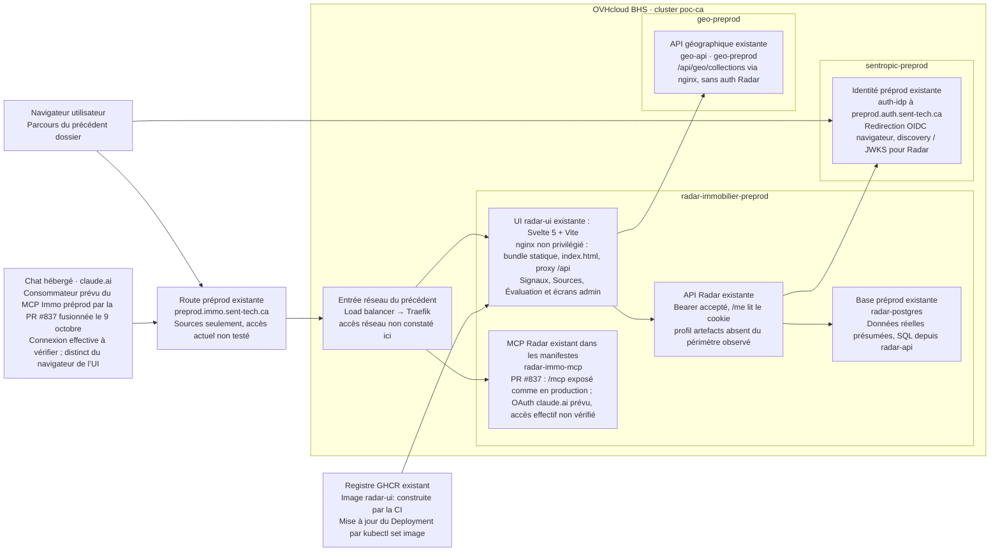
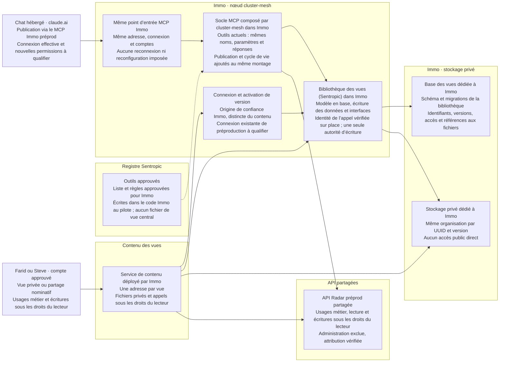
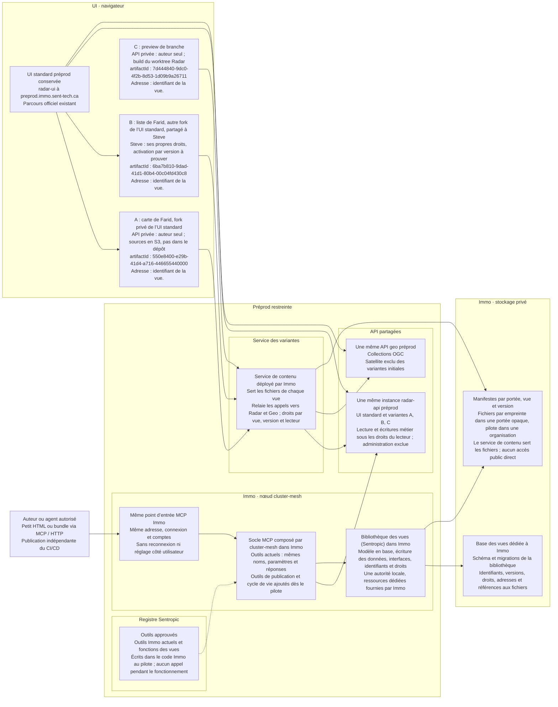
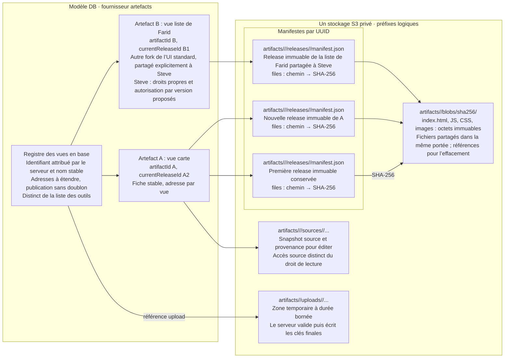
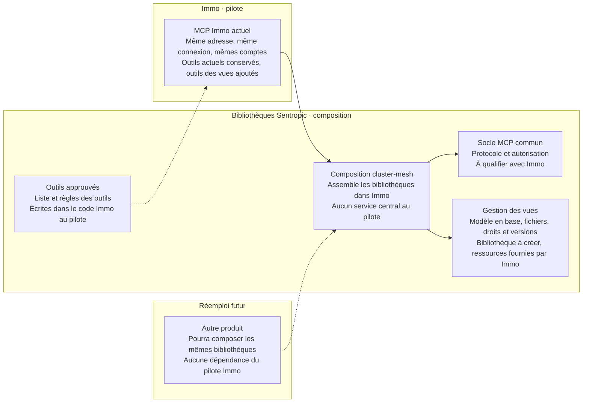

# Architecture du dossier #861 — scènes Focus

Révision v11 du 14 octobre 2026 : cible retenue, cluster-mesh dans Immo, cinq vues seulement. La vue « Aujourd’hui » reconstitue l’existant depuis les sources datées, sans nouvelle observation du cluster. Les vues de cible décrivent ce qui est à construire ; leurs mécanismes restent proposés. Zones logiques, orientation gauche → droite, cartes et moteur Focus inchangés. Le service de contenu est déployé par Immo sur un domaine séparé ; le service d’identité reste dans la préproduction Sentropic, hors du nœud Immo. L’ancienne alternative centralisée est conservée dans les archives, hors du pilote, et n’apparaît plus ici. Les parcours d’ouverture, de publication, de maquette locale et les briques déjà présentes sont décrits en prose dans l’annexe technique (section K).

Trait plein : relation décrite ; pointillé : conditionnel / non vérifié. L’ordre temporel se lit dans le déroulé « source → cible », sous chaque vue.

### `avant-existant` — AVANT : l’UI préprod existante et ses API

### `06-radar` — CIBLE RETENUE : cluster-mesh dans Immo

### `01-vues` — CIBLE RETENUE : plusieurs UI, une même API préprod

### `04-stockage` — UUID, releases et fichiers dans S3 privé

### `05-librairies` — Bibliothèques : ce que le pilote compose dans Immo

