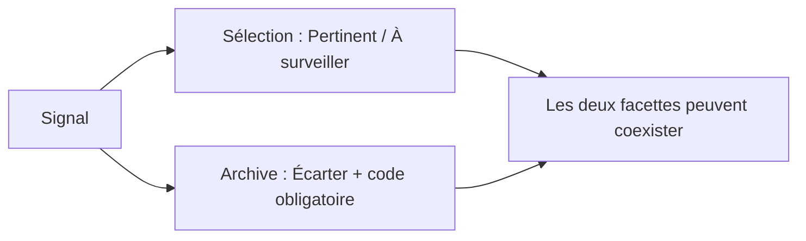
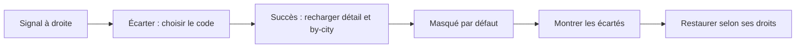
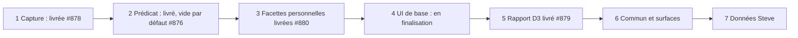

# Paniers et signaux écartés — v3

Chaque signal du panneau droit doit proposer **Pertinent**, **À surveiller** et **Écarter**, avec les catégories de Steve. Les écartés disparaissent de la vue courante ; **Montrer les écartés** les réaffiche sous les autres filtres. La priorité des UI custom **#861** reste maintenue, en parallèle de cette base métier.

## Décisions appliquées

La spec COLLAB et **O2, ratifiée le 16 août**, fixent le modèle : **Pertinent** et **À surveiller** sont des paniers personnels, privés par défaut ; **Écarter** active une archive indépendante, avec **code de motif de Steve obligatoire**. En livré (lot 3, PR #880), seul un compte approuvé agit pour lui-même, sans tenant, sans workspace et sans contrôle d'appartenance. La cible COLLAB (tenant, workspace, appartenance), l'écart commun réservé au modérateur, le rattachement aux workspaces, les contrôles d'appartenance et la migration ou la reprise des états personnels existants vers les workspaces sont affectés au lot 6. Une restauration personnelle ne lève pas un masquage commun.

Écarter conserve la sélection ; une désélection explicitement demandée constitue une transition séparée dans la même transaction. Restaurer conserve l'historique sans recréer une sélection retirée. Un refresh ne rétablit pas un écarté ; un contenu changé porte la mention « modifié depuis l'écart ». Limite livrée : les commandes ne transmettent que (citySlug, type, id) et `writer.ts` calcule l'empreinte au moment de l'écriture ; si l'utilisateur voit V1 puis écarte après un refresh vers V2, l'événement porte V2 sans conflit et `changedSinceArchive` peut rester faux, même si V2 n'a jamais été vue. La transmission et la vérification de la version affichée, avec le traitement d'un changement concurrent, sont affectées au lot 6. L'empreinte ne certifie pas le contenu vu.

Ces états vivent côté métier, hors annotations : première tranche du magasin de facettes généralisé, limitée aux signaux. **Aucun `ALTER` de `prospect_marks` maintenant** ; les marques de lots migreront au lot 6. Les contributions de Steve rejoindront le modèle commun via **#859**, encore brouillon. La base métier et l'UI minimale peuvent avancer sans cet import.

**Seules D5/D6 de Farid, déjà en attente, conditionnent l'entrée réelle des données de Steve côté décisions : attribution et visibilité/caviardage.** Elles ne sont pas reposées ; les preuves techniques d'import restent requises.

## Le parcours minimal

Les gestes proposent les motifs filtrés par classement ; l'archive refuse l'absence de code. Le profil immo fournit les **28 codes**, vérifiés par égalité d'ensemble avec `readPatternCodes` du lot 1. Aucun texte libre dans l'état métier.

Le filtre est conservé dans l'URL (`filter.showDiscarded=1`). Après écriture, panneau, carte, rail et compteurs relisent le même ensemble filtré. Une erreur reste explicite. Temps réel, reconnexion, réglementaire, PDF et paramètre explicite du **MCP** viennent au lot 6 ; le MCP hérite dès le branchement serveur du masquage par défaut sous l'identité de son utilisateur.

## Fidélité du classeur

Les recomptages fournis indiquent **7 feuilles, 433 lignes non vides, 4 392 cellules** ; **124 lignes triées : 40 / 29 / 55**, soit **84,9 % de 146**. Ce ne sont pas nécessairement 124 signaux distincts. S'ajoutent 121 contrôles d'exclusion, 77 constats, 26 règles ; 24 des 28 codes sont employés. Les totaux Initiateur **95** et Qualité du filtrage **123** restent conservés sans correction artificielle.

Fidélité à préserver : **47 cellules de formule** avec valeurs mémorisées, dont une formule partagée maîtresse et deux suiveuses ; **8 listes déroulantes** en B, F, G, J, K, P, Q, R, lignes 6–405 ; **3 filtres automatiques**, **3 noms définis masqués**, **7 parties de dessin vides** ; aucune personne, cellule fusionnée, lien ni format conditionnel. Le hash est confirmé ici ; les cellules n'ont pas été recomptées dans cette passe. Aucune ligne client n'est recopiée.

## Les sept lots et les cartes

L'ordre est **1 → 7** ; les lots 1, 2, 3 et 5 sont livrés (#878, #876, #880, #879) ; le lot 4 est en finalisation.

| Lot | Sortie et condition |
|---|---|
| **1** | Capture lecture seule du classeur, livrée (PR #878) ; compatible avec #859, sans dépendance de code. |
| **2** | Prédicat serveur des écartés, vide par défaut, livré (PR #876) ; sans stockage. |
| **3** | Facettes personnelles livrées (PR #880), compte approuvé seul, sans tenant/workspace/appartenance ; cible (citySlug, type, id) ; migration 0014 (`facet_events` immuable, `facet_commands`, `facet_reason_codes`) ; réponse sans ownerId/actorId/commandKey/commandDigest ; branchement sur 2. |
| **4** | En finalisation, après 2 et 3 : boutons, filtre, restauration, erreurs ; preuve par `make test-ui`. |
| **5** | Rattachement D3 des lignes, rapport seul, livré (PR #879), après fusion de 1 : 124 lignes contre graphe synthétique ; cinq statuts exclusifs, aucune écriture. |
| **6** | Rattachement aux workspaces, contrôles d'appartenance, migration/reprise des états personnels vers workspaces, transmission/vérification de la version affichée avec changement concurrent, modérateur, 409, migration des marques de lots et surfaces secondaires. |
| **7** | Classement source après D6 ; import après fusion #859, qualification M2/M3 et D5/D6. |

Chaque lot est découpé en commits **≤150 lignes**, avec commandes de test ciblées et nettoyage dans la [spec technique, §7](../../SPEC_PANIERS_ECARTES_STEVE.md#7-implementation-lots-and-verification).

**#702 reste P1** et porte tout le domaine collaboratif : cette tranche livre paniers/archive sur signaux ; annotations, partage et chat restent ouverts. **#760** doit remplacer ses prérequis périmés : classeur reçu, catégories reprises, UI de base sans attendre la maquette. **#784/#783/#797 restent P2** ; **#761** conserve les filtres métier. #859 relie #702 et #784 ; #872 est un chevauchement à coordonner, sans dépendance. Cet alignement est documenté ici ; aucune carte externe n'a été modifiée ou fermée.

Non vérifié : intégration #859/M2/M3, réponses D5/D6, rattachements/import réels, tests API/UI des lots et comportement déployé.
